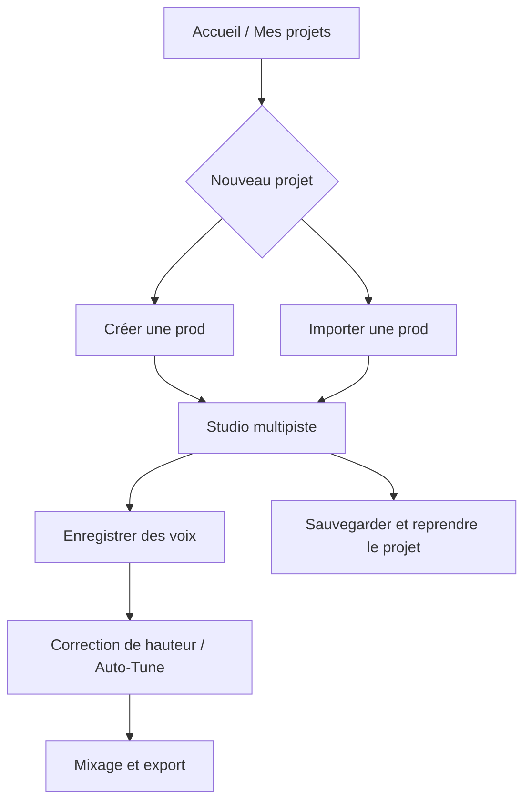

# 🎚️ RAP STUDIO — Cahier des missions

> **Projet Angular / Node.js / MongoDB**  
> **Version :** 1.0 · **Date :** 23 octobre 2026  
> **Objectif :** créer des prods de rap, importer une instrumentale et enregistrer sa voix dessus avec correction de justesse (*effet Auto-Tune*).

---

## 🎯 1. Vision du projet

Construire un **studio de production musicale dans le navigateur**, inspiré du fonctionnement des logiciels de MAO : composition avec des instruments, arrangement sur une timeline, écoute immédiate, enregistrement vocal, correction de hauteur, sauvegarde et export audio.

### Les 2 parcours utilisateur

| 🎹 Créer une prod | 📥 Importer une prod |
|---|---|
| Partir d'un projet vide | Charger une instrumentale MP3/WAV |
| Ajouter drums, 808, piano, synthés et samples | Visualiser la forme d'onde de l'instrumentale |
| Programmer des rythmes et écrire des mélodies | Modifier son volume et son égalisation |
| Arranger des clips sur la timeline | Placer l'instrumentale sur la timeline |
| Écouter et sauvegarder à chaque étape | Écouter et sauvegarder le projet |
| **Puis : enregistrer sa voix, appliquer une correction vocale, mixer, exporter** | **Puis : enregistrer sa voix, appliquer une correction vocale, mixer, exporter** |

**Principe d'architecture : un seul studio commun.** Les deux parcours ouvrent le **même éditeur multipiste** ; seul le contenu initial du projet change.



### ✅ Inclus dans ce projet

- Composition de prods : **drums, 808, instruments, mélodies, patterns et arrangements**.
- Import et lecture d'une instrumentale **MP3/WAV**.
- **Timeline multipiste**, lecture synchronisée, édition de clips.
- **Mixer** : volumes, mute/solo, panoramique, égaliseur et quelques effets.
- **Enregistrement vocal**, plusieurs prises et synchronisation.
- **Correction de hauteur de la voix après enregistrement**, réglable (*effet de type Auto-Tune*).
- **Sauvegarde** des projets éditables et **export** du morceau final.

### ⛔ Hors périmètre pour cette version

- Génération automatique d'instrumentales par IA.
- Suppression/séparation de la voix d'un rappeur sur un morceau existant.
- Clonage de voix, imitation d'artistes, plateforme sociale et collaboration en temps réel.
- Reproduction complète d'un logiciel commercial comme FL Studio.
- Auto-Tune **en direct pendant la prise** : la V1 applique la correction **après** l'enregistrement.

---

## 🧭 2. À quoi doit ressembler le studio ?

L'interface doit être **riche mais progressive** : les panneaux s'ouvrent selon l'action, plutôt que de tout afficher en permanence.

| Zone de l'écran | Éléments | Actions principales |
|---|---|---|
| **Haut — Transport** | ▶ Lecture, ■ Stop, ● Enregistrer, BPM, métronome, position | Écouter, mettre en boucle, enregistrer |
| **Gauche — Bibliothèque** | Drums, 808, instruments, samples, fichiers importés | Préécouter et ajouter un son |
| **Centre — Timeline** | Pistes et clips colorés, repères de mesures | Placer, déplacer, dupliquer, couper, sélectionner |
| **Bas — Éditeur contextuel** | Drum Rack / Piano Roll / Mixer | Éditer le contenu de la piste sélectionnée |
| **Côté — Inspecteur** | Volume, panoramique, EQ, effets | Régler l'élément sélectionné |
| **Haut droit** | État de sauvegarde, bouton Exporter | Conserver le projet ou produire un fichier audio |

**Ergonomie attendue :** interface pensée d'abord pour ordinateur ; zoom horizontal, panneau inférieur repliable, raccourcis clavier essentiels et couleurs distinctes par piste.

### Les commandes à ne pas confondre

| Commande | Résultat |
|---|---|
| **▶ Écouter** | Rend audible le projet en cours **sans** l'exporter |
| **💾 Sauvegarder** | Conserve les notes, clips, réglages, voix et références de fichiers pour les **rééditer plus tard** |
| **⬇ Exporter** | Génère un **fichier audio final** (WAV d'abord ; MP3 si possible) |

---

## 🏗️ 3. Architecture technique envisagée

| Couche | Outils envisagés | Responsabilité |
|---|---|---|
| Frontend | **Angular + TypeScript** | Pages, composants et état du studio |
| Backend | **Node.js + Express** | API, contrôle des droits, upload, sauvegarde |
| Données | **MongoDB + Mongoose** | Utilisateurs, projets, pistes, patterns, réglages |
| Moteur musical | **Tone.js + Web Audio API** | Timing musical, instruments, lecture et effets |
| Formes d'onde | **WaveSurfer.js** ou rendu personnalisé | Représentation des pistes audio |
| Microphone | **getUserMedia + MediaRecorder** | Capture de voix |
| Correction de hauteur | **Moteur dédié à sélectionner et tester** | Détection et modification de la hauteur des notes vocales |
| Export | **OfflineAudioContext et/ou FFmpeg** | Assemblage, rendu, conversion |
| Stockage audio | Fichiers sur serveur (ou stockage objet ultérieur) | Instrumentales importées, voix, échantillons |

> [!IMPORTANT]
> Un véritable effet de correction vocale type Auto-Tune **ne se résume pas à déplacer la hauteur d'un fichier**. Il faut évaluer très tôt un moteur adapté, sa qualité, sa latence, sa licence et son intégration. Ne pas promettre une correction professionnelle avant ce test de faisabilité.

### Modèle de données simplifié

```text
User
└── MusicalProject
    ├── id, ownerId, title, createdAt, updatedAt
    ├── bpm, timeSignature
    ├── tracks[]
    │   ├── type : drum | instrument | audio | vocal
    │   ├── instrument / sample / audioFileId
    │   ├── volume, pan, mute, solo, effects[]
    │   └── clips[] : start, duration, offset, patternId / audioFileId
    ├── patterns[]
    │   ├── drumSteps[]
    │   └── midiNotes[] : pitch, start, duration, velocity
    ├── recordings[] : fileId, position, pitchSettings
    └── masterSettings
```

Les données de projet sont stockées en base. **Les octets des MP3/WAV/enregistrements sont stockés séparément**, et leurs identifiants sont référencés dans MongoDB. Le moteur audio et la timeline travaillent à partir **d'une même horloge musicale**.

---

# 📋 4. Missions de développement

> Ordre recommandé : **valider le moteur audio et la correction vocale**, construire le studio, puis développer les deux parcours sur une base commune.

## M0 · Cadrage et prototypes techniques

**But :** vérifier les choix les plus risqués avant de construire toute l'interface.

- [ ] Créer les dossiers `frontend` / `backend` et le dépôt Git.
- [ ] Définir les modèles, les routes API et le format de sauvegarde d'un projet.
- [ ] Tester la lecture de **deux sources audio synchronisées** avec Tone.js/Web Audio API.
- [ ] Tester un **séquenceur simple au BPM choisi** et l'écoute en boucle.
- [ ] Tester l'accès au microphone et le rendu d'une prise séparée de la prod.
- [ ] Réaliser un **prototype de correction de hauteur sur un court fichier vocal**.
- [ ] Comparer les options de rendu/export et leurs limites.
- [ ] Vérifier les licences des moteurs, instruments et samples retenus.

**Livrable :** démo technique audio + schéma d'architecture + choix documentés.

**Critère de validation :** au moins deux pistes jouent ensemble de façon cohérente ; une prise vocale test est enregistrée ; une piste corrigée peut être réécoutée (ou une limitation technique est documentée et traitée avant de figer le périmètre).

---

## M1 · Comptes et bibliothèque de projets

**But :** retrouver son travail d'une session à l'autre.

- [ ] Inscription et connexion avec validations.
- [ ] Authentification JWT et routes backend protégées.
- [ ] Page **Mes projets** : créer, ouvrir, renommer, supprimer.
- [ ] Nouveau projet : **« Créer une prod »** ou **« Importer une prod »**.
- [ ] Sauvegarder les paramètres de base (nom, BPM, date, propriétaire).
- [ ] Vérifier l'isolation des projets entre utilisateurs.

**Livrable :** compte utilisateur + liste de projets persistants.

**Critère de validation :** après déconnexion/reconnexion, les projets réapparaissent, sans accès possible aux projets d'un autre compte.

---

## M2 · Structure de l'interface et transport

**But :** disposer du studio commun aux deux parcours.

- [ ] Créer l'écran Studio : transport, bibliothèque, timeline, éditeur inférieur, inspecteur.
- [ ] Intégrer **Play, Pause, Stop, position courante, BPM, métronome**.
- [ ] Afficher des pistes avec titre, couleur, mute/solo et volume.
- [ ] Permettre l'ajout, la sélection, le renommage et la suppression d'une piste.
- [ ] Ajouter zoom horizontal, défilement, règles de mesures et sélection de position.
- [ ] Prévoir le passage entre **Drum Rack, Piano Roll et Mixer**.
- [ ] Afficher l'état de sauvegarde et le bouton Export.

**Livrable :** éditeur utilisable avec transport et pistes, même avant l'implémentation complète des outils.

**Critère de validation :** les contrôles du transport pilotent **un seul moteur audio central**, et non plusieurs lecteurs indépendants.

---

## M3 · Composition : bibliothèque et Drum Rack

**But :** composer un vrai rythme de rap.

- [ ] Intégrer une première bibliothèque **autorisée** de kick, snare, clap, hi-hat et percussions.
- [ ] Ajouter des samples **808 / basses** et des sons de préécoute.
- [ ] Créer un **séquenceur de 16 pas** avec instruments par ligne.
- [ ] Programmer, désactiver et déplacer des frappes.
- [ ] Gérer la vélocité élémentaire et le BPM.
- [ ] Mettre un pattern en **boucle avec lecture immédiate**.
- [ ] Créer, dupliquer, modifier et supprimer des patterns.
- [ ] Sauvegarder les patterns dans le projet.

**Livrable :** Drum Rack opérationnel avec plusieurs kits/samples.

**Critère de validation :** le rythme est audible et synchronisé ; le pattern est identique après sauvegarde et réouverture.

---

## M4 · Composition : Piano Roll et instruments

**But :** ajouter des mélodies et des lignes de basse, pas seulement des drums.

- [ ] Ajouter au moins un **piano**, un **synthétiseur** et une **basse 808 jouable par notes**.
- [ ] Créer le **Piano Roll** : hauteur des notes en vertical, temps en horizontal.
- [ ] Ajouter des notes ; les déplacer, redimensionner et supprimer.
- [ ] Pouvoir jouer plusieurs notes en même temps sur un instrument polyphonique.
- [ ] Permettre la lecture immédiate et en boucle de la mélodie.
- [ ] Associer chaque pattern à son instrument, son son et ses paramètres.
- [ ] Enregistrer les notes, durées et vélocités (données de type MIDI).

**Livrable :** composition d'une mélodie et d'une basse par édition de notes.

**Critère de validation :** l'utilisateur peut créer une courte prod **drums + basse + mélodie** et l'écouter correctement.

---

## M5 · Timeline et arrangement de la prod

**But :** passer de petites boucles à un morceau structuré.

- [ ] Afficher les patterns et les fichiers audio sous forme de **clips**.
- [ ] Placer et déplacer des clips sur la timeline.
- [ ] Dupliquer, raccourcir et supprimer des clips.
- [ ] Répéter des patterns pour construire intro, couplet, refrain et outro.
- [ ] Jouer depuis une mesure ou une position sélectionnée.
- [ ] Ajouter une plage de lecture en boucle.
- [ ] Prévoir **Annuler / Rétablir** pour les modifications essentielles.
- [ ] Conserver exactement les positions de clips lors de la sauvegarde.

**Livrable :** éditeur d'arrangement multipiste.

**Critère de validation :** la prod complète joue de manière synchronisée et les placements sont restaurés à l'identique après réouverture.

---

## M6 · Importation d'une instrumentale existante

**But :** ouvrir un projet directement à partir d'un beat déjà terminé.

- [ ] Choisir un fichier **MP3 ou WAV**.
- [ ] Valider format, taille, absence de fichier et erreurs d'import.
- [ ] Uploader via une API protégée et afficher la progression.
- [ ] Conserver le fichier et ses métadonnées dans le stockage.
- [ ] Créer automatiquement une piste **Instrumentale** sur la timeline.
- [ ] Afficher une **forme d'onde**, écouter, naviguer et régler le niveau sonore.
- [ ] Ajouter un égaliseur **graves / médiums / aigus** sur la piste importée.
- [ ] Sauvegarder la position et les réglages de la piste.
- [ ] Autoriser l'ajout ultérieur de pistes vocales dans le même projet.

> [!NOTE]
> Sur un MP3/WAV déjà mixé, augmenter les basses agit sur **l'ensemble des fréquences graves**. On ne peut pas régler séparément chaque instrument d'origine sans disposer des pistes sources ; cette séparation est hors périmètre.

**Livrable :** parcours « Importer une prod » dans le studio commun.

**Critère de validation :** après réouverture, l'audio importé et ses réglages restent disponibles.

---

## M7 · Mixer, égaliseur et effets de base

**But :** travailler le son de la prod et des voix avec des réglages indépendants.

- [ ] Volume distinct pour chaque piste et volume **Master**.
- [ ] **Mute** et **Solo** indépendants.
- [ ] Réglage de **panoramique** gauche/droite.
- [ ] Égaliseur simple (graves, médiums, aigus) par piste.
- [ ] Ajouter **réverbération** et **delay** activables.
- [ ] Afficher un indicateur de niveau et signaler les saturations manifestes.
- [ ] Conserver les paramètres de mixage après sauvegarde.
- [ ] Assurer que les effets entendus sont pris en compte dans l'export.

**Livrable :** panneau Mixer fonctionnel.

**Critère de validation :** modifier le volume ou les effets d'une piste produit un changement audible **sans altérer le fichier original**.

---

## M8 · Enregistrement vocal multipiste

**But :** poser sa voix sur une prod créée ou importée.

- [ ] Demander l'autorisation d'accéder au microphone.
- [ ] Sélectionner le microphone si plusieurs entrées sont disponibles.
- [ ] Prévoir une piste vocale et un bouton **● Record**.
- [ ] Jouer la prod au casque pendant l'enregistrement.
- [ ] Enregistrer la voix sur une **piste indépendante**.
- [ ] Stopper l'enregistrement et afficher sa **forme d'onde**.
- [ ] Réécouter immédiatement **prod + voix**.
- [ ] Effectuer plusieurs prises ; supprimer et recommencer une prise.
- [ ] Déplacer ou décaler une prise pour corriger une éventuelle latence.
- [ ] Sauvegarder les prises et conserver les originaux.
- [ ] Gérer un refus de permission ou un micro indisponible.

**Livrable :** piste(s) vocales enregistrées et synchronisées.

**Critère de validation :** l'utilisateur peut rapper sur une prod, réécouter le résultat, déplacer sa prise et retrouver son enregistrement en rouvrant le projet.

---

## M9 · Correction vocale de type Auto-Tune

**But :** corriger la hauteur des notes d'une prise vocale enregistrée, avec des réglages adaptés au rap mélodique.

### A. Moteur de correction

- [ ] Choisir le moteur à partir des essais réalisés en **M0**.
- [ ] Détecter ou estimer la hauteur des passages vocaux.
- [ ] Appliquer une correction **sans modifier volontairement la durée totale de la prise**.
- [ ] Préserver la version originale et produire une version corrigée, ou un rendu dérivé réutilisable.
- [ ] Gérer le temps de traitement, les erreurs et les voix difficiles à corriger.

### B. Interface utilisateur

- [ ] Ajouter **Auto-Tune : Activé / Désactivé** dans les effets de la piste vocale.
- [ ] Choisir une **tonalité** (ex. La mineur) et une **gamme**.
- [ ] Régler l'intensité et, **si le moteur le permet**, la vitesse de correction.
- [ ] Proposer des préréglages **Naturel** et **Effet marqué**.
- [ ] Comparer **Avant / Après** sur la même prise.
- [ ] Enregistrer les réglages de correction.
- [ ] Inclure la version corrigée dans l'export audio.

> [!WARNING]
> **Auto-Tune** est aussi une marque commerciale. Dans le projet, utiliser « correction de hauteur vocale » ou « effet de type Auto-Tune » tant qu'aucune technologie sous cette marque n'est intégrée. Le rendu et la qualité dépendront du moteur effectivement retenu.

**Livrable :** correction vocale **après la prise**, contrôlable depuis le studio.

**Critère de validation :** une prise peut être comparée avant/après, les réglages sont conservés et le mix exporté utilise la version choisie.

---

## M10 · Sauvegarde complète et export audio

**But :** reprendre un projet modifiable et récupérer le morceau final.

### Sauvegarde

- [ ] Sauvegarder pistes, BPM, instruments, patterns, notes, clips, volumes et effets.
- [ ] Sauvegarder les fichiers importés et les prises vocales.
- [ ] Sauvegarder les paramètres de correction vocale.
- [ ] Mettre en place une sauvegarde explicite et, si possible, **automatique**.
- [ ] Indiquer clairement **Modifications non sauvegardées / Sauvegarde en cours / Sauvegardé / Erreur**.
- [ ] Charger un projet et retrouver la même session éditable.

### Export

- [ ] Produire un **mix unique** respectant les positions des clips.
- [ ] Inclure drums, instruments, prod importée, voix et effets actifs.
- [ ] Prendre en compte les volumes, la correction vocale et le Master.
- [ ] Exporter en **WAV** en priorité ; MP3 en complément si disponible.
- [ ] Indiquer la progression ou l'état du rendu.
- [ ] Permettre le téléchargement du fichier final.

**Livrable :** sauvegarde/rechargement fiable + export audible hors de l'application.

**Critère de validation :** un projet sauvegardé s'ouvre sans perte majeure ; l'export ressemble au mix entendu dans le studio et ses pistes sont synchronisées.

---

## M11 · Tests, stabilité et livraison

**But :** prouver que les deux parcours fonctionnent de bout en bout.

- [ ] Tester l'authentification et les droits d'accès aux projets.
- [ ] Tester les requêtes backend et les formats de fichiers refusés.
- [ ] Tester la programmation de drums et notes, avec sauvegarde/réouverture.
- [ ] Tester la synchronisation de plusieurs pistes et le changement de BPM.
- [ ] Tester les déplacements et duplications de clips.
- [ ] Tester l'import MP3/WAV et les messages d'erreur.
- [ ] Tester l'enregistrement avec et sans permission microphone.
- [ ] Tester la correction vocale et la comparaison avant/après.
- [ ] Tester la persistance des réglages et des prises vocales.
- [ ] Vérifier la qualité et le timing des exports audio.
- [ ] Ajouter des tests unitaires Angular et tests API pertinents.
- [ ] Exécuter les builds, documenter l'installation et préparer une démonstration.

**Livrable :** application testée + guide de lancement + scénario de démonstration.

---

## 🗂️ 5. Ordre d'exécution conseillé

| Phase | Missions | Ce qu'on peut montrer |
|---|---|---|
| **Fondations** | M0 → M1 → M2 | Connexion, projets, studio, transport |
| **Création musicale** | M3 → M4 → M5 | Une prod complète, écoutable et arrangée |
| **Import et mix** | M6 → M7 | Une prod MP3/WAV importée, réglable et mixable |
| **Voix et correction** | M8 → M9 | Enregistrement vocal et correction de hauteur |
| **Finalisation** | M10 → M11 | Projet sauvegardé, morceau exporté, tests |

**Dépendance à garder en tête :** **M9 doit être validée techniquement dès M0**, même si son interface finale est réalisée plus tard. C'est la fonctionnalité la plus incertaine du périmètre.

---

## 🎬 6. Démonstration finale attendue

### Parcours A — Création de prod

1. Se connecter et créer un projet « Nouvelle prod ».
2. Fixer le BPM, choisir un kit de drums et écrire un rythme.
3. Ajouter une basse 808 et une mélodie au Piano Roll.
4. Écouter les éléments ensemble et construire l'arrangement sur la timeline.
5. Ajuster les niveaux/effets et sauvegarder.
6. Enregistrer un couplet au micro, créer une deuxième prise si nécessaire.
7. Appliquer la correction vocale et comparer le résultat.
8. Exporter en WAV, puis rouvrir le projet pour prouver qu'il reste modifiable.

### Parcours B — Import de prod

1. Créer un projet « Importer une prod ».
2. Charger un MP3/WAV et observer sa forme d'onde.
3. Ajuster le volume et l'égaliseur de l'instrumentale.
4. Enregistrer une voix par-dessus, repositionner la prise si nécessaire.
5. Activer la correction vocale et mixer.
6. Sauvegarder le projet et exporter le morceau final.

---

## ✅ 7. Définition de « projet terminé »

- [ ] Une prod peut être **créée**, avec drums, basse et mélodie.
- [ ] Elle peut être **écoutée à tout moment**, mise en boucle et arrangée sur une timeline.
- [ ] Une prod MP3/WAV peut être **importée** et réglée.
- [ ] Une voix peut être **enregistrée** sur les deux types de projets.
- [ ] Une correction de hauteur vocale est **audible, réglable et conservée**.
- [ ] Les projets et leurs pistes restent **éditables après sauvegarde et réouverture**.
- [ ] L'utilisateur peut **exporter un morceau final** synchronisé.
- [ ] Les projets privés sont protégés et les principaux parcours sont testés.

---

> **Résumé :** un **studio unique** avec **2 entrées** (composer ou importer), **1 espace vocal commun**, **1 mixer**, **1 sauvegarde éditable** et **1 export audio**. Pas de génération IA ni de séparation de voix dans cette version.
