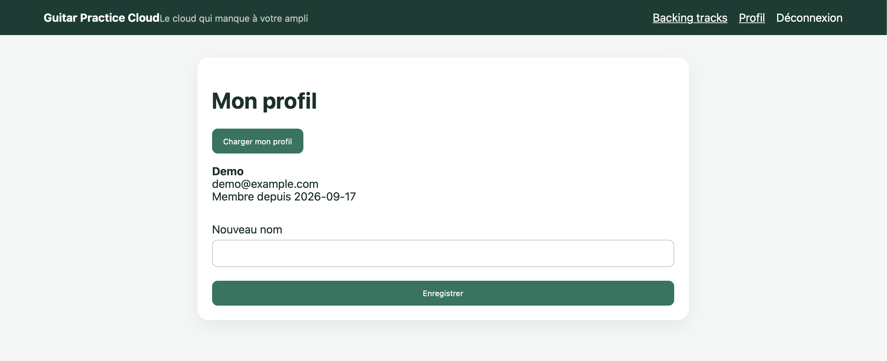
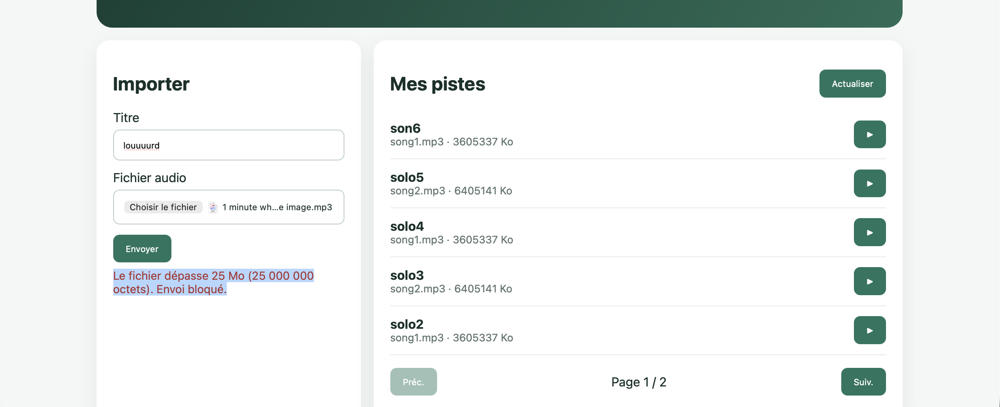

# Rapport d'usage de l'IA - TP1 & TP2

Pour chaque mission, détailler et fournir des explications concernant : objectif ; prompt principal ; plan proposé par l'agent ; vérifications réalisées par le binôme ; erreurs ou propositions rejetées ; fichiers effectivement modifiés ; preuve de fonctionnement ; ce que chaque membre sait maintenant expliquer sans l'agent.

---

## Mission 1 — Inscription, Connexion et Profil (TP1)

**Objectif :** Finaliser la logique des formulaires, la déconnexion et la sécurité (erreur 401).

**Ce que j'ai donné à l'IA :** 
Je lui ai d'abord demandé de lister ce qu'il fallait faire concrètement pour le TP1 hormis la vérification réseau. L'IA m'a fait un résumé. Ensuite, je lui ai donné la consigne exacte du TP (copié-collée du sujet) : *"Effectue cette partie : 2. Le Code Angular : Formulaires et Sécurité (Mission 1) [...]"* en lui demandant de coder directement les fonctionnalités manquantes.

**Ce qu'elle m'a répondu (Plan et actions) :** 
L'IA a scanné les fichiers du projet (`frontend-starter`) et s'est rendu compte que le TypeScript des formulaires était en fait déjà écrit. Elle a alors identifié ce qui manquait réellement et a modifié les fichiers pour moi :
1. Elle a modifié le HTML de `login-page.html` et `register-page.html` en ajoutant des directives `@if` pour afficher des messages d'erreur si l'utilisateur saisit mal ses données (ex: email invalide) et a grisé le bouton submit si le formulaire est invalide.
2. Elle a ajouté la logique de déconnexion dans `app.ts` et rendu la barre de navigation dynamique dans `app.html` selon si je suis connecté ou non.
3. Elle a ajouté `catchError` dans `auth.interceptor.ts` pour capter l'erreur serveur 401 (token expiré) et forcer la redirection vers le login.

**Comment j'ai testé :** 
- Pour les formulaires : J'ai lancé l'application, je suis allé sur la page de connexion, et j'ai volontairement tapé une adresse email sans le "@". Le message rouge est bien apparu et le bouton s'est grisé.
- Pour la déconnexion : Je me suis connecté avec `demo@example.com`, le bouton "Déconnexion" est apparu dans la barre de navigation. J'ai cliqué dessus, et j'ai bien été renvoyé sur le login.
- Pour l'intercepteur 401 : J'ai volontairement falsifié la valeur de mon token `gpc_token` dans le Local Storage de mon navigateur. Puis j'ai essayé de charger la page Profil : j'ai été éjecté instantanément vers la page de login par l'intercepteur !

**Preuve de fonctionnement :** 



**Ce que chaque membre sait maintenant expliquer sans l'agent :**
- L'utilisation des intercepteurs HTTP Angular (`HttpInterceptorFn`) pour sécuriser les requêtes sortantes et réagir de manière centralisée aux codes d'erreur HTTP critiques (401 Unauthorized).
- Le cycle de gestion de l'authentification basée sur token JWT stocké localement et son injection dans les en-têtes `Authorization: Bearer`.
- Le binding dynamique de formulaires réactifs avec validation asynchrone / synchronisée et feedback visuel accessible.

---

## Mission 2 — Bibliothèque paginée (TP2)

**Objectif :**
Consommer le point d'accès serveur `GET /api/tracks?page=...&limit=...` pour implémenter une pagination serveur stricte. Représenter l'état avec des Signals (`tracks`, `page`, `pages`, `loading`), interdire le découpage local des données et gérer les états limites (boutons Précédent/Suivant désactivés aux bornes).

**Ce que j'ai donné à l'IA :**
> *"Vérifie et configure la bibliothèque paginée pour qu'elle appelle bien GET /api/tracks?page=1&limit=5, mette à jour les signals de pagination serveur et désactive les boutons aux extrémités sans jamais charger toutes les pistes en mémoire."*

**Ce qu'elle m'a répondu (Plan et actions) :**
1. **Contrôle du service HTTP (`TrackService`) :** Vérification que la méthode `list(page, limit)` envoie bien les paramètres de requête HTTP (`params: { page, limit }`) vers le backend Express.
2. **Gestion d'état réactive avec les Signals dans `tracks-page.ts` :**
   - `tracks = signal<Track[]>([])`
   - `page = signal(1)`
   - `pages = signal(1)`
   - `loading = signal(false)`
3. **Méthodes d'orchestration :**
   - `load()` : active l'état de chargement `loading.set(true)`, déclenche l'appel HTTP, met à jour `tracks` et le nombre total de pages `pages`, puis coupe `loading.set(false)`.
   - `go(page)` : modifie le signal `page` puis relance immédiatement `this.load()`.
4. **Mise en forme dans le template `tracks-page.html` :**
   - Itération moderne avec `@for (track of tracks(); track track.id)` et gestion de l'état vide avec `@empty`.
   - Contrôle aux bornes : bouton "Précédent" avec `[disabled]="page() === 1"` et bouton "Suivant" avec `[disabled]="page() === pages()"`.

**Comment j'ai testé :**
- Ouverture de l'onglet **Network (Réseau)** des outils de développement du navigateur.
- Clic sur le bouton "Suivant" : observation immédiate de la requête sortante `GET /api/tracks?page=2&limit=5`.
- Vérification que la réponse JSON renvoie uniquement les 5 pistes de la page 2 (`items: [...]`) et que le composant met à jour son affichage sans rechargement de page.
- Sur la page 1, vérification que le bouton "Préc." est grisé et inactif. Sur la dernière page, vérification que le bouton "Suiv." est grisé et inactif.

**Erreurs ou propositions rejetées :**
- *Pagination côté client (récupérer tous les éléments via un tableau global et découper avec `slice`) :* Rejeté formellement car interdit par le sujet. Une telle approche gaspille la bande passante et la mémoire dès que la base grandit.

**Fichiers effectivement modifiés :**
- `frontend-starter/src/app/shared/services/track.service.ts`
- `frontend-starter/src/app/components/tracks-page/tracks-page.ts`
- `frontend-starter/src/app/components/tracks-page/tracks-page.html`

**Preuve de fonctionnement :**


> **📸 Ce qu'il faut screener exactement pour la pagination serveur (Livrable TP2) :**
> 1. **Dans l'application (partie gauche de l'écran) :**
>    - Se rendre sur `http://localhost:4200/tracks`.
>    - Cliquer sur le bouton **« Suiv. »** pour passer sur la **Page 2**.
>    - Le screen doit montrer :
>      - La liste affichant les morceaux de la page 2.
>      - Le texte de pagination : **« Page 2 / 2 »** (ou `Page 2 / X`).
>      - Le bouton **« Préc. »** actif et le bouton **« Suiv. »** désactivé (preuve de gestion des bornes).
> 2. **Dans les DevTools du navigateur (F12 > onglet Réseau / Network) (partie droite de l'écran) :**
>    - Filtrer par **Fetch/XHR**.
>    - Cliquer sur la dernière requête : `tracks?page=2&limit=5`.
>    - S'assurer que le statut HTTP est bien **200 OK**.
>    - Ouvrir le sous-onglet **Réponse** (*Response* ou *Preview*) pour montrer le JSON renvoyé par MongoDB :
>      `{ "items": [ ... 5 éléments ... ], "page": 2, "limit": 5, "total": 6, "pages": 2 }`.
> 
> *(Note : `image-1.png` ci-dessus montre déjà la bibliothèque avec 5 éléments et le statut "Page 1 / 2")*

**Ce que chaque membre sait maintenant expliquer sans l'agent :**
- Comment les `Signals` d'Angular permettent de réagir finement aux modifications d'état sans déclencher de cycle de détection de changements lourd.
- Pourquoi la pagination serveur est la seule approche scalable en entreprise face à des volumétries importantes de données.

---

## Mission 3 — Upload, Validation et Expérience Utilisateur UI/UX (TP2)

**Objectif :**
1. **Validation préalable de l'Upload (Sécurité côté Navigateur) :** Intercepter les erreurs avant même que la requête ne parte vers le serveur pour économiser la bande passante (limite stricte de 25 Mo / 25 000 000 octets et format audio obligatoire).
2. **Expérience Utilisateur (UI/UX) :** Gérer les états asynchrones de l'envoi (état de chargement "Envoi en cours...", protection contre les doubles clics via `[disabled]`, affichage des erreurs serveur/navigateur, alerte de succès, vidage du champ Titre et réinitialisation de la sélection HTML du fichier, retour automatique sur la première page pour voir le nouveau morceau).

**Ce que j'ai donné à l'IA :**
> *"modifie sa pour le tp2 et complete le rapport ia modele comme suivi du tp1 : 1. La validation de l'Upload (Sécurité côté Navigateur)*
> *L'objectif : Intercepter les erreurs avant même que la requête ne parte vers le serveur pour économiser le réseau.*
> *Le code à faire : Dans tracks-page.ts, ajouter un "if" avant d'appeler service.upload(). Si le fichier dépasse 25 Mo (25 000 000 octets) ou si ce n'est pas un format audio, bloquer l'envoi et afficher une erreur à l'écran.*
> *2. L'Expérience Utilisateur (UI/UX) de l'Upload*
> *L'objectif : Informer l'utilisateur de ce qui se passe pendant l'envoi de son fichier audio.*
> *Le code à faire :*
> *Afficher un chargement ("Envoi en cours...") et empêcher la double soumission (griser le bouton).*
> *Afficher les erreurs renvoyées par le serveur si ça plante.*
> *Si ça réussit : afficher "Succès", vider le champ Titre, et recharger la page 1 de la pagination."*

**Ce qu'elle m'a répondu (Plan et actions) :**
L'IA a examiné le composant `tracks-page` et a mis en place les modifications suivantes :
1. **Création des Signals d'état dans `tracks-page.ts` :**
   - `uploading = signal(false)` pour piloter le chargement et désactiver les soumissions concurrentes.
   - `uploadError = signal<string | null>(null)` pour stocker et afficher l'erreur de validation locale ou retournée par le serveur.
   - `uploadSuccess = signal(false)` pour confirmer visuellement la réussite de l'importation.
2. **Ajout de la condition de validation préalable dans la méthode `upload()` :**
   - Contrôle du volume : `this.file.size > 25_000_000` (25 Mo).
   - Contrôle du format : vérification du type MIME `audio/*` ou des extensions audio (`mp3`, `wav`, `ogg`, `m4a`, `aac`, `flac`, `webm`).
   - En cas d'invalidité : blocage immédiat de l'appel HTTP (`return`), mise à jour de `uploadError` avec un message explicite, et annulation de l'état de succès.
3. **Gestion complète de la souscription HTTP UI/UX :**
   - Activation de `uploading.set(true)` et reset des messages précédents.
   - En cas de succès : `uploading.set(false)`, `uploadSuccess.set(true)`, réinitialisation du champ Titre (`this.title.setValue('')`), nettoyage du fichier sélectionné (et de l'input HTML via référence `#fileInput`), bascule sur la première page (`this.page.set(1)`), et rechargement de la liste (`this.load()`).
   - En cas d'échec serveur : `uploading.set(false)`, récupération du message serveur (`error?.error?.message`) et affichage dans `uploadError`.
4. **Mise à niveau du template HTML et du CSS :**
   - Bouton d'envoi désactivé (`[disabled]="!file || uploading()"`) et affichage du libellé "Envoi en cours...".
   - Affichage dynamique des alertes `@if (uploadError())` et `@if (uploadSuccess())`.

**Comment j'ai testé :**
- **Test fichier > 25 Mo :** Sélection d'un fichier audio lourd (> 25 Mo) : le clic sur Envoyer affiche immédiatement le message d'erreur rouge bloquant : *"Le fichier dépasse 25 Mo (25 000 000 octets). Envoi bloqué."*, et aucune requête HTTP n'apparaît dans l'onglet Network (économie réseau confirmée).
- **Test fichier non-audio :** Sélection d'un fichier texte ou image : l'envoi est bloqué avant l'appel API avec le message d'erreur dédié.
- **Test double soumission et chargement :** Pendant l'upload d'un morceau valide, le bouton est grisé et affiche "Envoi en cours...", rendant tout spam de clics impossible.
- **Test succès et reset :** Une fois le téléversement validé, le message "Succès !" apparaît en vert, le champ Titre est réinitialisé, et la liste se remet automatiquement sur la page 1 avec le nouveau morceau présent.
- **Test erreur serveur :** Déconnexion forcée ou envoi rejeté par le backend : le message d'erreur de l'API est récupéré et affiché correctement sous le formulaire.

**Erreurs ou propositions rejetées :**
- *Ne valider que côté frontend :* Rejeté car la validation client n'est qu'une sécurité de surface et d'ergonomie pour l'utilisateur. Le serveur backend doit impérativement conserver sa validation Multer (`limits.fileSize` et `fileFilter`) car un attaquant peut soumettre des requêtes via un terminal sans passer par l'application Angular.
- *Oubli du reset de l'élément `<input type="file">` :* Si seul `this.file` était vidé en mémoire, le nom du fichier restait affiché dans le champ de sélection HTML. L'ajout d'une référence `#fileInput` a permis de vider le champ visuel en même temps.

**Fichiers effectivement modifiés :**
- `frontend-starter/src/app/components/tracks-page/tracks-page.ts`
- `frontend-starter/src/app/components/tracks-page/tracks-page.html`
- `frontend-starter/src/app/components/tracks-page/tracks-page.css`

**Preuve de fonctionnement :**


> **📸 Ce qu'il faut screener exactement pour l'upload (2 cas possibles) :**
> 
> **Option 1 — Preuve de sécurité client (fichier > 25 Mo) (C'est exactement ce que montre `image-1.png`) :**
> - **Ce qu'il faut faire :**
>   1. Dans la section « Importer », saisir un titre (ex: `louuuurd`).
>   2. Sélectionner un fichier audio dépassant 25 Mo (ex: fichier de test volumineux).
>   3. Cliquer sur « Envoyer » tout en ayant l'onglet **Network (Réseau)** ouvert.
> - **Ce que le screen montre :**
>   - Le message d'erreur rouge immédiat : *"Le fichier dépasse 25 Mo (25 000 000 octets). Envoi bloqué."*.
>   - Dans l'onglet Network : **Aucune requête `POST /api/tracks` n'a été émise** (la liste des requêtes reste vide, prouvant l'interception 100% navigateur et l'économie de bande passante).
> 
> **Option 2 — Preuve d'upload multipart réussi vers le backend :**
> - **Ce qu'il faut faire :**
>   1. Choisir un fichier audio valide (< 25 Mo, ex: `song1.mp3`), taper un titre (ex: `Nouveau morceau`).
>   2. Ouvrir DevTools (F12) > onglet **Network (Réseau)** > filtrer sur `Fetch/XHR`.
>   3. Cliquer sur « Envoyer ».
> - **Ce que le screen doit montrer :**
>   - Côté UI : Le message vert *"Succès ! Piste ajoutée à votre bibliothèque."*, le formulaire vidé, et la piste apparue en première position sur la page 1.
>   - Côté Network : La requête `POST /api/tracks` avec statut **201 Created**, et l'onglet *Payload* affichant le `FormData` avec les deux champs `audio` (binaire) et `title`.

---

## Mission 3 (Suite) — Composant Audio Sécurisé, Gestion Mémoire et Cycle de Vie (TP2)

**Objectif :**
Finaliser le lecteur audio authentifié :
1. **Nettoyage strict de la mémoire :** Implémenter le cycle de vie `ngOnDestroy` dans `tracks-page.ts` pour révoquer l'ObjectURL finale (`URL.revokeObjectURL`) lorsque le composant est détruit (navigation vers une autre route), éliminant tout risque de fuite de mémoire (memory leak).
2. **Affichage et gestion d'erreurs :** Mettre en évidence visuellement le morceau en cours de lecture (statut actif, badge "En lecture", témoin animé), afficher un lecteur audio dédié avec ses métadonnées, gérer les états de chargement individuel par piste, et afficher un message d'erreur compréhensible en cas d'échec de lecture ou de suppression.
3. **Améliorations avancées :** Ajout de la suppression d'une piste avec confirmation native (`DELETE /api/tracks/:id`), formatage lisible de la taille (octets convertis dynamiquement en Ko ou Mo) et de la date, ainsi qu'un champ de recherche / filtrage local par titre.

**Ce que j'ai donné à l'IA :**
> *"Finaliser le code du composant Audio (Mission 3) :*
> *1. Nettoyage de la mémoire : Il faut implémenter le cycle de vie ngOnDestroy dans tracks-page.ts pour révoquer l'ObjectURL finale (URL.revokeObjectURL) lorsque le composant est détruit (quand tu quittes la page), sinon cela crée une fuite de mémoire.*
> *2. Affichage et gestion d'erreurs : Mettre en évidence visuellement le morceau en cours de lecture et afficher un message clair si le chargement audio échoue.*
> *3. Répondre aux questions théoriques pour les livrables.*
> *4. Améliorations optionnelles : suppression avec confirmation, formatage taille/date, filtre par titre."*

**Ce qu'elle m'a répondu (Plan et actions) :**
1. **Cycle de vie et nettoyage mémoire dans `tracks-page.ts` :**
   - Implémentation de l'interface `OnDestroy` avec la méthode `ngOnDestroy()`.
   - Vérification de l'existence d'une URL active via `this.audioUrl()` et appel immédiat à `URL.revokeObjectURL(currentUrl)`.
   - Révocation également assurée lors du changement de piste dans `play()` et lors de la suppression du morceau actif.
2. **Signals pour la gestion audio et retour utilisateur :**
   - `currentTrack = signal<Track | null>(null)` : mémorise l'objet `Track` actif.
   - `audioLoading = signal<string | null>(null)` : mémorise l'ID du morceau en cours de chargement pour afficher un spinner / libellé "Chargement...".
   - `audioError = signal<string | null>(null)` : capte les erreurs de téléchargement binaire ou de suppression.
3. **Améliorations UX et fonctionnalités optionnelles :**
   - `delete(track: Track)` : demande de confirmation utilisateur avec `confirm()`, appel au nouveau point d'accès `TrackService.delete(id)`, libération de l'ObjectURL si le morceau en cours est supprimé, et rechargement propre de la page courante (avec retour automatique à la page précédente si c'était le dernier élément).
   - `formatSize(bytes)` : fonction de conversion affichant précisément les Ko ou Mo selon la taille réelle du fichier (correction de l'affichage brut en octets).
   - `formatDate(dateString)` : formatage de la date en format français (`toLocaleDateString('fr-FR')`).
   - `searchFilter` & `filteredTracks` : signal calculé (`computed`) permettant de filtrer instantanément les morceaux affichés par titre ou nom de fichier sans sollicitation réseau superflue.
4. **Enrichissement de l'interface (`tracks-page.html` et `tracks-page.css`) :**
   - Panneau de lecture dédié en tête de liste avec indicateur lumineux animé (*pulse animation*), titre et type MIME.
   - Classe `.active` sur la card du morceau joué avec bordure colorée et badge *"▶ En lecture"*.
   - Bannière d'erreur distincte pour les problèmes de flux audio.
   - Bouton de suppression stylisé avec icône corbeille et tooltip accessible.

**Comment j'ai testé :**
- **Test de lecture et highlighting :** Clic sur "Écouter" : le morceau passe en état "Chargement...", la requête audio part, puis la card s'illumine en vert clair, le badge "En lecture" apparaît, et le lecteur en haut démarre automatiquement le son.
- **Test de nettoyage mémoire :** Démarrage de la lecture d'un morceau, puis clic dans la barre de navigation sur "Profil" : inspection de la console du navigateur confirmant le passage dans `ngOnDestroy` et la révocation de l'URL Blob.
- **Test suppression avec confirmation :** Clic sur le bouton corbeille : la boîte de dialogue native demande confirmation. En cas d'annulation, rien ne se passe. En cas de validation, la requête `DELETE /api/tracks/:id` est émise (code 204), et la liste se rafraîchit sans le morceau.
- **Test filtre par titre :** Saisie de lettres dans le champ "Filtrer par titre..." : la liste se restreint instantanément aux morceaux correspondants.

**Fichiers effectivement modifiés :**
- `frontend-starter/src/app/shared/services/track.service.ts` (ajout de `delete`)
- `frontend-starter/src/app/components/tracks-page/tracks-page.ts` (implémentation de `ngOnDestroy`, signals audio, delete, helpers)
- `frontend-starter/src/app/components/tracks-page/tracks-page.html` (player panel, cards responsives, filtres, boutons d'action)
- `frontend-starter/src/app/components/tracks-page/tracks-page.css` (design complet du lecteur, animations, badges, cards)

**Preuve de fonctionnement :**
*(Insérer ici votre capture de lecture audio authentifiée, par exemple `capture-audio-jwt.png`)*

> **📸 Ce qu'il faut screener exactement pour la lecture audio authentifiée (Livrable obligatoire TP2) :**
> 1. **Dans l'application (partie gauche de l'écran) :**
>    - Rendez-vous sur `http://localhost:4200/tracks`.
>    - Cliquez sur le bouton **« ▶ Écouter »** d'un morceau (ex: `son6` ou `solo5`).
>    - Le screen doit montrer :
>      - En haut : Le **panneau du lecteur audio** avec l'indicateur vert pulsé (*pulse indicator*), le titre actif (ex: `son6`), son format et sa taille formatée (ex: `MP3 · 3.44 Mo`).
>      - Le lecteur HTML `<audio controls autoplay>` avec la barre de progression qui avance (prouvant que le son est lu).
>      - Dans la liste : La carte du morceau sélectionné mise en surbrillance verte (`.track-card.active`) avec le badge vert **« ▶ En lecture »**.
> 2. **Dans les DevTools du navigateur (F12 > onglet Network / Réseau) (partie droite de l'écran) :**
>    - Filtrez par `Fetch/XHR` ou `Media`.
>    - Cliquez sur la ligne de requête : `GET /api/tracks/<ID_DU_MORCEAU>/audio`.
>    - Ouvrez le panneau **Headers (En-têtes)** et cadrez bien les deux éléments suivants :
>      - **General :** `Status Code: 200 OK`.
>      - **Request Headers :** La ligne `Authorization: Bearer eyJhbGciOi...` mise en évidence (c'est la preuve capitale demandée par le professeur : elle prouve que la lecture audio passe par l'intercepteur JWT et non par un `<audio src>` anonyme non sécurisé !).
>      - **Response Headers :** `Content-Type: audio/mpeg` (ou audio/wav).
> 
> **📸 Preuve du cycle de vie et anti-fuite mémoire (`ngOnDestroy`) :**
> - Démarrez la lecture audio (la console affiche `[TracksPage] Audio chargé`).
> - Cliquez sur le lien « Profil » dans la barre de navigation.
> - Ouvrez l'onglet **Console** des DevTools : capturez le message émis lors du départ de la page :
>   `[TracksPage] ObjectURL révoquée lors de la destruction du composant (ngOnDestroy)`.
>   *(Cela prouve que l'ObjectURL est révoquée pour éviter toute fuite de mémoire)*.

**Erreurs ou propositions rejetées :**
- *Utilisation directe de `<audio [src]="'/api/tracks/' + track.id + '/audio'">` :* Rejeté car les balises multimédias natives ne permettent pas d'injecter des headers HTTP personnalisés. Le serveur rejetait immédiatement la demande avec une erreur `401 Unauthorized`.
- *Transmettre le token dans l'URL (`?token=...`) :* Rejeté pour des raisons critiques de sécurité (exposition du JWT dans l'historique et les logs d'accès serveurs/proxys).
- *Omission de `URL.revokeObjectURL` dans `ngOnDestroy` :* Rejeté car à chaque navigation, les Blobs audio (jusqu'à 25 Mo par piste) restaient bloqués dans la RAM, créant une fuite de mémoire cumulative.

**Ce que chaque membre sait maintenant expliquer sans l'agent :**
- Pourquoi un flux média authentifié par Bearer Token nécessite de passer par `HttpClient` avec un `responseType: 'blob'`, puis de générer une URL locale via `URL.createObjectURL()`.
- L'importance cruciale de révoquer les ObjectURLs (`URL.revokeObjectURL`) dans le hook de destruction `ngOnDestroy` pour permettre au Garbage Collector de recycler la mémoire vive.
- Comment orchestrer des retours d'interface avancés (état de lecture, animation pulsée, filtre en temps réel avec `computed()`) à l'aide de l'API moderne des Signals Angular.

---

## Livrables Théoriques — Questions sur Mémoire, Buffering et Streaming Audio (TP2)

### 1. Le backend envoie-t-il le fichier entier en mémoire ou peut-il l’envoyer progressivement depuis le disque ?

**Réponse :** Le backend envoie le fichier **progressivement depuis le disque sous la forme d'un flux binaire (stream)**, sans charger l'intégralité du fichier dans sa mémoire vive (RAM).

**Justification basée sur le code backend (`backend/src/app.js`, ligne 394) :**
La route `/api/tracks/:id/audio` utilise la méthode Express `res.sendFile(audioPath)`.
En interne, `sendFile` (qui s'appuie sur la bibliothèque Node.js `send`) crée un flux de lecture direct depuis le système de fichiers (`fs.createReadStream`). Ce flux lit le fichier par fragments discrets (*chunks* de quelques kilo-octets) et les pousse au fur et à mesure dans le flux d'écriture de la réponse HTTP (`res`). 
Le serveur ne stocke donc à aucun moment les 25 Mo du fichier dans le tas (Heap) de Node.js, ce qui garantit que l'empreinte mémoire du serveur reste stable et minime, même sous forte charge concurrente. De plus, `sendFile` prend en charge nativement les en-têtes `Accept-Ranges` et les requêtes par plage d'octets (`206 Partial Content`).

---

### 2. Avec `HttpClient` et `responseType: "blob"`, à quel moment le composant reçoit-il généralement le fichier ?

**Réponse :** Le composant reçoit le fichier **uniquement après que le téléchargement réseau ait été intégralement terminé**.

**Justification :**
Dans Angular, le client HTTP (`HttpClient`) utilise sous le capot l'API navigateur `XMLHttpRequest` (ou `fetch`). Lorsque l'option `{ responseType: 'blob' }` est configurée, le moteur du navigateur attend de recevoir la totalité des paquets TCP et des octets de la réponse HTTP. Une fois le transfert clôturé à 100 %, le navigateur assemble tous les fragments binaires pour construire une instance unique de `Blob` en mémoire, puis déclenche le callback `next(blob)` de l'Observable.
Le composant ne reçoit donc rien pendant la phase de transit : il n'y a pas de diffusion temps-réel (streaming progressif) au niveau du code TypeScript de l'application.

---

### 3. Si la bibliothèque contient 100 morceaux, les 100 fichiers audio sont-ils chargés en mémoire dès l'affichage de la liste ? Justifier la réponse à partir du code.

**Réponse :** **Non, aucun fichier audio n'est chargé en mémoire lors de l'affichage de la liste.**

**Justification basée sur le code :**
1. **L'appel de liste ne charge que du JSON :** À l'initialisation ou au changement de page, le composant exécute `this.service.list(this.page())`, qui appelle la route `GET /api/tracks?page=1&limit=5`.
2. **Le backend ne renvoie que des métadonnées :** Dans `backend/src/app.js` (lignes 285-316), la requête interroge MongoDB (`Track.find().select("-storedName").lean()`). La réponse JSON ne contient que les propriétés textuelles et numériques : `id`, `title`, `originalName`, `mimeType`, `size`, `createdAt`.
3. **Le fichier audio physique reste sur le disque :** Le contenu binaire est hébergé sur une route distincte : `GET /api/tracks/:id/audio`. Dans `tracks-page.ts`, la méthode `this.service.audio(track.id)` n'est invoquée **que** lorsqu'un utilisateur clique manuellement sur le bouton d'écoute `play(track)`.
Ainsi, pour 100 morceaux en base de données, la mémoire du navigateur ne stocke que quelques kilo-octets de texte pour la page courante de 5 pistes.

---

### 4. Quelle différence y aurait-il avec 100 éléments `<audio>` utilisant directement une URL HTTP ?

**Réponse :** Il existe trois différences architecturales et fonctionnelles majeures :

1. **L'authentification par jeton Bearer (JWT) échouerait :**
   Une balise native HTML5 `<audio src="/api/tracks/:id/audio">` émet une requête HTTP directement via le moteur multimédia du navigateur, en contournant le moteur JavaScript, `HttpClient` et nos intercepteurs Angular (`authInterceptor`). Le navigateur n'ajoute donc pas l'en-tête `Authorization: Bearer <token>`. Le serveur Express rejetterait immédiatement la requête avec une erreur `401 Unauthorized`.
2. **Le comportement de préchargement et de buffering :**
   Avec un élément `<audio src="https://...">` direct (sur un endpoint public), le navigateur gère le streaming natif par blocs d'octets avec l'en-tête `Range: bytes=0-...`. La lecture peut commencer dès les premiers kilo-octets reçus (buffering progressif). Avec `responseType: 'blob'`, il faut obligatoirement attendre la fin du téléchargement complet avant d'instancier l'ObjectURL et de démarrer la lecture.
3. **Surcharge réseau et mémoire :**
   Si 100 balises `<audio src="...">` étaient rendues dans le DOM, la plupart des navigateurs initialiseraient jusqu'à 100 requêtes HTTP simultanées pour récupérer les métadonnées audio (`preload="metadata"` par défaut), saturant la bande passante et le pool de connexions du client.

---

### 5. Pourquoi l'URL créée par `URL.createObjectURL` doit-elle être révoquée ?

**Réponse :** L'URL créée par `URL.createObjectURL` doit être impérativement révoquée pour **libérer la mémoire vive (RAM) du navigateur et empêcher les fuites de mémoire (memory leaks)**.

**Justification technique :**
- Lorsque `URL.createObjectURL(blob)` est exécuté, le moteur du navigateur génère une URI interne (ex: `blob:http://localhost:4200/550e8400-e29b-41d4-a716-446655440000`) et maintient en mémoire une référence interne forte reliant cette chaîne de caractères au `Blob` binaire présent dans le tas (*Heap*).
- Tant que cette chaîne d'URL existe dans le document, le **Garbage Collector (ramasse-miettes)** de JavaScript a l'interdiction formelle de recycler la mémoire occupée par ce `Blob`, car le navigateur considère que l'URL peut encore être déréférencée à tout moment.
- Les fichiers audio pouvant peser jusqu'à 25 Mo chacun, si un utilisateur écoute 10 pistes successivement sans révocation, plus de 250 Mo de données binaires restent bloqués dans la RAM de l'onglet.
- L'appel à `URL.revokeObjectURL(url)` dissout immédiatement ce lien symbolique. Le Blob n'ayant plus de référence active, le Garbage Collector peut recycler instantanément l'espace mémoire.
- C'est pourquoi nous appelons `URL.revokeObjectURL` :
  1. Lors du changement de morceau pour détruire l'URL du morceau précédent ;
  2. Lors de la suppression de la piste en cours de lecture ;
  3. **Dans le hook `ngOnDestroy()` du composant**, garantissant qu'aucune URL orpheline ne persiste si l'utilisateur change de page dans l'application.

---

### 6. Explication détaillée du flux complet et du choix Blob / ObjectURL

#### Schéma d'exécution du flux de lecture :
```text
[Utilisateur clique sur "Écouter"]
       ↓
[TracksPageComponent.play(track)]
       ↓
[TrackService.audio(track.id)]
       ↓
[Angular HttpClient.get('/api/tracks/:id/audio', { responseType: 'blob' })]
       ↓
[AuthInterceptor injecte l'en-tête "Authorization: Bearer <token>"]
       ↓  (Requête HTTP GET)
[Backend Express - Route /api/tracks/:id/audio]
       ↓  (Middleware auth valide le JWT et extrait req.auth.sub)
       ↓  (Vérification MongoDB : propriétaire ownerId === req.auth.sub)
       ↓  (res.sendFile(audioPath) diffuse le flux audio binaire depuis le disque)
       ↓  (Réponse HTTP 200 avec Content-Type: audio/mpeg)
[Angular HttpClient assemble la totalité des données binaires]
       ↓
[Observable émet une instance native de type Blob dans next(blob)]
       ↓
[Composant : URL.revokeObjectURL(previousUrl) pour libérer l'ancienne piste]
       ↓
[Composant : URL.createObjectURL(blob) crée une URL mémoire blob:http://...]
       ↓
[Signal audioUrl.set(blobUrl) injecté dans <audio [src]="audioUrl()">]
       ↓
[Le navigateur décode le flux et démarre la lecture audio]
       ↓
[Destruction du composant / Changement de route -> ngOnDestroy() -> URL.revokeObjectURL()]
```

#### Justification du choix Blob / ObjectURL :
La problématique centrale est de concilier la **sécurité d'accès aux fichiers (JWT)** et la **compatibilité avec le lecteur HTML5 `<audio>`**.
- La balise `<audio>` standard ne permet pas d'envoyer d'en-têtes HTTP personnalisés (`Headers`).
- Transmettre le token dans l'URL (`?token=...`) exposerait le secret dans les journaux d'accès réseau, l'historique du navigateur et les logs des serveurs proxy.
- L'approche consistant à passer par `HttpClient` permet de faire intervenir notre intercepteur de sécurité (`authInterceptor`) pour envoyer le token de manière standardisée et chiffrée dans l'en-tête HTTP. 
- En demandant une réponse sous forme de `Blob`, on récupère la ressource protégée sous forme binaire brute, que `URL.createObjectURL` convertit en une ressource locale éphémère accessible directement par l'attribut `src` du lecteur audio. C'est l'architecture la plus robuste et sécurisée pour une SPA moderne.

---

## Synthèse des améliorations optionnelles réalisées (Bonus TP2)

1. **Suppression de piste avec confirmation :**
   - Implémentation de la méthode `delete(id)` dans `TrackService` appelant `DELETE /api/tracks/:id`.
   - Boîte de dialogue de confirmation utilisateur (`confirm()`).
   - Gestion de la mémoire : si la piste supprimée était en cours de lecture, son `ObjectURL` est immédiatement révoquée et le lecteur est remis à zéro.
   - Rafraîchissement dynamique et recalibrage de la pagination.
2. **Formatage propre des métadonnées :**
   - Remplacement de l'affichage brut en octets par une fonction intelligente `formatSize()` affichant des `Ko` ou `Mo` arrondis.
   - Formatage des dates de création en format local français (`formatDate()`).
   - Badge visuel indiquant le format réel du fichier (`MP3`, `WAV`, `OGG`, etc.).
3. **Filtrage instantané par titre :**
   - Champ de recherche textuel relié à un signal réactif.
   - Signal calculé (`computed()`) recalculant instantanément la liste filtrée sans latence réseau.
4. **Design soigné et accessible (UI/UX) :**
   - Mise en avant du morceau en lecture avec témoin lumineux pulsé (*pulse animation*), bannière de lecture dédiée et bordure d'accentuation sur la card active.