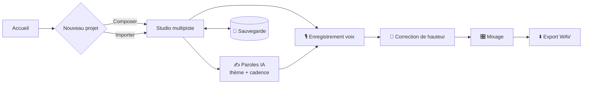
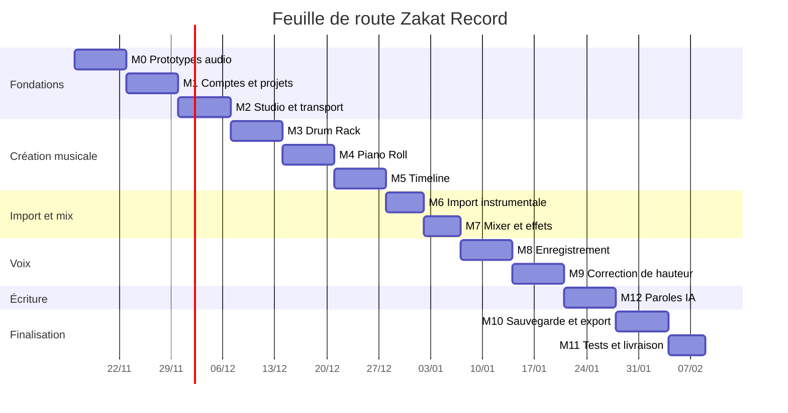
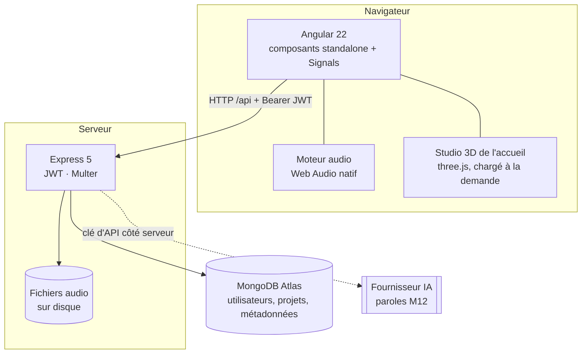
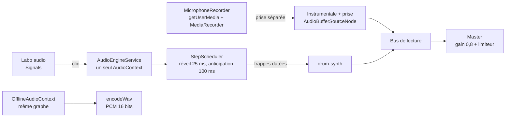

<div align="center">

# 🎚️ ZAKAT RECORD

### Le studio de production rap, directement dans le navigateur.

Composer une prod, importer une instrumentale, poser sa voix, la corriger, mixer et exporter — sans rien installer.


[](https://github.com/Zakary-213/AngularM1_Projet/actions/workflows/ci.yml)

</div>

---

## 📑 Sommaire

1. [Le projet](#-le-projet)
2. [Fonctionnalités](#-fonctionnalités)
3. [État d'avancement](#-état-davancement)
4. [Architecture](#-architecture)
5. [Structure du dépôt](#-structure-du-dépôt)
6. [Démarrage rapide](#-démarrage-rapide)
7. [Scripts disponibles](#-scripts-disponibles)
8. [Tests et qualité](#-tests-et-qualité)
9. [Contrat d'API](#contrat-dapi)
10. [Organisation du travail](#-organisation-du-travail)
11. [Contribuer](#-contribuer)
12. [Journal](#journal)

---

## 🎤 Le projet

**Zakat Record** est un projet de Master 1 MIAGE : une application web de **MAO (musique assistée par ordinateur)** pensée pour le rap. Le cahier des charges complet se trouve dans [MISSIONS_STUDIO_RAP_ANGULAR.md](MISSIONS_STUDIO_RAP_ANGULAR.md).

### Deux parcours, un seul studio

| 🎹 Créer une prod | 📥 Importer une prod |
|---|---|
| Partir d'un projet vide | Charger une instrumentale MP3 / WAV |
| Drums, 808, piano, synthés, samples | Visualiser la forme d'onde |
| Drum Rack 16 pas et Piano Roll | Régler le volume et l'égaliseur |
| Arranger les clips sur la timeline | Placer l'instru sur la timeline |

Les deux parcours ouvrent **le même éditeur multipiste**, puis convergent :



### Hors périmètre (V1)

Génération **audio** par IA (instrumentales), séparation de voix, clonage vocal et correction de hauteur **en direct** pendant la prise. La collaboration temps réel et la publication sont envisagées mais doivent d'abord être validées (voir [AGENTS.md](AGENTS.md)).

---

## ✨ Fonctionnalités

| Domaine | Fonctionnalité | Statut |
|---|---|---|
| Comptes | Inscription, connexion JWT, profil, photo de profil, déconnexion depuis l’en-tête | ✅ Fonctionnel |
| Fichiers audio | Upload multipart avec progression, liste paginée, lecture, suppression | ✅ Fonctionnel |
| Accueil | Visite 3D d'un studio au défilement : la caméra avance jusqu'au bureau (synthé, enceintes, écran) | ✅ Fonctionnel |
| Interface | Pages Projets, Studio, Bibliothèque, Collaborations, Publications | 🎨 Maquette |
| Moteur audio | Branché dans `/studio` : séquenceur 16 pas au BPM choisi, 2e source synchronisée, prise micro, export WAV (Web Audio natif) | 🧪 Prototype M0 intégré |
| Studio | Lecture, pause, stop, position (mesure:temps:double-croche), tempo, métronome, enregistrement, pistes avec mute / solo / volume, zoom de la timeline ; ajout / renommage de pistes, sélection de position et sauvegarde restent à faire | 🚧 Partiel (M2) |
| Composition | Drum Rack, Piano Roll, instruments, timeline | ⏳ À faire (M3 → M5) |
| Import | Instrumentale MP3 / WAV, forme d'onde, égaliseur | ⏳ À faire (M6) |
| Mix | Volume, mute et solo par piste (écoute et export) faits ; pan, EQ, réverbération, delay | ⏳ À faire (M7) |
| Voix | Prise micro (bouton ●) et onglet « Correction vocale » : 6 styles (Naturel, Rap, Trap, Drill, Raï, Robot) + dose d'effet, mode personnalisé (gamme, notes, humanisation, transposition, égaliseur), courbe de hauteur, calcul dans un Web Worker, version corrigée utilisable sur la piste Voix | 🚧 Partiel (M9) |
| Voix (studio) | Enregistrement multiprise, correction sur les pistes | ⏳ À faire (M8, M9) |
| ✍️ Paroles IA | Génération de couplets selon le thème et la cadence (BPM, mesures, flow), édition, prompteur synchronisé | ⏳ À faire (M12) |
| Livraison | Sauvegarde complète, export WAV, tests de bout en bout | ⏳ À faire (M10, M11) |

---

## 📈 État d'avancement



> Les dates sont indicatives. Le suivi réel se fait dans le **tableau Kanban GitHub** du dépôt (onglet *Projects*), avec une issue par mission.

---

## 🏗️ Architecture



| Couche | Technologies | Responsabilité |
|---|---|---|
| Frontend | Angular 22, TypeScript strict, Signals, Angular Material | Pages, état du studio, accessibilité |
| Moteur audio | Web Audio API native, MediaRecorder, OfflineAudioContext | Lecture synchronisée, instruments, enregistrement, export WAV |
| 3D | three.js 0.187 (MIT), chunk séparé | Hero interactif de la page d'accueil |
| Backend | Node.js, Express 5, Multer, bcryptjs, jsonwebtoken | API REST, droits, uploads |
| Données | MongoDB + Mongoose 9 | Utilisateurs, métadonnées des pistes et projets |
| Stockage audio | Disque serveur | Octets audio séparés des documents MongoDB |
| Paroles IA *(prévu)* | API d'un modèle de langage, appelée par le backend | Couplets selon thème et cadence, quotas par utilisateur |

**Principes clés :** une seule horloge audio pour toutes les pistes, données de projet sérialisables séparées des objets audio, projets privés par défaut, et vérification des droits côté serveur à chaque requête.

---

## 🗂️ Structure du dépôt

```text
.
├── frontend-starter/            # Application Angular
│   ├── src/app/
│   │   ├── components/          # Une page = un dossier (ts, html, css)
│   │   │   ├── home-page/       # Accueil + scène 3D (instrument-scene.ts)
│   │   │   ├── studio-page/     # Studio : transport, timeline, onglets d'édition
│   │   │   ├── drum-rack-panel/ # Séquenceur 16 pas du studio
│   │   │   ├── pitch-correction-panel/ # Correction vocale (chargée à la demande)
│   │   │   ├── export-panel/    # Export WAV du mix
│   │   │   ├── tracks-page/     # Fichiers audio : upload, lecture, suppression
│   │   │   └── ...
│   │   ├── shared/              # Services, guards, intercepteurs, modèles
│   │   │   └── audio/           # Moteur audio (horloge, séquenceur, micro, export WAV)
│   │   └── routes.ts            # Routes chargées à la demande
│   └── public/                  # Polices locales et licences
├── backend/                     # API Express
│   ├── src/app.js               # Routes et middlewares
│   ├── src/models/              # Schémas Mongoose (User, Track, MusicalProject)
│   └── test/                    # Tests node:test
├── .github/                     # CI, modèles d'issues et de PR, Dependabot
├── captures/                    # Captures de vérification
├── MISSIONS_STUDIO_RAP_ANGULAR.md  # Cahier des missions M0 → M11
└── AGENTS.md                    # Règles de développement communes
```

---

## 🚀 Démarrage rapide

### Prérequis

- **Node.js 22**, ou Node 24 en version **24.15 minimum** (la CLI Angular refuse les versions antérieures) ;
- une base **MongoDB** (Atlas gratuit ou locale) ;
- Git et un navigateur récent (Chrome, Firefox, Edge, Safari) avec WebGL.

### 1. Cloner

```bash
git clone https://github.com/Zakary-213/AngularM1_Projet.git
```

```bash
cd AngularM1_Projet
```

### 2. Backend

```bash
cd backend && cp .env.example .env
```

Renseigner dans `backend/.env` :

| Variable | Description |
|---|---|
| `MONGODB_URI` | URI de connexion MongoDB (Atlas ou locale) |
| `JWT_SECRET` | Secret long et aléatoire, propre à chaque poste |
| `PORT` | Port de l'API (`3000` par défaut) |

> ⚠️ Ne jamais committer `.env` ni copier un secret dans le code Angular.

```bash
npm install && npm start
```

L'API écoute sur `http://localhost:3000`.

### 3. Frontend

Dans un second terminal :

```bash
cd frontend-starter && npm install && npm start
```

Ouvrir **http://localhost:4200**. Le proxy (`proxy.conf.json`) redirige `/api` vers le backend.

Compte de démonstration : `demo@example.com` / `Demo1234!`.

---

## 🧰 Scripts disponibles

| Dossier | Commande | Effet |
|---|---|---|
| `frontend-starter/` | `npm start` | Serveur de développement avec proxy API |
| `frontend-starter/` | `npm test` | Tests unitaires Vitest (sans backend) |
| `frontend-starter/` | `npm run build` | Build de production dans `dist/` |
| `backend/` | `npm start` | API avec les variables de `.env` |
| `backend/` | `npm test` | Tests `node:test` |

---

## 🧪 Tests et qualité

- **Frontend** : Vitest + TestBed + `HttpTestingController`. Les requêtes HTTP, le micro et le Web Audio sont simulés : aucun backend ni MongoDB n'est nécessaire.
- **Backend** : `node:test` (santé de l'API, schémas Mongoose).
- **Avant chaque fusion** : `npm test` dans chaque partie modifiée, `npm run build` après un changement frontend, vérification au navigateur (console, onglet Network, largeurs 360 px / tablette / bureau).
- **Accessibilité** : HTML sémantique, focus visible, noms accessibles, respect de `prefers-reduced-motion`.

Dernier résultat connu : **81 / 81 tests frontend** et **15 / 15 tests backend** réussis, build OK (16 novembre 2026).

---

## Contrat d'API

Base : `/api`. Sauf inscription et connexion, envoyer `Authorization: Bearer <token>`. Toute route ajoutée ou modifiée doit être documentée ici (méthode, URL, authentification, paramètres, corps, réponses, erreurs).

| Méthode | Route | Requête | Réponse principale |
|---|---|---|---|
| GET | `/health` | - | `200 { "status": "ok" }` |
| POST | `/auth/register` | `{name,email,password}` | `201 {token,user}` |
| POST | `/auth/login` | `{email,password}` | `200 {token,user}` |
| GET | `/users/me` | JWT | `200 User` |
| PUT | `/users/me` | `{name}` + JWT | `200 User` |
| PUT | `/users/me/avatar` | multipart : `avatar` (JPEG, PNG ou WebP, 2 Mo max) + JWT | `200 User` |
| GET | `/users/me/avatar` | JWT | image (`Cache-Control: private, no-cache`) ou `404` sans photo |
| DELETE | `/users/me/avatar` | JWT | `204` |
| GET | `/tracks?page=1&limit=5` | JWT | `200 Page<Track>` |
| POST | `/tracks` | multipart : `audio`, `title` + JWT | `201 Track` |
| GET | `/tracks/:id/audio` | JWT | flux audio |
| DELETE | `/tracks/:id` | JWT (propriétaire) | `204` |

`User` contient `id`, `name`, `email`, `createdAt`, `hasAvatar` et `avatarUpdatedAt` ; le nom de stockage de la photo n'est jamais exposé. Photo de profil : le type annoncé **et** la signature binaire du fichier sont vérifiés (`400` sinon), `413` au-delà de 2 Mo, l'ancienne photo est supprimée après remplacement.

`Page<Track>` contient `items`, `page`, `limit`, `total` et `pages`. Formats audio acceptés : MP3, WAV, OGG et M4A, 25 Mo maximum. Erreurs courantes : `400` validation, `401` authentification, `404` ressource absente ou non autorisée, `409` email déjà utilisé.

### Projets musicaux — format v1 et routes prévues (M1, non implémentées)

Définis en M0 (#5) pour l'issue #7. Le schéma est `backend/src/models/MusicalProject.js` (validé par `backend/test/musical-project.test.js`) ; les routes ci-dessous ne répondent pas encore.

| Méthode | Route | Requête | Réponse principale |
|---|---|---|---|
| GET | `/projects?page=1&limit=10` | JWT | `200 Page<ProjectSummary>` (id, title, origin, bpm, updatedAt) |
| POST | `/projects` | `{title, origin: "create"\|"import", bpm?}` + JWT | `201 Project` |
| GET | `/projects/:id` | JWT (propriétaire) | `200 Project` |
| PUT | `/projects/:id` | `{revision, title, bpm, key, tracks, patterns, master}` + JWT | `200 Project` (révision + 1) |
| PATCH | `/projects/:id` | `{title}` + JWT | `200 Project` (renommage) |
| DELETE | `/projects/:id` | JWT (propriétaire) | `204` |

`Project` : `id`, `ownerId`, `formatVersion` (1), `title` (1 à 80 caractères), `origin`, `bpm` (60 à 200), `timeSignature` (4/4 seulement en V1), `key` (`root` 0 à 11 depuis do, `scale` `major`\|`minor`), `tracks[]` (16 max. ; `id` stable, `type` `drum`\|`instrument`\|`audio`\|`vocal`, `volume` 0 à 1, `pan` −1 à 1, `mute`, `solo`, `clips[]`), `patterns[]` (64 max. ; lignes de batterie de 16 pas, notes MIDI), `master.volume`, `revision`, `createdAt`, `updatedAt`. Un clip a un `id` stable, `startBeat` et `durationBeats` (en temps, pour suivre les changements de BPM), `offsetSeconds` et **soit** `patternId`, **soit** `audioFileId` (référence d'une piste `Track`, jamais d'octets audio), plus `pitchCorrection` facultatif (`enabled`, `strength` 0 à 1, `retuneMs` 0 à 500).

Règles prévues : `ownerId` vient du JWT, jamais du corps ; seuls les champs listés sont copiés (liste blanche) ; `404` pour un projet absent **ou** d'un autre utilisateur ; `400` validation ; `409` si `revision` ne correspond plus (sauvegarde depuis un autre onglet : rien n'est écrasé) ; `422` si `formatVersion` n'est pas pris en charge (le projet n'est pas réécrit).

---

## 📋 Organisation du travail

- **Kanban GitHub Projects** : colonnes *Backlog → À faire → En cours → En revue → Terminé*. Chaque mission M0 → M11 est une issue.
- **Labels** :
  - type : `feature`, `bug`, `docs`, `test`, `spike` (prototype technique), `design` ;
  - priorité : `priority: high`, `priority: medium`, `priority: low` ;
  - zone : `frontend`, `backend`, `audio`.
- **Branches** : une branche par issue (`feat/m3-drum-rack`, `fix/upload-progress`…), fusion par pull request.
- **Commits** : style conventionnel (`feat:`, `fix:`, `docs:`, `test:`, `refactor:`).
- Une mission n'est cochée dans le cahier qu'**après vérification** sur la version actuelle du code.

---

## 🤝 Contribuer

1. Lire [AGENTS.md](AGENTS.md) puis les `AGENTS.md` / `best-practices.md` de `frontend-starter/` et `backend/`.
2. Prendre une issue du Kanban et la passer *En cours*.
3. Créer une branche, développer, ajouter des tests utiles.
4. Lancer `npm test` et `npm run build`, vérifier au navigateur.
5. Ouvrir une pull request qui référence l'issue (`Closes #12`) et mettre à jour le journal ci-dessous.

---

## Journal

Choix techniques, fonctionnalités réalisées, tests exécutés et limites, mission par mission.

### 16 novembre 2026 — Style Raï renforcé : réverbération et écho (M9, #15)

- **Espace de la voix** (`shared/audio/pitch/voice-fx.ts`) : réverbération synthétisée (bruit à décroissance exponentielle, pré-délai 20 ms, énergie normalisée ; aucun fichier d'impulsion, donc aucune licence) et écho avec répétitions assombries (passe-bas 4,5 kHz dans la boucle). Rendu hors temps réel après l'égaliseur ; la durée de la prise est conservée (la traîne au-delà de la fin est coupée) et une crête au-dessus de 0,98 est ramenée en dessous pour ne pas saturer le WAV.
- **Raï** : intensité 95 %, recalage 20 ms (la voix glisse vers la note), mineur harmonique, voix éclaircie (coupe-bas 150 Hz, corps −3 dB, présence +6 dB, air +7 dB), réverbération 45 % sur 3,2 s, écho 38 % à la croche du tempo du projet (333 ms à 90 BPM) avec 50 % de répétitions.
- Les autres styles reçoivent un peu d'espace (Rap, Trap, Drill) ; Naturel et Robot restent secs. La dose d'effet réduit aussi réverbération et écho. Le panneau avancé gagne une section « Espace » (réverbération, taille de salle, écho, temps d'écho avec « Caler sur le tempo », répétitions). Les styles personnels enregistrés avant restent lisibles, sans effet.
- « Voix qui s'aiguë » est rendu par le timbre (présence et air), pas en changeant la note : transposer sortirait la voix de la tonalité. La transposition reste disponible dans le panneau avancé.
- **Vérifications** : `npm run build` réussi ; `npm test` 119/119 (8 nouveaux tests : valeurs du Raï, styles secs, dose, écho calé sur le tempo, bornes, relecture d'un ancien style, décroissance et énergie de la réverbération, limitation de crête). Navigateur, voix de test : le Raï affiche les réglages ci-dessus, 37 → 10 cents, console sans erreur. **Non vérifié** : le rendu à l'oreille de la réverbération et de l'écho.

### 16 novembre 2026 — Correction vocale : styles et mode personnalisé (M9, #15)

- **Interface simple** : cartes de style (Naturel, Rap, Trap, Drill, Raï, Robot) avec une phrase d'explication, un seul curseur « Dose d'effet », tonalité du projet reprise automatiquement, Avant / Après. Changer de style ou de dose relance le calcul tout seul (après 250 ms sans changement).
- **Mode avancé** (repliable) : tonalité, gamme (mineur, majeur, **mineur harmonique**, **phrygien dominant / Hijaz**), notes autorisées cochables, intensité, vitesse de recalage, **tolérance en cents** (humanisation : le vibrato sous le seuil n'est pas corrigé), **transposition** ± 12 demi-tons, **spectre de la voix** (coupe-bas, corps 250 Hz, présence 3,5 kHz, air 10 kHz). Toute modification passe en « Personnalisé (basé sur …) », avec « Réinitialiser le style ».
- **Mes styles** : un réglage peut être nommé et enregistré ; il apparaît comme une carte. Stockage dans le navigateur (`localStorage`, entrées validées à la relecture) **en attendant la sauvegarde de projet (M10)** : les styles ne suivent pas encore le projet d'un appareil à l'autre.
- **Timbre / formants** : non proposé. Le PSOLA actuel ne sépare pas le timbre de la hauteur ; la limite est affichée dans le panneau.
- **Calcul** dans un Web Worker (`pitch-correction.worker.ts`), annulable ; un calcul remplacé par un plus récent est ignoré. L'égaliseur est rendu ensuite avec un `OfflineAudioContext`.
- **Durée** : extraits jusqu'à **60 s** (au lieu de 30 s). Mesure : ≈ 1,3 s de calcul pour une minute de voix à 48 kHz (Node, machine de test), hors du thread de l'interface.
- **Courbe de hauteur** : hauteur chantée (pointillés) et corrigée sur la durée de la prise.
- **Piste Voix** : quand la source est la prise du studio, « Utiliser la version corrigée sur la piste Voix » la fait jouer à l'écoute et à l'export ; l'originale reste conservée et peut être rétablie.
- **Vérifications** : `npm run build` réussi (panneau 11 ko et worker 1,4 ko transférés, à la demande) ; `npm test` 111/111 (20 nouveaux tests : extrait d'une minute accepté, gammes ajoutées, notes autorisées, tolérance, transposition, valeurs des styles, dose, validation et relecture des styles personnels, égaliseur, courbe). Navigateur, sur la voix de test : Naturel 37 → 26 cents, Trap 37 → 5 cents, Raï à 50 % affiche « La mineur harmonique » et recoche sol♯ ; une modification de présence passe en « Personnalisé (basé sur Raï) » ; style personnel enregistré puis retrouvé après rechargement ; pas de débordement à 360 px ; console sans erreur.
- **Non vérifié** : la qualité à l'oreille de chaque style ; « Annuler » (le calcul de la voix de test ne dure que ≈ 75 ms) ; le passage de la version corrigée sur la piste Voix et dans l'export, faute de vraie prise micro dans le navigateur de test.

### 16 novembre 2026 — Pause, métronome, mixage par piste et zoom (M2, #8)

- **Pause** : ▶ / ❚❚ alterne lecture et pause ; la pause garde la position et la reprise repart au même pas, clips compris (le début déjà joué est sauté). ■ arrête et revient au début. Une prise lancée depuis une pause démarre à cette position.
- **Position** : le compteur affiche mesure : temps : double-croche (le pas est désormais compté depuis le début du morceau, plus seulement dans la boucle d'une mesure) ; une tête de lecture est tracée sur la timeline.
- **Métronome** : bouton ♩ dans le transport, clic sur chaque temps et accent sur le premier ; il n'est ni mixé ni exporté.
- **Mixage par piste** : chaque piste (batterie, instrumentale, voix) passe par son propre gain. Volume de −36 à +6 dB, mute et solo (le mute l'emporte) dans l'onglet Mixeur et sur la timeline ; les changements s'appliquent pendant la lecture avec un lissage de 15 ms et sont repris à l'identique dans l'export WAV. Logique pure dans `shared/audio/track-mix.ts`.
- **Zoom** : boutons − / + de la timeline, 4, 8, 16 ou 32 mesures visibles ; la règle garde 8 repères.
- **Vérifications** : `npm run build` réussi ; `npm test` 91/91 (10 nouveaux tests : gains, mute, solo, bornes du fader, reprise d'un clip, reprise du séquenceur au pas absolu). Navigateur : pause figée sur 07:03:04 puis reprise à 08:01:01 ; stop revient à 01:01:01 ; zoom à 8 mesures (règle 1 → 8) ; solo de la batterie affiché « Coupée par un solo » sur les deux autres pistes ; fader à −12 dB ; pas de débordement horizontal ; console sans erreur. **Non vérifié** à l'oreille : niveau réel des faders, clic du métronome, absence de claquement au changement de volume (le panneau navigateur ne restitue pas le son de façon fiable).
- **Reste pour M2** : ajout, renommage et suppression de pistes, sélection de position sur la règle, état de sauvegarde.

### 16 novembre 2026 — Intégration du labo dans le studio (M2)

Le labo `/audio-lab` a été supprimé : tout ce qu'il démontrait est désormais dans `/studio`.

- **Transport** : ▶ / ■ lance ou arrête la boucle, ● enregistre une prise sur la prod (micro demandé au clic, fermé à l'arrêt), ↤ arrête et revient au début ; le tempo est saisi directement dans le transport (60–200 BPM, une valeur invalide est signalée sans être appliquée) ; la position affiche temps et double-croche.
- **Timeline** : pistes réelles de la session (Batterie, Instrumentale importée, Voix principale) placées selon leur durée et leur position ; bouton **M** pour rendre muette l'instrumentale ou la prise, pris en compte à la lecture et à l'export.
- **Onglets** : *Batterie* (séquenceur 16 pas), *Correction vocale* (chargée à la demande, propose la dernière prise du studio), *Export* (WAV du mix écouté), *Mixeur* (encore un aperçu).
- **Architecture** : l'état audio est dans `StudioSessionService`, fourni par la page Studio et libéré à sa sortie ; chaque panneau est un composant distinct.
- **Vérifications** : `npm run build` réussi (studio 9 ko et correction vocale 5 ko transférés, à la demande) ; `npm test` 81/81. Navigateur : lecture en boucle avec tête de lecture, correction de la voix de test (37 → 23 cents en *Naturel*), onglet Export affiché, pas de débordement à 360 px, console sans erreur. **Non vérifié** : vraie prise micro et téléchargement WAV depuis le studio.

### 16 novembre 2026 — M0 (suite) : format de projet et correction de hauteur (#5, #6)

**Format de sauvegarde v1** : schéma Mongoose `MusicalProject` versionné (`formatVersion: 1`), limites nommées (`PROJECT_LIMITS`), identifiants stables générés par le client, positions de clips en temps, octets audio hors du document, `revision` pour refuser une sauvegarde concurrente. Routes M1 décrites dans le « Contrat d'API » (non implémentées).

**Prototype de correction de hauteur** (onglet « Correction vocale » du studio, code dans `shared/audio/pitch/`) :

- **Analyse** : YIN toutes les 5 ms sur le signal sous-échantillonné à ≈ 11 kHz, fenêtre de 40 ms, tessiture 70 Hz à 1 kHz, trames silencieuses ignorées.
- **Cible** : note la plus proche dans la tonalité et la gamme (majeur ou mineur) ; **intensité** = part de l'écart corrigée ; **vitesse de recalage** = lissage en ms (0 ms = effet robotique). Préréglages *Naturel* (60 %, 80 ms) et *Effet marqué* (100 %, 0 ms).
- **Synthèse** : TD-PSOLA (grains de deux périodes ré-espacés) : la hauteur change, **la durée est conservée**. L'original n'est jamais modifié ; la version corrigée est un nouveau buffer, écoutable en A/B et téléchargeable en WAV.
- **Limites** : traitement sur le thread de l'interface (30 s maximum : ≈ 60 ms mesurées pour 3 s de voix sur la machine de test, à déporter dans un Web Worker si les prises réelles le justifient) ; marques de période approximatives, donc un grain audible possible sur les transitions ; formants non préservés pour les grands écarts ; voix mono.

| Moteur envisagé | Licence | Intérêt | Décision |
|---|---|---|---|
| **PSOLA maison** (ce prototype) | Code du projet | Aucune dépendance, compréhensible, testé | **Retenu pour M9**, sous réserve de l'écoute |
| Rubber Band (wasm) | GPL ou licence commerciale | Très bonne qualité | Écarté : contraintes de licence et taille |
| SoundTouch | LGPL | Transposition globale robuste | Écarté : pas de correction note par note |
| Vocodeur WORLD | BSD modifiée | Préserve mieux les formants | Plan B si PSOLA est jugé insuffisant |

Les licences de ce tableau sont citées de mémoire et doivent être reconfirmées avant toute adoption.

**Vérifications**

- Frontend `npm test` : 81/81 (dont 14 tests de hauteur : conversions, gammes, YIN à ±0,5 % de 110 à 880 Hz, rejet du bruit, 230 Hz → 220 Hz et 243 Hz → 246,9 Hz à ±1 % avec durée identique, intensité de 60 %, intensité nulle sans effet, limite de 30 s). `npm run build` réussi.
- Backend `npm test` : 15/15 (dont 7 tests du format v1 : valeurs par défaut, `toPublic`, bornes de BPM, version inconnue, nombre de pistes, 16 pas par ligne, clip pattern **ou** audio, identifiants et types).
- Navigateur (Chromium, Playwright) : voix de test, écart moyen à la gamme **37 → 5 cents** en *Effet marqué* et **37 → 23 cents** en *Naturel* ; lecture A/B ; WAV corrigé de 3,00 s ; un fichier de 3 min est refusé (30 s max.). Pas de débordement à 360 px ni à 640 px (équivalent du zoom à 200 %) après correction d'un `fieldset` trop large.
- **Non vérifié** : la qualité à l'oreille, en particulier sur une vraie voix. Le micro simulé de Chromium n'émet que des bips (0 % de trames voisées), donc aucune vraie prise n'a été corrigée.

### 16 novembre 2026 — M0 : prototypes audio et cadrage technique (#5)

**Démo technique :** d'abord une page `/audio-lab` isolée, désormais intégrée au studio (voir l'entrée « Intégration du labo dans le studio »). Code du moteur dans `frontend-starter/src/app/shared/audio/`.



- **Horloge commune** : chaque frappe et chaque fichier est daté sur `AudioContext.currentTime` à partir d'un même `startTime`. Le timer JavaScript ne fait que réveiller le scheduler (« lookahead ») ; un changement de BPM s'applique au pas suivant. La tête de lecture lit la file des pas programmés via `requestAnimationFrame` et n'écrit un signal qu'au changement de pas.
- **Séquenceur** : 16 pas, kick / snare / hi-hat **synthétisés en code** (aucun sample, donc aucune licence à vérifier pour le prototype), BPM borné entre 60 et 200.
- **Deux sources synchronisées** : un MP3/WAV local (25 Mo max., MP3 ou WAV contrôlés) démarre sur la même date que le séquenceur. Le fichier reste dans le navigateur : aucun upload en M0.
- **Prise micro** : micro demandé seulement au clic sur « Enregistrer », traitements de visio désactivés, pas de retour micro, pistes coupées à l'arrêt. Format choisi selon `MediaRecorder.isTypeSupported` (Opus/WebM, Opus/Ogg, puis MP4 pour Safari). La prise originale est conservée telle quelle (ObjectURL libéré au remplacement et à la fermeture) et placée dans le morceau en retranchant la latence de sortie et d'entrée **estimée par le navigateur**.
- **Export** : rendu `OfflineAudioContext` avec les mêmes fonctions que l'écoute (synthé, clips, Master), puis WAV PCM 16 bits stéréo 44,1 kHz encodé sans dépendance. La crête est affichée en dBFS.

**Comparaison des options d'export**

| Option | Avantages | Limites | Décision |
|---|---|---|---|
| `OfflineAudioContext` + encodeur WAV maison | Plus rapide que le temps réel, même graphe que l'écoute, aucune dépendance | WAV volumineux (≈ 10 Mo/min) ; mémoire proportionnelle à la durée | **Retenu pour la V1** |
| `MediaRecorder` sur `MediaStreamDestination` | Simple | Temps réel (3 min d'attente pour 3 min), format compressé dépendant du navigateur | Écarté |
| Encodeur MP3 JavaScript dans un Web Worker | Fichiers légers | Dépendance et licence à vérifier, travail supplémentaire | À évaluer en M10 si le MP3 est demandé |
| FFmpeg (wasm ou serveur) | Tous les formats | ffmpeg.wasm pèse plusieurs dizaines de Mo ; côté serveur, il faut envoyer toutes les pistes | Écarté pour la V1 |

**Choix du moteur : Web Audio natif, pas de Tone.js pour l'instant.** Le scheduler tient en moins de 80 lignes testées, fonctionne aussi hors ligne et n'ajoute aucune dépendance. Tone.js (15.1.22, licence MIT vérifiée sur npm, 5,4 Mo décompressé) reste l'option pour les instruments mélodiques de M4 ; on l'ajoutera si l'écriture des synthés et du sampler devient coûteuse, après mesure de la taille du chunk.

**Licences**

- Web Audio, MediaRecorder et OfflineAudioContext sont des API du navigateur ; le code du moteur est original. Aucun sample n'est utilisé.
- Les fichiers `frontend-starter/fichiers-audio-de-test/song1.mp3` et `song2.mp3` (déjà présents dans le dépôt) n'ont **pas d'origine ni de licence documentée** : ils ne servent qu'aux tests locaux et ne doivent pas être distribués ni publiés. Le moteur de correction de hauteur est traité dans #6.

**Vérifications**

- `npm test` : 67/67 (dont 23 nouveaux tests : conversions temporelles, scheduler et dérive sur 60 s, pattern, placement des clips et de la prise, validation des fichiers, formats micro et messages d'erreur, encodeur WAV).
- `npm run build` réussi.
- Navigateur (Chromium via Playwright, micro simulé) : la tête de lecture avance, un BPM de 300 est refusé avec message, `song1.mp3` est décodé (180,06 s) et un fichier texte est refusé, une prise de 1,56 s est enregistrée en Opus/WebM puis le micro est fermé, l'export de 4 mesures à 140 BPM donne un WAV stéréo 44,1 kHz de 6,86 s (crête −0,6 dBFS). Aucune erreur console. Pas de débordement horizontal à 360 px ni à 800 px ; le séquenceur défile dans son cadre ; les pas se basculent à Entrée et Espace.
- **Non vérifié** : l'écoute réelle (calage à l'oreille de l'instrumentale, du séquenceur et d'une vraie voix au casque), Firefox et Safari, le zoom à 200 %. La compensation de latence repose sur les valeurs annoncées par le navigateur ; une mesure par boucle (sortie reliée à l'entrée) sera nécessaire en M8.
- **Complété le même jour** : format de sauvegarde et prototype de correction de hauteur (entrée ci-dessus).

### 15 novembre 2026 — Refonte de l'accueil : studio 3D (#39)

- L'ancienne scène (fond gris, instruments en formes simples) est remplacée par **un studio modélisé** : bureau en noyer, écran affichant une session de musique, enceintes de monitoring, clavier synthétiseur 49 touches, carte son, casque, lampe, micro sur pied, lattes de bois, panneaux acoustiques, disques d'or, plante.
- **Défilement** : plan large → « 01 Le studio » → gros plan « 02 Le synthé » → « 03 La session » face à l'écran, avec l'appel « Entrer dans le studio ». Navigation par étape au clavier, barre de progression.
- **Rendu** : matériaux PBR, réflexions d'un environnement généré, ombres douces, tone mapping ACES. Éclairage chaud et indirect ; bloom très discret (seuil 0,95) après le retour « lumières trop flash » sur une première version. Une version intermédiaire avec un salon et un Far West a été abandonnée à la demande de l'utilisateur.
- **Performance** : toutes les textures sont dessinées en code (aucun fichier téléchargé), scène chargée à la demande (≈ 124 ko transférés), qualité réduite automatiquement si les premières images sont trop lentes.
- Vérifications : `npm test` 44/44, `npm run build` réussi ; rendu contrôlé au navigateur sur ordinateur aux trois étapes. **Non vérifiés** : 360 px, `prefers-reduced-motion` et la fluidité réelle (le panneau du navigateur était souvent masqué pendant les mesures, ce qui fausse le nombre d'images par seconde).

### 15 novembre 2026 — Photo de profil (#37)

- Backend : `PUT`, `GET` et `DELETE /api/users/me/avatar`. Images JPEG, PNG ou WebP de 2 Mo maximum, rangées dans `backend/data/avatars/` sous un nom aléatoire (extension tirée du type validé). Le type annoncé et la signature binaire du fichier sont contrôlés ; l'ancienne photo est supprimée après l'enregistrement de la nouvelle, et le fichier envoyé est nettoyé si MongoDB échoue.
- Frontend : page profil refaite (photo, informations, nom). Aperçu local avant envoi, boutons Choisir / Changer / Supprimer, validation côté client, état d'envoi et messages accessibles. La photo apparaît aussi dans l'en-tête. Elle est téléchargée avec le JWT puis affichée via un ObjectURL libéré à chaque changement et à la déconnexion.
- Correction : quand plusieurs requêtes échouaient en 401, la redirection vers `/login` s'empilait (`returnUrl` imbriqué).
- Suivi : `AGENTS.md` impose désormais à tout agent de tenir à jour les issues et le Kanban à chaque implémentation.
- Vérifications : backend `npm test` 8/8 (6 nouveaux tests : 401, absence de fichier, type refusé, contenu falsifié, 413, profil public) ; frontend `npm test` 44/44 (10 nouveaux) et `npm run build` réussis. Parcours réel vérifié au navigateur avec le compte de démonstration et MongoDB Atlas : connexion avec retour vers `/profile`, envoi d'une photo (PUT 200), affichage dans le profil et l'en-tête, persistance après rechargement (GET 200), refus côté client d'une image de 3 Mo sans requête, suppression (DELETE 204) avec retour à l'initiale et fichier effacé du disque. Affichage contrôlé à 1280 et 360 px sans débordement.

### 15 novembre 2026 — Inscription et connexion intégrées au site (#35)

- En-tête : liens **Connexion** et **S'inscrire** pour un visiteur ; une fois connecté, le nom de l'utilisateur (lien vers le profil) et **Se déconnecter**. Le profil est rechargé après un rafraîchissement de la page. Sous 1100 px, la navigation passe dans le menu repliable pour éviter tout débordement.
- Pages `/login` et `/register` refaites au design Zakat Record : erreurs liées aux champs (`aria-describedby`), message global annoncé (`role="alert"`), bouton afficher/masquer le mot de passe, règle des 8 caractères affichée, état « en cours » et blocage des doubles envois. Le compte de démonstration n'est plus prérempli.
- Retour à la page demandée après connexion (`returnUrl`, limité aux chemins internes pour éviter les redirections ouvertes) ; page par défaut : `/projects`. Un utilisateur déjà connecté est renvoyé hors de `/login` et `/register`.
- L'intercepteur ne déconnecte plus sur le 401 de la route de connexion (mauvais identifiants). Les erreurs 0 et 502–504 affichent « Serveur injoignable ».
- Vérifications : `npm test` 34/34 (24 nouveaux tests : pages, guards, intercepteur, en-tête, utilitaires) et `npm run build` réussis. Au navigateur : redirection vers `/login?returnUrl=…`, validations, en-tête connecté et déconnexion à 1280, 1024 et 360 px sans débordement horizontal. **Non vérifié** : une connexion réelle de bout en bout, car le cluster MongoDB Atlas refusait l'adresse IP du poste (backend arrêté au démarrage).

### 15 novembre 2026 — Nouvelle mission M12 : paroles par IA

- Ajout au cahier de la mission **M12 · Assistant d'écriture de paroles par IA** : génération de couplets à partir d'un thème et de la cadence du projet (BPM, mesures, densité de syllabes, schéma de rimes), édition, prompteur synchronisé et sauvegarde.
- Choix de principe : l'appel au fournisseur d'IA passe **uniquement par le backend** (clé jamais exposée), avec validation des entrées, quotas par utilisateur et refus d'imiter un artiste réel. Le fournisseur reste à choisir via un spike.
- Aucune ligne de code pour l'instant : documentation et tableau Kanban uniquement.

### 15 novembre 2026 — Accueil 3D « Zakat Record »

- Le site s'appelle désormais **Zakat Record** (en-tête, pied de page, titres des pages).
- Accueil : hero plein écran au-dessus d'une scène 3D d'instruments lumineux (vinyles, micros, enceintes, fûts, casques, claviers), entièrement construits en code à partir de formes simples : aucun modèle 3D ni photo téléchargé. La caméra avance seule, le défilement de la page l'accélère, le curseur repousse et illumine les instruments, et le survol de la flèche arrête le vol et disperse la scène.
- Son d'ambiance optionnel, synthétisé avec Web Audio (aucun fichier audio). Coupé par défaut, il ne démarre qu'après un clic sur le bouton.
- Nouvelle dépendance : **three.js 0.187** (licence MIT), utilisée pour la scène 3D et le bloom. Elle est chargée à la demande dans un chunk séparé (environ 117 ko transférés) : le bundle initial ne change pas.
- Le mouvement automatique est désactivé avec `prefers-reduced-motion`. Si WebGL n'est pas disponible, un fond statique et un message remplacent la scène.
- Vérifications : `npm test` (10/10, dont 3 nouveaux tests du son d'ambiance) et `npm run build` réussis. Rendu contrôlé au navigateur sur ordinateur, sans erreur console ; absence de débordement horizontal à 360 px. Le rendu visuel à 360 px et le zoom à 200 % n'ont pas pu être confirmés, car le panneau du navigateur était masqué.

### 23 octobre 2026 — Maquette frontend

- Six pages en maquette (Accueil, Projets, Studio, Bibliothèque, Collaborations, Publications), chargées à la demande, avec données de démonstration. Thème sombre, polices locales (licences SIL OFL dans `frontend-starter/public/fonts/`).
- Aucune action métier branchée : pas de lecture audio, de micro ni de sauvegarde sur ces pages.

---

<div align="center">

**ZAKAT RECORD** · Projet Angular M1 MIAGE · 2026

</div>
