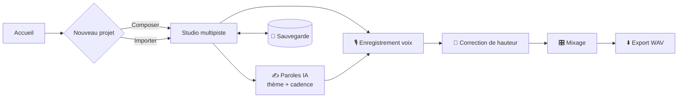
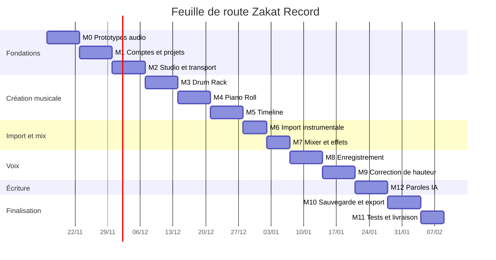

<div align="center">

# 🎚️ ZAKAT RECORD

### Le studio de production rap, directement dans le navigateur.

Composer une prod, importer une instrumentale, poser sa voix, la corriger, mixer et exporter — sans rien installer.


[](https://github.com/Zakary-213/AngularM1_Projet/actions/workflows/ci.yml)

</div>

---

## 📑 Sommaire

1. [Le projet](#-le-projet)
2. [Fonctionnalités](#-fonctionnalités)
3. [État d'avancement](#-état-davancement)
4. [Architecture](#-architecture)
5. [Structure du dépôt](#-structure-du-dépôt)
6. [Démarrage rapide](#-démarrage-rapide)
7. [Scripts disponibles](#-scripts-disponibles)
8. [Tests et qualité](#-tests-et-qualité)
9. [Contrat d'API](#contrat-dapi)
10. [Organisation du travail](#-organisation-du-travail)
11. [Contribuer](#-contribuer)
12. [Journal](#journal)

---

## 🎤 Le projet

**Zakat Record** est un projet de Master 1 MIAGE : une application web de **MAO (musique assistée par ordinateur)** pensée pour le rap. Le cahier des charges complet se trouve dans [MISSIONS_STUDIO_RAP_ANGULAR.md](MISSIONS_STUDIO_RAP_ANGULAR.md).

### Deux parcours, un seul studio

| 🎹 Créer une prod | 📥 Importer une prod |
|---|---|
| Partir d'un projet vide | Charger une instrumentale MP3 / WAV |
| Drums, 808, piano, synthés, samples | Visualiser la forme d'onde |
| Drum Rack 16 pas et Piano Roll | Régler le volume et l'égaliseur |
| Arranger les clips sur la timeline | Placer l'instru sur la timeline |

Les deux parcours ouvrent **le même éditeur multipiste**, puis convergent :



### Hors périmètre (V1)

Génération **audio** par IA (instrumentales), séparation de voix, clonage vocal et correction de hauteur **en direct** pendant la prise. La collaboration temps réel et la publication sont envisagées mais doivent d'abord être validées (voir [AGENTS.md](AGENTS.md)).

---

## ✨ Fonctionnalités

| Domaine | Fonctionnalité | Statut |
|---|---|---|
| Comptes | Inscription, connexion JWT, profil, photo de profil, déconnexion depuis l’en-tête | ✅ Fonctionnel |
| Fichiers audio | Upload multipart avec progression, liste paginée, lecture, suppression | ✅ Fonctionnel |
| Accueil | Hero 3D interactif (instruments lumineux, son d'ambiance synthétisé) | ✅ Fonctionnel |
| Interface | Pages Projets, Studio, Bibliothèque, Collaborations, Publications | 🎨 Maquette |
| Moteur audio | Transport, BPM, métronome, horloge commune (Tone.js / Web Audio) | ⏳ À faire (M0, M2) |
| Composition | Drum Rack, Piano Roll, instruments, timeline | ⏳ À faire (M3 → M5) |
| Import | Instrumentale MP3 / WAV, forme d'onde, égaliseur | ⏳ À faire (M6) |
| Mix | Volume, mute / solo, pan, EQ, réverbération, delay | ⏳ À faire (M7) |
| Voix | Enregistrement multiprise, correction de hauteur | ⏳ À faire (M8, M9) |
| ✍️ Paroles IA | Génération de couplets selon le thème et la cadence (BPM, mesures, flow), édition, prompteur synchronisé | ⏳ À faire (M12) |
| Livraison | Sauvegarde complète, export WAV, tests de bout en bout | ⏳ À faire (M10, M11) |

---

## 📈 État d'avancement



> Les dates sont indicatives. Le suivi réel se fait dans le **tableau Kanban GitHub** du dépôt (onglet *Projects*), avec une issue par mission.

---

## 🏗️ Architecture


| Couche | Technologies | Responsabilité |
|---|---|---|
| Frontend | Angular 22, TypeScript strict, Signals, Angular Material | Pages, état du studio, accessibilité |
| Moteur audio | Web Audio API, Tone.js *(prévu)*, MediaRecorder | Lecture synchronisée, instruments, enregistrement |
| 3D | three.js 0.187 (MIT), chunk séparé | Hero interactif de la page d'accueil |
| Backend | Node.js, Express 5, Multer, bcryptjs, jsonwebtoken | API REST, droits, uploads |
| Données | MongoDB + Mongoose 9 | Utilisateurs, métadonnées des pistes et projets |
| Stockage audio | Disque serveur | Octets audio séparés des documents MongoDB |
| Paroles IA *(prévu)* | API d'un modèle de langage, appelée par le backend | Couplets selon thème et cadence, quotas par utilisateur |

**Principes clés :** une seule horloge audio pour toutes les pistes, données de projet sérialisables séparées des objets audio, projets privés par défaut, et vérification des droits côté serveur à chaque requête.

---

## 🗂️ Structure du dépôt

```text
.
├── frontend-starter/            # Application Angular
│   ├── src/app/
│   │   ├── components/          # Une page = un dossier (ts, html, css)
│   │   │   ├── home-page/       # Accueil + scène 3D (instrument-scene.ts)
│   │   │   ├── studio-page/     # Studio (maquette)
│   │   │   ├── tracks-page/     # Fichiers audio : upload, lecture, suppression
│   │   │   └── ...
│   │   ├── shared/              # Services, guards, intercepteurs, modèles
│   │   └── routes.ts            # Routes chargées à la demande
│   └── public/                  # Polices locales et licences
├── backend/                     # API Express
│   ├── src/app.js               # Routes et middlewares
│   ├── src/models/              # Schémas Mongoose (User, Track)
│   └── test/                    # Tests node:test
├── .github/                     # CI, modèles d'issues et de PR, Dependabot
├── captures/                    # Captures de vérification
├── MISSIONS_STUDIO_RAP_ANGULAR.md  # Cahier des missions M0 → M11
└── AGENTS.md                    # Règles de développement communes
```

---

## 🚀 Démarrage rapide

### Prérequis

- **Node.js 22**, ou Node 24 en version **24.15 minimum** (la CLI Angular refuse les versions antérieures) ;
- une base **MongoDB** (Atlas gratuit ou locale) ;
- Git et un navigateur récent (Chrome, Firefox, Edge, Safari) avec WebGL.

### 1. Cloner

```bash
git clone https://github.com/Zakary-213/AngularM1_Projet.git
```

```bash
cd AngularM1_Projet
```

### 2. Backend

```bash
cd backend && cp .env.example .env
```

Renseigner dans `backend/.env` :

| Variable | Description |
|---|---|
| `MONGODB_URI` | URI de connexion MongoDB (Atlas ou locale) |
| `JWT_SECRET` | Secret long et aléatoire, propre à chaque poste |
| `PORT` | Port de l'API (`3000` par défaut) |

> ⚠️ Ne jamais committer `.env` ni copier un secret dans le code Angular.

```bash
npm install && npm start
```

L'API écoute sur `http://localhost:3000`.

### 3. Frontend

Dans un second terminal :

```bash
cd frontend-starter && npm install && npm start
```

Ouvrir **http://localhost:4200**. Le proxy (`proxy.conf.json`) redirige `/api` vers le backend.

Compte de démonstration : `demo@example.com` / `Demo1234!`.

---

## 🧰 Scripts disponibles

| Dossier | Commande | Effet |
|---|---|---|
| `frontend-starter/` | `npm start` | Serveur de développement avec proxy API |
| `frontend-starter/` | `npm test` | Tests unitaires Vitest (sans backend) |
| `frontend-starter/` | `npm run build` | Build de production dans `dist/` |
| `backend/` | `npm start` | API avec les variables de `.env` |
| `backend/` | `npm test` | Tests `node:test` |

---

## 🧪 Tests et qualité

- **Frontend** : Vitest + TestBed + `HttpTestingController`. Les requêtes HTTP, le micro et le Web Audio sont simulés : aucun backend ni MongoDB n'est nécessaire.
- **Backend** : `node:test` (santé de l'API, schémas Mongoose).
- **Avant chaque fusion** : `npm test` dans chaque partie modifiée, `npm run build` après un changement frontend, vérification au navigateur (console, onglet Network, largeurs 360 px / tablette / bureau).
- **Accessibilité** : HTML sémantique, focus visible, noms accessibles, respect de `prefers-reduced-motion`.

Dernier résultat connu : **10 / 10 tests frontend réussis**, build OK.

---

## Contrat d'API

Base : `/api`. Sauf inscription et connexion, envoyer `Authorization: Bearer <token>`. Toute route ajoutée ou modifiée doit être documentée ici (méthode, URL, authentification, paramètres, corps, réponses, erreurs).

| Méthode | Route | Requête | Réponse principale |
|---|---|---|---|
| GET | `/health` | - | `200 { "status": "ok" }` |
| POST | `/auth/register` | `{name,email,password}` | `201 {token,user}` |
| POST | `/auth/login` | `{email,password}` | `200 {token,user}` |
| GET | `/users/me` | JWT | `200 User` |
| PUT | `/users/me` | `{name}` + JWT | `200 User` |
| PUT | `/users/me/avatar` | multipart : `avatar` (JPEG, PNG ou WebP, 2 Mo max) + JWT | `200 User` |
| GET | `/users/me/avatar` | JWT | image (`Cache-Control: private, no-cache`) ou `404` sans photo |
| DELETE | `/users/me/avatar` | JWT | `204` |
| GET | `/tracks?page=1&limit=5` | JWT | `200 Page<Track>` |
| POST | `/tracks` | multipart : `audio`, `title` + JWT | `201 Track` |
| GET | `/tracks/:id/audio` | JWT | flux audio |
| DELETE | `/tracks/:id` | JWT (propriétaire) | `204` |

`User` contient `id`, `name`, `email`, `createdAt`, `hasAvatar` et `avatarUpdatedAt` ; le nom de stockage de la photo n'est jamais exposé. Photo de profil : le type annoncé **et** la signature binaire du fichier sont vérifiés (`400` sinon), `413` au-delà de 2 Mo, l'ancienne photo est supprimée après remplacement.

`Page<Track>` contient `items`, `page`, `limit`, `total` et `pages`. Formats audio acceptés : MP3, WAV, OGG et M4A, 25 Mo maximum. Erreurs courantes : `400` validation, `401` authentification, `404` ressource absente ou non autorisée, `409` email déjà utilisé.

---

## 📋 Organisation du travail

- **Kanban GitHub Projects** : colonnes *Backlog → À faire → En cours → En revue → Terminé*. Chaque mission M0 → M11 est une issue.
- **Labels** :
  - type : `feature`, `bug`, `docs`, `test`, `spike` (prototype technique), `design` ;
  - priorité : `priority: high`, `priority: medium`, `priority: low` ;
  - zone : `frontend`, `backend`, `audio`.
- **Branches** : une branche par issue (`feat/m3-drum-rack`, `fix/upload-progress`…), fusion par pull request.
- **Commits** : style conventionnel (`feat:`, `fix:`, `docs:`, `test:`, `refactor:`).
- Une mission n'est cochée dans le cahier qu'**après vérification** sur la version actuelle du code.

---

## 🤝 Contribuer

1. Lire [AGENTS.md](AGENTS.md) puis les `AGENTS.md` / `best-practices.md` de `frontend-starter/` et `backend/`.
2. Prendre une issue du Kanban et la passer *En cours*.
3. Créer une branche, développer, ajouter des tests utiles.
4. Lancer `npm test` et `npm run build`, vérifier au navigateur.
5. Ouvrir une pull request qui référence l'issue (`Closes #12`) et mettre à jour le journal ci-dessous.

---

## Journal

Choix techniques, fonctionnalités réalisées, tests exécutés et limites, mission par mission.

### 15 novembre 2026 — Photo de profil (#37)

- Backend : `PUT`, `GET` et `DELETE /api/users/me/avatar`. Images JPEG, PNG ou WebP de 2 Mo maximum, rangées dans `backend/data/avatars/` sous un nom aléatoire (extension tirée du type validé). Le type annoncé et la signature binaire du fichier sont contrôlés ; l'ancienne photo est supprimée après l'enregistrement de la nouvelle, et le fichier envoyé est nettoyé si MongoDB échoue.
- Frontend : page profil refaite (photo, informations, nom). Aperçu local avant envoi, boutons Choisir / Changer / Supprimer, validation côté client, état d'envoi et messages accessibles. La photo apparaît aussi dans l'en-tête. Elle est téléchargée avec le JWT puis affichée via un ObjectURL libéré à chaque changement et à la déconnexion.
- Correction : quand plusieurs requêtes échouaient en 401, la redirection vers `/login` s'empilait (`returnUrl` imbriqué).
- Suivi : `AGENTS.md` impose désormais à tout agent de tenir à jour les issues et le Kanban à chaque implémentation.
- Vérifications : backend `npm test` 8/8 (6 nouveaux tests : 401, absence de fichier, type refusé, contenu falsifié, 413, profil public) ; frontend `npm test` 44/44 (10 nouveaux) et `npm run build` réussis. Parcours réel vérifié au navigateur avec le compte de démonstration et MongoDB Atlas : connexion avec retour vers `/profile`, envoi d'une photo (PUT 200), affichage dans le profil et l'en-tête, persistance après rechargement (GET 200), refus côté client d'une image de 3 Mo sans requête, suppression (DELETE 204) avec retour à l'initiale et fichier effacé du disque. Affichage contrôlé à 1280 et 360 px sans débordement.

### 15 novembre 2026 — Inscription et connexion intégrées au site (#35)

- En-tête : liens **Connexion** et **S'inscrire** pour un visiteur ; une fois connecté, le nom de l'utilisateur (lien vers le profil) et **Se déconnecter**. Le profil est rechargé après un rafraîchissement de la page. Sous 1100 px, la navigation passe dans le menu repliable pour éviter tout débordement.
- Pages `/login` et `/register` refaites au design Zakat Record : erreurs liées aux champs (`aria-describedby`), message global annoncé (`role="alert"`), bouton afficher/masquer le mot de passe, règle des 8 caractères affichée, état « en cours » et blocage des doubles envois. Le compte de démonstration n'est plus prérempli.
- Retour à la page demandée après connexion (`returnUrl`, limité aux chemins internes pour éviter les redirections ouvertes) ; page par défaut : `/projects`. Un utilisateur déjà connecté est renvoyé hors de `/login` et `/register`.
- L'intercepteur ne déconnecte plus sur le 401 de la route de connexion (mauvais identifiants). Les erreurs 0 et 502–504 affichent « Serveur injoignable ».
- Vérifications : `npm test` 34/34 (24 nouveaux tests : pages, guards, intercepteur, en-tête, utilitaires) et `npm run build` réussis. Au navigateur : redirection vers `/login?returnUrl=…`, validations, en-tête connecté et déconnexion à 1280, 1024 et 360 px sans débordement horizontal. **Non vérifié** : une connexion réelle de bout en bout, car le cluster MongoDB Atlas refusait l'adresse IP du poste (backend arrêté au démarrage).

### 15 novembre 2026 — Nouvelle mission M12 : paroles par IA

- Ajout au cahier de la mission **M12 · Assistant d'écriture de paroles par IA** : génération de couplets à partir d'un thème et de la cadence du projet (BPM, mesures, densité de syllabes, schéma de rimes), édition, prompteur synchronisé et sauvegarde.
- Choix de principe : l'appel au fournisseur d'IA passe **uniquement par le backend** (clé jamais exposée), avec validation des entrées, quotas par utilisateur et refus d'imiter un artiste réel. Le fournisseur reste à choisir via un spike.
- Aucune ligne de code pour l'instant : documentation et tableau Kanban uniquement.

### 15 novembre 2026 — Accueil 3D « Zakat Record »

- Le site s'appelle désormais **Zakat Record** (en-tête, pied de page, titres des pages).
- Accueil : hero plein écran au-dessus d'une scène 3D d'instruments lumineux (vinyles, micros, enceintes, fûts, casques, claviers), entièrement construits en code à partir de formes simples : aucun modèle 3D ni photo téléchargé. La caméra avance seule, le défilement de la page l'accélère, le curseur repousse et illumine les instruments, et le survol de la flèche arrête le vol et disperse la scène.
- Son d'ambiance optionnel, synthétisé avec Web Audio (aucun fichier audio). Coupé par défaut, il ne démarre qu'après un clic sur le bouton.
- Nouvelle dépendance : **three.js 0.187** (licence MIT), utilisée pour la scène 3D et le bloom. Elle est chargée à la demande dans un chunk séparé (environ 117 ko transférés) : le bundle initial ne change pas.
- Le mouvement automatique est désactivé avec `prefers-reduced-motion`. Si WebGL n'est pas disponible, un fond statique et un message remplacent la scène.
- Vérifications : `npm test` (10/10, dont 3 nouveaux tests du son d'ambiance) et `npm run build` réussis. Rendu contrôlé au navigateur sur ordinateur, sans erreur console ; absence de débordement horizontal à 360 px. Le rendu visuel à 360 px et le zoom à 200 % n'ont pas pu être confirmés, car le panneau du navigateur était masqué.

### 23 octobre 2026 — Maquette frontend

- Six pages en maquette (Accueil, Projets, Studio, Bibliothèque, Collaborations, Publications), chargées à la demande, avec données de démonstration. Thème sombre, polices locales (licences SIL OFL dans `frontend-starter/public/fonts/`).
- Aucune action métier branchée : pas de lecture audio, de micro ni de sauvegarde sur ces pages.

---

<div align="center">

**ZAKAT RECORD** · Projet Angular M1 MIAGE · 2026

</div>
