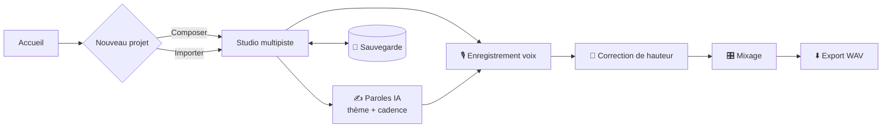
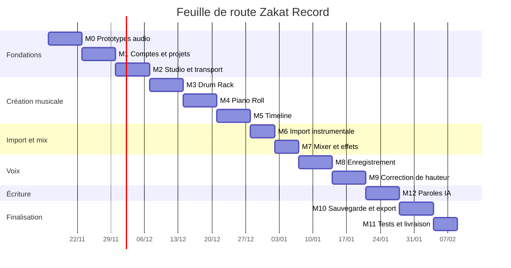
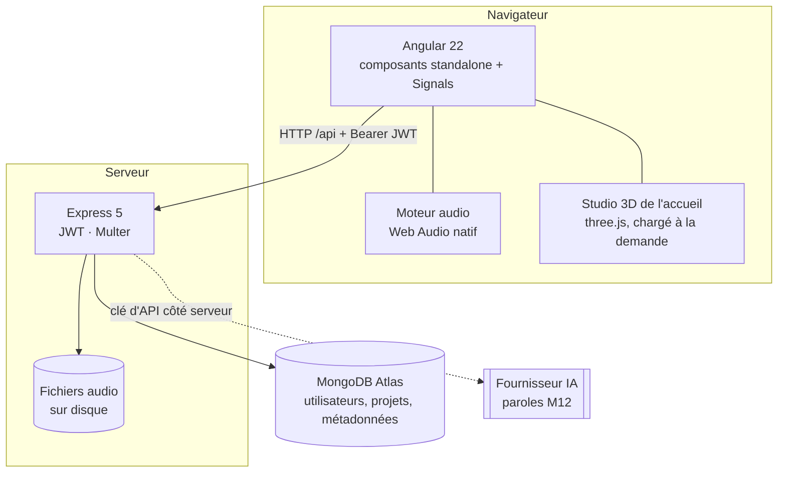
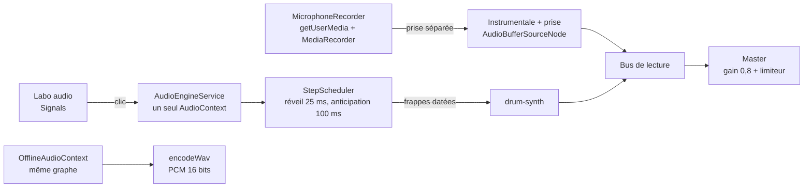

<div align="center">

# 🎚️ ZAKAT RECORD

### Le studio de production rap, directement dans le navigateur.

Composer une prod, importer une instrumentale, poser sa voix, la corriger, mixer et exporter — sans rien installer.


[](https://github.com/Zakary-213/AngularM1_Projet/actions/workflows/ci.yml)

</div>

---

## 📑 Sommaire

1. [Le projet](#-le-projet)
2. [Fonctionnalités](#-fonctionnalités)
3. [État d'avancement](#-état-davancement)
4. [Architecture](#-architecture)
5. [Structure du dépôt](#-structure-du-dépôt)
6. [Démarrage rapide](#-démarrage-rapide)
7. [Scripts disponibles](#-scripts-disponibles)
8. [Tests et qualité](#-tests-et-qualité)
9. [Contrat d'API](#contrat-dapi)
10. [Organisation du travail](#-organisation-du-travail)
11. [Contribuer](#-contribuer)
12. [Journal](#journal)

---

## 🎤 Le projet

**Zakat Record** est un projet de Master 1 MIAGE : une application web de **MAO (musique assistée par ordinateur)** pensée pour le rap. Le cahier des charges complet se trouve dans [MISSIONS_STUDIO_RAP_ANGULAR.md](MISSIONS_STUDIO_RAP_ANGULAR.md).

### Deux parcours, un seul studio

| 🎹 Créer une prod | 📥 Importer une prod |
|---|---|
| Partir d'un projet vide | Charger une instrumentale MP3 / WAV |
| Drums, 808, piano, synthés, samples | Visualiser la forme d'onde |
| Drum Rack 16 pas et Piano Roll | Régler le volume et l'égaliseur |
| Arranger les clips sur la timeline | Placer l'instru sur la timeline |

Les deux parcours ouvrent **le même éditeur multipiste**, puis convergent :



### Hors périmètre (V1)

Génération **audio** par IA (instrumentales), séparation de voix, clonage vocal et correction de hauteur **en direct** pendant la prise. La collaboration temps réel et la publication sont envisagées mais doivent d'abord être validées (voir [AGENTS.md](AGENTS.md)).

---

## ✨ Fonctionnalités

| Domaine | Fonctionnalité | Statut |
|---|---|---|
| Comptes | Inscription, connexion JWT, profil, photo de profil, déconnexion depuis l’en-tête | ✅ Fonctionnel |
| Fichiers audio | Upload multipart avec progression, liste paginée, lecture, suppression | ✅ Fonctionnel |
| Accueil | Visite 3D d'un studio au défilement : la caméra avance jusqu'au bureau (synthé, enceintes, écran) | ✅ Fonctionnel |
| Projets | Mes projets (créer « Créer / Importer une prod », ouvrir, renommer, supprimer, pagination), sauvegarde du studio avec état visible et conflits détectés | ✅ Fonctionnel (M1) |
| Interface | Pages Bibliothèque, Collaborations, Publications | 🎨 Maquette |
| Moteur audio | Branché dans `/studio` : séquenceur 16 pas au BPM choisi, 2e source synchronisée, prise micro, export WAV (Web Audio natif) | 🧪 Prototype M0 intégré |
| Studio | Lecture, pause, stop, position (mesure:temps:double-croche), tempo, métronome, enregistrement, pistes avec mute / solo / volume, zoom de la timeline ; ajout / renommage de pistes, sélection de position et sauvegarde restent à faire | 🚧 Partiel (M2) |
| Timeline | Se placer (clic, clavier), boucle, clips de batterie (déplacer, dupliquer, raccourcir, supprimer), instrumentale et prises déplaçables, Annuler / Rétablir, positions sauvegardées | ✅ Fonctionnel (M5) |
| Batterie | Drum Rack 16 pas, 6 instruments synthétisés (kick, snare, clap, hi-hat, percussion, 808 accordée sur la tonalité), 2 kits (boom bap, trap), préécoute, vélocité, bibliothèque de patterns, un pattern par clip de batterie | ✅ Fonctionnel (M3) |
| Composition | Piano Roll (ajouter, déplacer, redimensionner, supprimer des notes à la souris ou au clavier, accords), 3 instruments synthétisés (piano, synthé, basse 808 jouée par notes) avec brillance et relâchement, écoute en boucle d'un pattern, pistes Mélodie et Basse dans la timeline, le mixeur et l'export, notes MIDI sauvegardées | ✅ Fonctionnel (M4) |
| Import | Instrumentale MP3 / WAV envoyée dans vos fichiers audio, forme d'onde, égaliseur 3 bandes, retrouvée à la réouverture du projet | ✅ Fonctionnel (M6) |
| Mix | Mixeur : volume, mute, solo, panoramique, égaliseur 3 bandes, réverbération et delay par piste, volume Master, vumètres avec alerte « Saturation » ; appliqués à l'écoute et à l'export WAV, conservés à la sauvegarde | ✅ Fonctionnel (M7) |
| Voix | Prise micro (bouton ●) et onglet « Correction vocale » : 6 styles (Naturel, Rap, Trap, Drill, Raï, Robot) + dose d'effet, mode personnalisé (gamme, notes, humanisation, transposition, égaliseur), courbe de hauteur, calcul dans un Web Worker, version corrigée utilisable sur la piste Voix | 🚧 Partiel (M9) |
| Voix (studio) | Jusqu'à 8 prises sur la piste Voix (prise active, renommer, supprimer, décaler par 10 ms), choix du micro, indicateur de niveau et alerte de saturation, prises envoyées dans vos fichiers audio et retrouvées à la réouverture | ✅ Fonctionnel (M8) |
| ✍️ Paroles IA | Génération de couplets selon le thème et la cadence (BPM, mesures, flow), édition, prompteur synchronisé | ⏳ À faire (M12) |
| Livraison | Sauvegarde complète, export WAV, tests de bout en bout | ⏳ À faire (M10, M11) |

---

## 📈 État d'avancement



> Les dates sont indicatives. Le suivi réel se fait dans le **tableau Kanban GitHub** du dépôt (onglet *Projects*), avec une issue par mission.

---

## 🏗️ Architecture



| Couche | Technologies | Responsabilité |
|---|---|---|
| Frontend | Angular 22, TypeScript strict, Signals, Angular Material | Pages, état du studio, accessibilité |
| Moteur audio | Web Audio API native, MediaRecorder, OfflineAudioContext | Lecture synchronisée, instruments, enregistrement, export WAV |
| 3D | three.js 0.187 (MIT), chunk séparé | Hero interactif de la page d'accueil |
| Backend | Node.js, Express 5, Multer, bcryptjs, jsonwebtoken | API REST, droits, uploads |
| Données | MongoDB + Mongoose 9 | Utilisateurs, métadonnées des pistes et projets |
| Stockage audio | Disque serveur | Octets audio séparés des documents MongoDB |
| Paroles IA *(prévu)* | API d'un modèle de langage, appelée par le backend | Couplets selon thème et cadence, quotas par utilisateur |

**Principes clés :** une seule horloge audio pour toutes les pistes, données de projet sérialisables séparées des objets audio, projets privés par défaut, et vérification des droits côté serveur à chaque requête.

---

## 🗂️ Structure du dépôt

```text
.
├── frontend-starter/            # Application Angular
│   ├── src/app/
│   │   ├── components/          # Une page = un dossier (ts, html, css)
│   │   │   ├── home-page/       # Accueil + scène 3D (instrument-scene.ts)
│   │   │   ├── studio-page/     # Studio : transport, timeline, onglets d'édition
│   │   │   ├── drum-rack-panel/ # Séquenceur 16 pas du studio
│   │   │   ├── pitch-correction-panel/ # Correction vocale (chargée à la demande)
│   │   │   ├── export-panel/    # Export WAV du mix
│   │   │   ├── tracks-page/     # Fichiers audio : upload, lecture, suppression
│   │   │   └── ...
│   │   ├── shared/              # Services, guards, intercepteurs, modèles
│   │   │   └── audio/           # Moteur audio (horloge, séquenceur, micro, export WAV)
│   │   └── routes.ts            # Routes chargées à la demande
│   └── public/                  # Polices locales et licences
├── backend/                     # API Express
│   ├── src/app.js               # Routes et middlewares
│   ├── src/models/              # Schémas Mongoose (User, Track, MusicalProject)
│   └── test/                    # Tests node:test
├── .github/                     # CI, modèles d'issues et de PR, Dependabot
├── captures/                    # Captures de vérification
├── MISSIONS_STUDIO_RAP_ANGULAR.md  # Cahier des missions M0 → M11
└── AGENTS.md                    # Règles de développement communes
```

---

## 🚀 Démarrage rapide

### Prérequis

- **Node.js 22**, ou Node 24 en version **24.15 minimum** (la CLI Angular refuse les versions antérieures) ;
- une base **MongoDB** (Atlas gratuit ou locale) ;
- Git et un navigateur récent (Chrome, Firefox, Edge, Safari) avec WebGL.

### 1. Cloner

```bash
git clone https://github.com/Zakary-213/AngularM1_Projet.git
```

```bash
cd AngularM1_Projet
```

### 2. Backend

```bash
cd backend && cp .env.example .env
```

Renseigner dans `backend/.env` :

| Variable | Description |
|---|---|
| `MONGODB_URI` | URI de connexion MongoDB (Atlas ou locale) |
| `JWT_SECRET` | Secret long et aléatoire, propre à chaque poste |
| `PORT` | Port de l'API (`3000` par défaut) |

> ⚠️ Ne jamais committer `.env` ni copier un secret dans le code Angular.

#### Créer une base MongoDB Atlas

1. Dans un projet Atlas, ouvrir **Clusters** et créer un cluster **Free (M0)**. [Créer un cluster gratuit](https://www.mongodb.com/docs/atlas/tutorial/deploy-free-tier-cluster/)
2. Dans **Database Users**, créer un utilisateur de base de données avec un mot de passe. Dans **Specific Privileges**, lui attribuer le rôle `readWrite` sur la base du backend. Conserver son nom si elle existe déjà, ou choisir un nom comme `zakat-record` pour une nouvelle base. [Configurer un utilisateur de base de données](https://www.mongodb.com/docs/atlas/security-add-mongodb-users/)
3. Dans **IP Access List**, autoriser l’adresse IP publique du poste qui lance le backend. Lors de la création du cluster, **Add My Current IP Address** permet d’ajouter l’IP du poste courant. Mettre l’entrée à jour si l’IP change. [Autoriser une adresse IP](https://www.mongodb.com/docs/atlas/security/ip-access-list/)
4. Sur le cluster, ouvrir **Connect → Drivers → Node.js** et copier l’URI `mongodb+srv://` comme valeur de `MONGODB_URI` dans `backend/.env`. Renseigner les identifiants et le même nom de base qu’à l’étape 2, par exemple `…mongodb.net/zakat-record?…`, en gardant les options fournies par Atlas. [Récupérer l’URI](https://www.mongodb.com/docs/drivers/node/current/get-started/)

Dans l’URI, encoder les caractères réservés du mot de passe. Par exemple, `@` s’écrit `%40`. [Format des URI MongoDB](https://www.mongodb.com/docs/manual/reference/connection-string-formats/)

#### Lancer l’API

```bash
npm install && npm start
```

L'API écoute sur `http://localhost:3000`. Ouvrir [la route de vérification](http://localhost:3000/api/health) pour vérifier que le backend a démarré après la connexion à MongoDB.

### 3. Frontend

Dans un second terminal :

```bash
cd frontend-starter && npm install && npm start
```

Ouvrir **http://localhost:4200**. Le proxy (`proxy.conf.json`) redirige `/api` vers le backend.

Compte de démonstration : `demo@example.com` / `Demo1234!`.

---

## 🧰 Scripts disponibles

| Dossier | Commande | Effet |
|---|---|---|
| `frontend-starter/` | `npm start` | Serveur de développement avec proxy API |
| `frontend-starter/` | `npm test` | Tests unitaires Vitest (sans backend) |
| `frontend-starter/` | `npm run build` | Build de production dans `dist/` |
| `backend/` | `npm start` | API avec les variables de `.env` |
| `backend/` | `npm test` | Tests `node:test` |

---

## 🧪 Tests et qualité

- **Frontend** : Vitest + TestBed + `HttpTestingController`. Les requêtes HTTP, le micro et le Web Audio sont simulés : aucun backend ni MongoDB n'est nécessaire.
- **Backend** : `node:test` (santé de l'API, schémas Mongoose).
- **Avant chaque fusion** : `npm test` dans chaque partie modifiée, `npm run build` après un changement frontend, vérification au navigateur (console, onglet Network, largeurs 360 px / tablette / bureau).
- **Accessibilité** : HTML sémantique, focus visible, noms accessibles, respect de `prefers-reduced-motion`.

Dernier résultat connu : **217 / 217 tests frontend** et **33 / 33 tests backend** réussis, build OK (20 novembre 2026).

---

## Contrat d'API

Base : `/api`. Sauf inscription et connexion, envoyer `Authorization: Bearer <token>`. Toute route ajoutée ou modifiée doit être documentée ici (méthode, URL, authentification, paramètres, corps, réponses, erreurs).

| Méthode | Route | Requête | Réponse principale |
|---|---|---|---|
| GET | `/health` | - | `200 { "status": "ok" }` |
| POST | `/auth/register` | `{name,email,password}` | `201 {token,user}` |
| POST | `/auth/login` | `{email,password}` | `200 {token,user}` |
| GET | `/users/me` | JWT | `200 User` |
| PUT | `/users/me` | `{name}` + JWT | `200 User` |
| PUT | `/users/me/avatar` | multipart : `avatar` (JPEG, PNG ou WebP, 2 Mo max) + JWT | `200 User` |
| GET | `/users/me/avatar` | JWT | image (`Cache-Control: private, no-cache`) ou `404` sans photo |
| DELETE | `/users/me/avatar` | JWT | `204` |
| GET | `/tracks?page=1&limit=5` | JWT | `200 Page<Track>` |
| POST | `/tracks` | multipart : `audio`, `title` + JWT | `201 Track` |
| GET | `/tracks/:id/audio` | JWT | flux audio |
| DELETE | `/tracks/:id` | JWT (propriétaire) | `204` |

`User` contient `id`, `name`, `email`, `createdAt`, `hasAvatar` et `avatarUpdatedAt` ; le nom de stockage de la photo n'est jamais exposé. Photo de profil : le type annoncé **et** la signature binaire du fichier sont vérifiés (`400` sinon), `413` au-delà de 2 Mo, l'ancienne photo est supprimée après remplacement.

`Page<Track>` contient `items`, `page`, `limit`, `total` et `pages`. Formats audio acceptés : MP3, WAV, OGG, M4A et WebM (prises enregistrées par MediaRecorder), 25 Mo maximum. Erreurs courantes : `400` validation, `401` authentification, `404` ressource absente ou non autorisée, `409` email déjà utilisé.

### Projets musicaux (format v2, M1 #7, M10 #16)

Schéma : `backend/src/models/MusicalProject.js` ; routes : `backend/src/routes/projects.js`. Toutes les routes exigent le JWT.

| Méthode | Route | Requête | Réponse principale |
|---|---|---|---|
| GET | `/projects?page=1&limit=12` | JWT (`limit` 1 à 50, défaut 12) | `200 Page<ProjectSummary>`, du plus récemment modifié au plus ancien |
| POST | `/projects` | `{title, origin: "create"\|"import", bpm?, key?}` + JWT | `201 Project` (révision 0, format 2) |
| GET | `/projects/:id` | JWT (propriétaire) | `200 Project` |
| POST | `/projects/:id/lyrics/generate` | JWT (propriétaire), thème, réglages et `regenerate?` ci-dessous | `200 {bpm, timeSignature, key, targetSyllables, lines}` |
| PUT | `/projects/:id` | `{revision, title?, bpm?, key?, tracks?, patterns?, master?, vocal?, lyrics?}` + JWT | `200 Project` (révision + 1, réécrit au format 2) |
| PATCH | `/projects/:id` | `{title}` + JWT | `200 Project` (renommage, révision + 1) |
| DELETE | `/projects/:id` | JWT (propriétaire) | `204` (les fichiers `Track` référencés sont conservés) |

`ProjectSummary` : `id`, `title`, `origin`, `bpm`, `key`, `trackCount`, `formatVersion`, `createdAt`, `updatedAt`.

`Project` : `id`, `ownerId`, `formatVersion` (1 ou 2 : voir « Versions du format » ci-dessous), `title` (1 à 80 caractères), `origin`, `bpm` (60 à 200), `timeSignature` (4/4 seulement en V1), `key` (`root` 0 à 11 depuis do, `scale` `major`\|`minor`\|`harmonicMinor`\|`phrygianDominant`), `tracks[]` (16 max. ; `id` stable, `name`, `type` `drum`\|`instrument`\|`audio`\|`vocal`, `color`, `volumeDb` −36 à +6, `pan` −1 (gauche) à 1 (droite), `mute`, `solo`, `eq` {`lowDb`, `midDb`, `highDb`} −12 à +12 dB, `fx` {`reverb`, `delay`} (M7 : envois vers la réverbération et le delay partagés du mixeur, chacun {`enabled` booléen, `amount` 0 à 1} ; absents = effets désactivés, quantité 0,3), `activeClipId` facultatif (prise jouée, doit désigner un clip de la piste), `clips[]`), `patterns[]` (64 max. ; `id`, `name`, `kit` facultatif (`boomBap`\|`trap`, M3), `drumRows` : `voice` (`kick`\|`snare`\|`clap`\|`hihat`\|`perc`\|`bass808`), `steps` (16 booléens) et `velocities` facultatives (16 valeurs de 0 à 1, M3) ; pattern mélodique (M4) : `instrument` (`piano`\|`synth`\|`bass808`), `params` facultatifs {`tone` 0 à 1, `releaseSeconds` 0,02 à 2}, `bars` (1, 2 ou 4 ; 1 si absent), `notes[]` (512 max. : `pitch` entier MIDI 0 à 127, `startStep` entier ≥ 0 et `durationSteps` entier ≥ 1 en doubles-croches depuis le début du pattern, `velocity` 0 à 1) ; une note doit finir avant `bars × 16` pas et seul un pattern avec `instrument` porte des notes), `master.volume` (gain linéaire 0 à 1, 0,8 par défaut ; appliqué avant le limiteur de sécurité), `revision`, `createdAt`, `updatedAt`. Sur la piste Batterie, chaque clip joue le pattern en boucle de `startBeat` à `startBeat + durationBeats` (M5) ; une piste Batterie sans clip est silencieuse. Les pistes `melody` et `bass` (type `instrument`, M4) fonctionnent de même avec un pattern mélodique, qui boucle sur sa longueur à l'intérieur du clip ; les patterns de batterie et mélodiques partagent la limite de 64. Un clip a un `id` stable, un `label` facultatif (nom affiché, 120 caractères max.), `startBeat` et `durationBeats` (en temps, pour suivre les changements de BPM), `offsetSeconds` et **soit** `patternId`, **soit** `audioFileId` (référence d'une piste `Track`, jamais d'octets audio), plus `pitchCorrection` facultatif (`enabled`, `strength` 0 à 1, `retuneMs` 0 à 500, champ de M0 que le studio n'écrit pas) et, depuis le format 2, `correction` facultatif sur une prise (clip avec `audioFileId` seulement) : version corrigée de la prise {`audioFileId` (fichier `Track` dérivé, l'original reste `audioFileId` du clip), `styleLabel` (60 caractères max.), `enabled` (version corrigée jouée sur la piste Voix, à l'écoute et à l'export)}. `vocal` (format 2, facultatif) : correction vocale du projet (M9) {`styleId` `natural`\|`rap`\|`trap`\|`drill`\|`rai`\|`robot`, `dose` 0 à 1, `userStyleName` facultatif (doit être le nom d'un des `userStyles`), `custom` facultatif (réglages personnalisés), `userStyles[]` (12 max., noms uniques de 1 à 30 caractères : `name`, `basedOn` (un `styleId`), `settings`)}. Réglages (`custom`, `settings`) : `root` 0 à 11, `scale`, `allowedPitchClasses` (entiers 0 à 11 sans doublon), `strength` 0 à 1, `retuneMs` 0 à 300, `toleranceCents` 0 à 50, `transposeSemitones` entier −12 à 12, `eq` {`lowCutHz` 0 à 300, `bodyDb`, `presenceDb`, `airDb` −12 à 12}, `fx` {`reverbMix` 0 à 1, `reverbSeconds` 0,3 à 5, `delayMix` 0 à 1, `delayMs` 50 à 1000, `feedback` 0 à 0,8}.

Règles : `ownerId` vient du JWT, jamais du corps ; seuls `title`, `bpm`, `key`, `tracks`, `patterns`, `master`, `vocal` et `lyrics` sont copiés à la sauvegarde (liste blanche : `ownerId`, `origin`, `formatVersion`, `revision` envoyés sont ignorés) ; le document complet est validé avant écriture. Un `audioFileId` (prise, instrumentale **ou** `correction.audioFileId`) doit désigner un fichier `Track` de l'utilisateur authentifié, sinon la sauvegarde est refusée (`400 « Fichier audio inconnu ou non autorisé »`) : un projet ne peut pas servir à lire le fichier d'un autre compte. Aucun octet audio n'est accepté dans le JSON : les fichiers passent par `POST /tracks`. Erreurs : `400` validation, révision absente, fichier audio d'un autre compte ou JSON invalide ; `401` sans JWT ; `404` projet absent, identifiant mal formé **ou** projet d'un autre utilisateur ; `409 {message, revision}` si la révision envoyée n'est plus la révision actuelle (sauvegarde depuis un autre onglet : rien n'est écrasé) ; `413` corps JSON au-delà de 1 Mo ; `422` si le projet stocké a un `formatVersion` non pris en charge (il n'est pas réécrit).

**Versions du format.** 1 (M1 à M9) et 2 (M10 : `vocal` et `clips[].correction`, tous deux facultatifs). Le serveur relit les deux ; un projet v1 est renvoyé tel quel par `GET` et réécrit au format 2 par sa prochaine sauvegarde. Le studio lit un projet v1 avec les réglages de correction par défaut et, s'il n'a pas encore de styles personnels sauvegardés, reprend ceux que l'ancien studio gardait dans le navigateur (`localStorage`, clé `zakat.vocalStyles.v1`), à sauvegarder. Un projet d'une version supérieure n'est pas ouvert par le studio (message) et sa sauvegarde est refusée (`422`).

**Paroles sauvegardées M12 (#31).** Le format 2 accepte le champ facultatif `lyrics` dans `GET /projects/:id` et `PUT /projects/:id`. Il contient `{current, history}`. Chaque version contient `options` (thème et réglages ci-dessous), `bpm` (60 à 200), `targetSyllables` (entier de 1 à 64) et `lines` (un texte par mesure, jusqu’à 240 caractères par ligne, une ligne vide marque une pause). `history` garde jusqu’à cinq versions précédentes, de la plus ancienne à la plus récente. Si le champ est omis d’une sauvegarde, la version enregistrée est conservée. Le serveur calcule `lyricsAnalysis` pour la version courante dans la réponse `Project`. La sauvegarde et la lecture utilisent les droits, la révision et les erreurs habituelles du projet et ne consomment aucune tentative Groq. Les erreurs de sauvegarde des paroles ne journalisent pas le contenu.

**Génération de paroles M12 (#31).** `POST /projects/:id/lyrics/generate` attend un corps JSON avec un `theme` de 1 à 200 caractères après suppression des espaces en bordure. Les autres réglages sont facultatifs. La première valeur de chaque ligne est celle par défaut.

| Champ | Valeurs autorisées |
|---|---|
| `mood` | `neutral`, `dark`, `melancholic`, `egoTrip`, `festive` |
| `language` | `fr`, `en` |
| `structure` | `verse`, `chorus`, `bridge` |
| `measures` | `8`, `4`, `16` (entiers) |
| `flow` | `standard`, `relaxed`, `fast` |
| `rhymeScheme` | `AABB`, `ABAB`, `internal` |
| `languageLevel` | `standard`, `casual`, `formal` |

Pour une régénération partielle, ajouter `regenerate: {from, to, lines}`. Les bornes inclusives sont des numéros de mesure avec `1 ≤ from ≤ to ≤ measures`. Le tableau `lines` contient tout le texte courant selon les mêmes limites qu’à la sauvegarde. La plage hors bornes ou le nombre de lignes incorrect provoque un `400` avant l’appel à Groq. Seules les mesures hors plage sont envoyées comme contexte. Le serveur demande deux variantes par mesure en un appel, recalcule la longueur après ajout de la rime et accepte un écart maximal de deux syllabes estimées par rapport à la cible. Si aucune variante ne convient, il renvoie `502` et le studio garde le texte précédent. En cas de succès, la réponse renvoie le texte complet avec les mesures de la plage remplacées et leur analyse recalculée. Chaque demande envoyée à Groq utilise une tentative.

En AABB et ABAB, le serveur prépare deux paires de mots par bloc de quatre mesures. Pour les rimes internes, il prévoit un fragment qui contient deux mots rimant dans la même mesure. Il donne à Groq le nombre de syllabes à écrire avant chaque fin prévue. En régénération AABB ou ABAB, le vocabulaire sert d’abord à chercher une fin qui rime avec la mesure conservée. Si aucune fin compatible n’est disponible, Groq propose une fin à partir du contexte. Chaque demande utilise un seul appel.

Le serveur lit le BPM, la signature rythmique et la tonalité dans le projet enregistré. La cible `targetSyllables` correspond à la durée d’une mesure multipliée par la densité choisie, arrondie à l’entier le plus proche. Le serveur valide le nombre et l’ordre des mesures renvoyées par Groq. Il estime les syllabes et les rimes à partir du texte en français ou en anglais. Chaque entrée de `lines[]` contient `measure`, `text`, `syllables` et `rhyme` avec le groupe (`group`, `null` pour les rimes internes), les mots repérés (`words`) et le résultat estimé (`matches`). Le comptage dépend de la prononciation et les rimes sont approximées à partir des terminaisons. Les paroles sont renvoyées sans écriture dans le projet.

`GROQ_API_KEY` est lu depuis l’environnement du backend. Chaque compte dispose de cinq tentatives envoyées à Groq par jour UTC, tous ses projets confondus. Les erreurs retournées après un appel utilisent une tentative. Le compteur est enregistré dans MongoDB et la limite est vérifiée avant l’appel. Dans le processus API, le délai `Retry-After` annoncé par Groq s’applique à tous les comptes.

Le serveur bloque les demandes explicites d’imitation ou de copie qu’il reconnaît avant de consommer le quota. Groq reçoit aussi la consigne de refuser l’imitation d’un artiste réel, la reproduction de paroles existantes et la génération de textes haineux ou harcelants. Les formulations indirectes reposent sur le refus du modèle. Le serveur valide ce refus et renvoie un message invitant à choisir un thème original.

Groq reçoit le thème, les réglages de génération et le contexte musical nécessaire. Pour cette route, le journal HTTP conserve la méthode, le modèle d’URL, le statut et la durée. Les erreurs de génération y figurent sous forme de codes ou messages génériques, sans le corps des requêtes ni celui des réponses.

Erreurs possibles : `400` JSON, thème ou réglage invalide (le champ `field` identifie un réglage refusé), `401` sans JWT valide, `404` projet introuvable ou inaccessible, `413` corps trop volumineux, `422` demande de génération refusée ou version de projet non prise en charge, `429` quota journalier ou quota Groq, `500` erreur interne, `502` réponse indisponible ou invalide, `503` clé absente ou compteur indisponible, `504` délai dépassé. Pour un `429` avec délai connu, la réponse indique `retryAfterSeconds` et renseigne l’en-tête `Retry-After` en secondes.

**Sauvegarde côté studio.** Bouton 💾 ou Ctrl + S, et sauvegarde automatique (case à cocher, active par défaut) 2 s après la dernière modification : une série de réglages part en une seule requête `PUT`. Jamais pendant l'envoi d'un fichier ni après un `409` ; après un échec, pas de nouvel essai automatique avant une nouvelle modification.

---

## 📋 Organisation du travail

- **Kanban GitHub Projects** : colonnes *Backlog → À faire → En cours → En revue → Terminé*. Chaque mission M0 → M11 est une issue.
- **Labels** :
  - type : `feature`, `bug`, `docs`, `test`, `spike` (prototype technique), `design` ;
  - priorité : `priority: high`, `priority: medium`, `priority: low` ;
  - zone : `frontend`, `backend`, `audio`.
- **Branches** : une branche par issue (`feat/m3-drum-rack`, `fix/upload-progress`…), fusion par pull request.
- **Commits** : style conventionnel (`feat:`, `fix:`, `docs:`, `test:`, `refactor:`).
- Une mission n'est cochée dans le cahier qu'**après vérification** sur la version actuelle du code.

---

## 🤝 Contribuer

1. Lire [AGENTS.md](AGENTS.md) puis les `AGENTS.md` / `best-practices.md` de `frontend-starter/` et `backend/`.
2. Prendre une issue du Kanban et la passer *En cours*.
3. Créer une branche, développer, ajouter des tests utiles.
4. Lancer `npm test` et `npm run build`, vérifier au navigateur.
5. Ouvrir une pull request qui référence l'issue (`Closes #12`) et mettre à jour le journal ci-dessous.

---

## Journal

Choix techniques, fonctionnalités réalisées, tests exécutés et limites, mission par mission.

### M12 (#31) · Première étape de génération côté serveur

La route protégée `POST /api/projects/:id/lyrics/generate` utilise la clé Groq du serveur et reprend le tempo, la signature et la tonalité du projet enregistré. La première étape génère huit mesures à partir d’un thème. Le quota par utilisateur et le panneau Paroles seront traités dans la suite de la #31.

`npm test` dans `backend/` a réussi (48 tests). Une requête locale avec un projet de test en mémoire et un vrai appel Groq a renvoyé huit mesures numérotées à 90 BPM (`200`). Le même projet a renvoyé `401` sans JWT et `404` avec le JWT d’un autre compte.

**Validation des réglages.** Le backend accepte 4, 8 ou 16 mesures et une liste de choix pour chaque option. Le français est la langue par défaut et l’anglais est également disponible. La cible de syllabes varie avec la durée de la mesure et le flow choisi. `npm test` a réussi (50 tests). Sur un projet de test à 140 BPM, la route a refusé 12 mesures (`400`) et un appel réel à Groq a renvoyé 16 mesures (`200`).

**Réponse structurée.** Groq fournit les mesures numérotées et le texte. Le backend vérifie la structure, estime les syllabes à partir des mots et repère les rimes à partir des terminaisons. Les tests couvrent les lignes manquantes ou invalides, les comptes de syllabes et les schémas AABB, ABAB et internes. `npm test` a réussi (54 tests). Un appel réel à 90 BPM a renvoyé huit mesures, de 9 à 12 syllabes estimées pour une cible de 10. L’analyse a repéré deux des quatre paires de rimes demandées.

**Quota et erreurs de génération.** La limite est de cinq tentatives par utilisateur et par jour UTC, avec un compteur MongoDB commun aux projets. La réservation atomique précède l’appel au fournisseur. Les `429` avec `Retry-After` de Groq suspendent les nouveaux appels dans le processus API jusqu’au délai indiqué. `npm test` a réussi (57 tests). Avec le stockage et Groq simulés, sept demandes en parallèle sur deux projets d’un compte ont donné cinq réponses `200` et deux `429`. Les tests vérifient aussi la remise à zéro à minuit UTC, l’accès d’un autre compte, le délai de reprise Groq, une réponse invalide et le délai dépassé. Le compteur reste à éprouver sur une instance MongoDB de test.

**Demandes refusées.** Les formulations explicites testées sont bloquées avant l’appel et la réservation du quota. La réponse structurée de Groq distingue un refus sans paroles d’un couplet complet. `npm test` a réussi (60 tests), dont les demandes de copie, l’imitation et les thèmes originaux qui mentionnent un artiste. Sur un projet de test en mémoire, un appel réel a refusé une demande formulée « à la manière de » (`422`) et un autre a renvoyé huit mesures pour un thème original (`200`). Le refus des formulations indirectes dépend du modèle.

**Confidentialité des journaux.** Pour la génération de paroles, les logs HTTP utilisent la route type `/api/projects/:id/lyrics/generate` sans paramètres d’URL. Les erreurs ne journalisent pas les corps et les détails privés. Le test HTTP vérifie qu’un thème, des paroles, une clé factice et des détails d’erreur injectés restent hors des journaux lors d’une génération, d’un JSON invalide, d’un corps trop volumineux et de pannes. Le contrat d’API décrit les réglages, les réponses et les erreurs. `npm test` a réussi (61 tests).

### M12 (#31) · Paramètres et aperçu des paroles dans le studio

L’onglet Paroles est chargé à la demande dans le studio. Il permet de choisir le thème, l’ambiance, la langue, la structure, le nombre de mesures, la densité du flow, le schéma de rimes et le registre. Le panneau affiche le BPM, la signature et la tonalité du projet enregistré. Une modification du BPM ou de la tonalité doit être sauvegardée avant de générer. La proposition affiche les paroles par mesure avec les syllabes estimées, les indications de rime et la mention « Proposition générée par IA ».

Les 290 tests Angular et le build de production ont réussi. Dans Edge, un appel réel à Groq sur un projet de test a renvoyé huit mesures. Le formulaire et les paroles ont été vérifiés à 360, 768 et 1280 px. La proposition reste visible après un changement d’onglet ou une erreur de quota simulée.

### M12 (#31) · Édition, sauvegarde et prompteur

Chaque mesure peut être modifiée ou régénérée. Une régénération de bloc remplace uniquement la plage choisie et utilise les réglages de la version courante. Annuler restaure la version précédente parmi les cinq versions conservées. La sauvegarde habituelle du projet garde le texte et son historique. Après une édition manuelle, les syllabes et les rimes sont recalculées à la sauvegarde. Le prompteur prend la mesure courante depuis la tête de lecture du moteur Web Audio et affiche la ligne suivante en aperçu. Le texte commence à la mesure 1 du projet.

Les 63 tests backend, les 294 tests Angular et le build de production passent. Dans Edge, un projet de test avec stockage en mémoire a conservé le texte et son historique après rechargement. La régénération simulée d’une mesure puis d’un bloc a préservé les lignes hors sélection et une réponse `429` a laissé le texte en place. Le prompteur a suivi la lecture Web Audio et gardé sa mesure en pause. Le panneau tient à 360, 768 et 1280 px.

À 140 BPM, Groq a renvoyé 8 mesures de 6 à 7 syllabes estimées et 16 mesures de 5 à 8 pour une cible de 6. L’analyse a repéré respectivement 1 paire de rimes sur 4 et 2 sur 8. Une régénération réelle de la mesure 2 a conservé les sept autres. L’écoute et l’enregistrement au micro restent à essayer sur une prod.

**Rimes croisées.** Le panneau indique le schéma demandé et le nombre de paires repérées. Seules les rimes repérées sont surlignées. À 140 BPM, une génération Groq de huit mesures a donné quatre paires sur quatre, et la régénération ciblée de la mesure 4 a donné « jeu » pour rimer avec « feu » en conservant les trois autres lignes. Les deux derniers essais réels de 16 mesures ont renvoyé un refus du modèle et une erreur de format. Edge a affiché une paire sur deux pour le texte d’origine à 360, 768 et 1280 px. Les 68 tests backend, les 295 tests Angular et le build passent. Les formulations générées restent éditables.

**Vérification des trois modes.** Un même refrain festif original de huit mesures à 90 BPM, généré avec Groq, a donné 4 paires sur 4 en AABB, 4 sur 4 en ABAB et une rime interne dans 8 mesures sur 8. Pour une cible de 7, les deux schémas de fin de ligne ont donné 6 à 9 syllabes estimées, et le mode interne 4 à 6. Edge a confirmé les compteurs et le surlignage dans les trois modes avec le fournisseur simulé. Les 70 tests backend, les 296 tests Angular et le build final passent.

**Cadence à la régénération.** Le contrôle porte sur les lignes assemblées. Les 216 cas automatisés croisent les trois schémas de rimes, la ligne ou le bloc, les trois densités, le français et l’anglais, les formats de 4, 8 et 16 mesures et les tempos de 90 et 140 BPM. Les six essais Groq sur un refrain fictif à 90 BPM ont rendu de 5 à 9 syllabes estimées pour une cible de 7, avec les rimes repérées et les mesures hors plage conservées. Dans Edge, une mesure interne régénérée à partir d’une réponse simulée trop longue est revenue à 7 syllabes sur 7. Les 73 tests backend passent.

### Prototype de génération de paroles (#32)

L’essai compare [Gemini 3.1 Flash-Lite](https://aistudio.google.com/docs/models/gemini-3.1-flash-lite) et [GPT-OSS 20B sur Groq](https://console.groq.com/docs/model/openai/gpt-oss-20b) avec le même sujet fictif, « la nuit en ville ». Chaque commande fait deux demandes au fournisseur choisi, à 90 et à 140 BPM, avec 8 mesures, une cible fixe de 10 syllabes par mesure et des rimes par paires.

Groq a été choisi comme deuxième fournisseur à tester pour son [offre API gratuite](https://console.groq.com/docs/rate-limits). L’accès à l’API Mistral demande d’activer la facturation selon [sa documentation](https://docs.mistral.ai/admin/billing-usage/usage-limits).

Renseigner la clé du fournisseur dans `backend/.env`, puis lancer sa commande depuis la racine du dépôt.

```bash
node --env-file=backend/.env backend/scripts/compare-lyrics.mjs gemini
node --env-file=backend/.env backend/scripts/compare-lyrics.mjs groq
```

Pour relancer un seul essai, ajouter `90` ou `140` à la fin de la commande.

Le script vérifie les huit mesures numérotées, affiche le texte, le délai et les tokens consommés. Les syllabes annoncées viennent du modèle. Pour comparer les résultats, relire les lignes à voix haute, recompter les syllabes prononcées et noter l’écart moyen à la cible (la moyenne des écarts absolus sur les huit mesures). Relever aussi le français, les rimes et le coût d’après les tokens et le tarif du fournisseur.

**Premier essai Gemini** (un appel par tempo, depuis le poste de développement). Les deux réponses contenaient 8 mesures au bon format et des rimes par paires.

| Tempo | Délai | Tokens entrée / sortie | Syllabes recomptées, par mesure | Écart moyen à la cible |
|---|---:|---:|---|---:|
| 90 BPM | 2,19 s | 80 / 350 | 11, 11, 10, 10, 10, 10, 9, 11 | 0,50 syllabe |
| 140 BPM | 8,21 s | 81 / 331 | 9, 10, 8, 9, 10, 8, 10, 10 | 0,75 syllabe |

Le recomptage suit une prononciation naturelle, avec les `e` finaux muets. L’articulation en rappant peut faire varier le résultat. Aux [tarifs standard payants de Gemini](https://aistudio.google.com/docs/pricing#gemini-3.1-flash-lite), les tokens relevés représenteraient environ 0,00055 $ à 90 BPM et 0,00052 $ à 140 BPM. Une mesure par tempo donne un premier ordre de grandeur de la latence.

**Essais Groq.** La première demande à 90 BPM a reçu un HTTP 400. Les deux appels suivants à 90 BPM ont renvoyé huit mesures au bon format. Le motif du premier refus reste inconnu.

| Tempo | Délai | Tokens entrée / sortie | Syllabes recomptées, par mesure | Écart moyen à la cible |
|---|---:|---:|---|---:|
| 90 BPM, premier résultat | 0,69 s | 253 / 289 | 12, 12, 14, 13, 13, 15, 14, 15 | 3,50 syllabes |
| 90 BPM, deuxième résultat | 0,54 s | 253 / 316 | 12, 13, 14, 13, 14, 12, 12, 13 | 2,88 syllabes |
| 140 BPM | 0,60 s | 253 / 268 | 10, 10, 10, 10, 10, 10, 10, 10 | 0 syllabe |

Groq a annoncé 10 syllabes partout. À 90 BPM, le premier texte respecte deux paires de rimes sur quatre et répète « béton » dans la même mesure. Le deuxième texte respecte une paire sur quatre. À 140 BPM, le texte atteint la cible de syllabes et aucune des quatre paires demandées ne rime. Gemini fournit quatre paires aux deux tempos dans ces essais. Aux [tarifs de GPT-OSS 20B sur Groq](https://console.groq.com/docs/models), les tokens relevés représenteraient entre 0,00010 $ et 0,00011 $ par génération.

**Conditions et confidentialité.** Google demande d’utiliser ses services payants pour mettre un client de l’API Gemini à disposition d’utilisateurs dans l’EEE, dont la France. Dans ces services payants, Google indique que les consignes et réponses ne servent pas à améliorer ses produits. Groq autorise l’intégration dans une application et indique conserver les métadonnées d’usage, avec une conservation possible des entrées et sorties dans certains cas, notamment pour la fiabilité et la prévention des abus. Le prototype envoie uniquement un sujet fictif et des paramètres musicaux. [Conditions Gemini](https://aistudio.google.com/docs/terms#use-restrictions) · [Conditions Groq](https://console.groq.com/docs/legal/services-agreement) · [Traitement des données par Groq](https://console.groq.com/docs/your-data)

**Choix pour la #31.** Groq en offre gratuite, avec un budget de **0 € par mois**. À épuisement du quota gratuit, le studio affichera un message et suspendra les générations jusqu’au renouvellement du quota. Le faible nombre d’appels donne un premier aperçu. L’intégration devra traiter les erreurs et vérifier la cadence et les rimes avant de présenter le résultat comme conforme à la consigne.

**Quota initial.** Cinq tentatives de génération par jour UTC et par utilisateur connecté, régénérations comprises, dans la limite globale du compte Groq. L’API renvoie un message quand l’un des quotas est atteint. [Limites de l’offre gratuite Groq](https://console.groq.com/docs/rate-limits)

### 22 novembre 2026 — M10 : sauvegarde complète et export ; fin de la M9 (#16, #15)

- **Inventaire de départ** (code relu avant de cocher) : la sauvegarde v1 couvrait déjà pistes, BPM, tonalité, patterns de batterie et du Piano Roll, notes, clips, mixeur M7 et Master, instrumentale et prises (références de fichiers) avec états visibles, révision et refus des conflits (`409`) ; l'export WAV existait mais seulement sur 1 à 8 mesures. Manquaient la sauvegarde automatique, la correction vocale (réglages, styles personnels gardés dans le navigateur, version corrigée perdue à la fermeture) et l'export du morceau entier.
- **Format v2** (`MusicalProject.js`, `project-mapping.ts`) : section `vocal` (style, dose, réglages personnalisés, styles personnels) et `clips[].correction` (version corrigée de la prise, fichier dérivé ; l'original reste référencé). Serveur : validation de chaque champ (bornes identiques au studio, noms uniques, style choisi présent, correction seulement sur une prise audio), fichier corrigé contrôlé comme les autres (`400` s'il appartient à un autre compte), relecture des projets v1 et réécriture en v2 à la sauvegarde. Studio : relecture tolérante (valeurs abîmées bornées, styles invalides ignorés) dans `pitch/voice-correction-state.ts`, logique pure testée.
- **Migration des styles personnels** : un projet sans styles sauvegardés reprend ceux du `localStorage` (ancienne clé) et devient « Modifications non sauvegardées » ; dans la session libre, les styles restent dans le navigateur. Les réglages de correction vivent maintenant dans `StudioSessionService` : ils ne sont plus perdus en changeant d'onglet.
- **Version corrigée** : « Utiliser la version corrigée sur la piste Voix » l'envoie en WAV mono dans la bibliothèque (progression, erreur, « Réessayer » ; la sauvegarde attend la fin de l'envoi) ; à l'ouverture, elle est récupérée et rejouée. **Correction de hauteur : activée / désactivée** dans la tranche Voix du mixeur (libellé sans la marque « Auto-Tune »), sauvegardée.
- **Sauvegarde automatique** (`StudioProjectService`) : un `effect` relancé à chaque modification programme la sauvegarde 2 s après la dernière ; jamais pendant un envoi de fichier ou un conflit ; après un échec, attente d'une nouvelle modification (pas de boucle). Case « Sauvegarde automatique » ; libellés « Modifications non sauvegardées · sauvegarde automatique dans un instant / Sauvegarde en cours / Sauvegardé · révision n / Erreur : la sauvegarde a échoué / Conflit ».
- **Export du morceau entier** (`song-length.ts`, `offline-render.ts`) : durée = fin du dernier clip de pattern ou du dernier fichier joué (instrumentale, prise active), + 2 s de traîne si une réverbération ou un delay est actif, 10 min maximum (au-delà, coupé et signalé) ; « rien à exporter » si la timeline est vide. Progression par `OfflineAudioContext.suspend()` (Chrome, Safari) ; Firefox n'affiche que « Rendu en cours ». Nom de fichier tiré du titre du projet. **MP3 non proposé** : aucun navigateur ne l'encode nativement et les encodeurs JavaScript (LGPL, plus de 100 Ko) n'ont pas été ajoutés ; limite affichée dans le panneau.

**Vérifications** : backend `npm test` 44/44 (6 nouveaux : réglages de correction valides et hors bornes, styles en double, style choisi absent, correction sur un clip de pattern ou sans fichier, aller-retour HTTP de `vocal` et `correction`, fichier corrigé d'un autre compte refusé, projet v1 relu puis réécrit en v2) ; frontend `npm test` 284/284 (20 nouveaux : 11 dans `m10-save-export.spec.ts` — durée du morceau, nom de fichier, relecture et migration de la correction vocale, version corrigée de la prise active — et 9 de `StudioProjectService` : sauvegarde automatique regroupée, aucun envoi sans modification, pendant un conflit ou désactivée, pas de boucle après échec, correction vocale sauvegardée et relue, migration du `localStorage`, envoi et relecture de la version corrigée, échec d'envoi puis nouvel essai) ; `npm run build` réussi. **Navigateur intégré** (`ng serve` + API Express sur la base MongoDB de développement, compte de démonstration, projet « Test M10 sauvegarde ») : un clic dans le Drum Rack sauvegardé automatiquement (révision 0 → 1) ; instrumentale importée par le champ fichier, prise enregistrée avec le bouton ● (micro remplacé dans la page par un oscillateur à 230 Hz, le pane n'ayant pas de micro), BPM 100, clip de batterie déplacé en mesures 13 à 20, pan, volume, égaliseur, réverbération, delay et Master réglés par l'interface, style Trap calculé (écart moyen 77 → 0 cents) et placé sur la piste Voix, style personnel « Refrain test » enregistré. Après rechargement complet : « Sauvegardé · révision 9 » sans modification fantôme, BPM, clips, mixeur, prise, instrumentale, style personnel, réglages avancés et « Correction de hauteur : activée (Trap) » retrouvés ; rien d'écrit dans le `localStorage`. Export intercepté dans la page et analysé : 50,0 s (20 mesures à 100 BPM + 2 s de traîne), 8 820 044 octets, progression 0 à 95 % puis « Fichier téléchargé » ; voix à 220 Hz avec la correction (énergie 0,085 contre 0,0003 à 230 Hz) et à 230 Hz une fois la correction désactivée dans le mixeur (0,065 contre 0,0002) ; aigus de la batterie absents avant la mesure 13 et présents après. Calcul de correction sur un extrait de 60 s (1,3 s) annulé à 0,3 s : aucune nouvelle version, interface libre. Deux onglets : le second sauvegarde, le premier affiche « Conflit » et n'écrase rien (`409`). 360 px : panneau Export sans débordement horizontal. **Non vérifiés** : le rendu à l'oreille, une vraie prise au micro, un projet v1 réel ouvert dans le navigateur (couvert par les tests), Firefox et Safari, le zoom à 200 %.
- **Limites** : une seule version corrigée par projet, celle de la prise active (changer de prise active l'abandonne ; son fichier reste dans « Fichiers audio ») ; chaque « Mettre à jour avec ce réglage » envoie un nouveau fichier, l'ancien reste dans la bibliothèque (pas de nettoyage automatique des fichiers orphelins) ; la sauvegarde envoie encore le projet complet (regroupée, pas de modifications partielles) ; export limité à 10 min et en WAV seulement.

### 22 novembre 2026 — Vérifications de l’accueil 3D (#4)

- Sur petit écran, les boutons de 44 px affichent les noms des trois étapes. La scène suit la hauteur visible du navigateur. En portrait, l’objectif s’élargit sur le trajet de caméra d’origine. Le plan « La session » cadre l’écran entier, avec un nom « Zakat Record » agrandi. Le numéro et le sous-titre de l’étape sont plus grands et ombrés. Sur un écran peu haut, les titres et les espacements s’adaptent pour garder les commandes visibles.
- Le changement d’étape annonce son titre et sa légende. Avec les animations réduites, la caméra suit directement le défilement et les changements d’étape se font sans transition. Les boutons permettent aussi de parcourir les légendes lorsque WebGL est indisponible.
- Au navigateur intégré, les trois étapes ont été parcourues à 360 × 800 px sans débordement horizontal ni espace sous la scène. À 640 × 400 px, les trois boutons, la légende finale, le lien vers le studio et la commande de son tenaient dans la fenêtre. La navigation clavier et les attributs d’accessibilité ont été vérifiés. Le comportement JavaScript en animations réduites a été testé avec une préférence simulée.
- Sur ordinateur à 1280 × 800 px, onglet visible, les rappels de rendu ont été mesurés à 145–147 images/s sur des fenêtres de 3 s. Le premier rendu est intervenu entre 1,02 et 1,14 s après deux navigations locales. La création du décor et des textures a pris 453 ms sur le premier essai.
- `npm test` a réussi (264/264) ainsi que `npm run build`.
- Le test sur téléphone réel a permis d’ajuster le cadrage, la hauteur de la scène et la lisibilité du sous-titre. L’auteur a confirmé le rendu et donné un retour favorable sur la checklist après les essais sur téléphone et sur PC avec le Narrateur Windows. Le modèle du téléphone et les versions des navigateurs n’ont pas été relevés.

### 21 novembre 2026 — M7 : mixeur, égaliseur et effets (#13)

- **Un seul graphe de mixage** (`shared/audio/mixer-graph.ts`) construit à l'identique pour l'écoute (`AudioContext`) et l'export (`OfflineAudioContext`) : par piste, égaliseur 3 bandes → fader (volume, mute, solo) → panoramique (`StereoPannerNode`) → Master, avec deux **envois post-fader** vers une **réverbération** et un **delay partagés** (2 effets au lieu de 10 ; une piste muette n'alimente plus les effets). Master : volume puis limiteur de sécurité. L'ancien égaliseur porté par le clip instrumental à l'export disparaît : l'égaliseur est désormais sur chaque piste, partout.
- **Effets factorisés** avec la voix corrigée (`pitch/voice-fx.ts` : `createReverbConvolver`, `createEchoLoop`) : réverbération synthétisée (bruit à décroissance exponentielle, 1,8 s, aucun fichier sous licence), delay en croche pointée calé sur le BPM (recalé si le tempo change), répétitions assombries, réinjection 0,35.
- **Logique pure et testée** (`track-mix.ts`, `level-meter.ts`) : bornes du pan, des envois et du Master, conversion Master dB ↔ linéaire, relecture tolérante des réglages, échelle du vumètre (−48 à 0 dBFS), maintien 1,5 s de l'alerte de saturation.
- **Vumètres** par piste et Master : deux `AnalyserNode` par tranche (gauche et droite, pour ne pas sous-estimer un son panoramiqué), Master mesuré **avant** le limiteur (sinon les dépassements seraient masqués). Dessinés par `requestAnimationFrame` en modifiant directement le style de la barre : aucun rendu Angular par image ; seule l'alerte « Saturation » (texte dans une région `role="status"`, pas seulement une couleur) passe par un signal, écrit quand l'ensemble des pistes saturées change.
- **Interface** (`mixer-panel`) : 5 tranches + Master, curseurs avec nom accessible (« Volume : Basse », « Panoramique : Voix principale »…) et valeur lue (`aria-valuetext` : « 35 % à droite », « −6,0 dB »), égaliseur repliable, cases Réverbération / Delay avec quantité, double-clic sur le pan = centre ; une colonne à 360 px sans débordement.
- **Sauvegarde** : `pan`, `eq` (toutes les pistes), `fx` et `master.volume` dans le format v1 (pas de nouvelle version : champs facultatifs). Le serveur valide pan −1 à 1, quantités 0 à 1, Master 0 à 1 ; un projet antérieur s'ouvre avec un mix neutre (pan centré, effets coupés, Master 0,8).
- **Limites** : les effets sont partagés (un seul réglage de durée de réverbération et de temps de delay pour tout le morceau) ; le retour d'effets suit le panoramique de la piste (une piste à gauche a sa réverbération à gauche) ; la traîne des effets est coupée à la fin de l'export ; pas d'automatisation des réglages dans le temps ; l'arrêt coupe aussi la traîne en cours.

**Vérifications** : frontend `npm test` 264/264 (dont `m7-mixer.spec.ts` et 3 tests de sérialisation M7 : aller-retour, projet antérieur neutre, valeurs abîmées bornées) ; backend `npm test` 38/38 (2 nouveaux : défauts neutres et valeurs valides, pan / envoi / Master hors bornes refusés) ; `npm run build` réussi. Navigateur intégré (`ng serve`) : vumètres animés pendant la lecture (batterie et Master), « Saturation » affiché sur la Batterie et le Master avec la batterie à +6 dB et le Master à 0 dB ; export WAV intercepté dans la page et analysé : batterie panoramiquée à gauche → canal droit à 0, réverbération + delay activés → RMS 0,1205 au lieu de 0,1091 sans effets, batterie centrée et Master à −12 dB → 0,0248 par canal (valeur attendue par le calcul). Sauvegarde puis rechargement avec les vraies routes Express et la validation Mongoose (MongoDB remplacé par un stockage en mémoire, script hors dépôt) : volume et pan de la voix, graves de la basse, réverbération et delay, Master −6 dB retrouvés, état « Sauvegardé » sans modification fantôme ; `pan` 3 envoyé directement → `400`. **Non vérifiés** : le rendu à l'oreille (pas de sortie audio écoutée), le zoom à 200 %, une tablette ; dans le pane du navigateur masqué, `requestAnimationFrame` était suspendu et a été remplacé temporairement dans la page pour l'inspection.

### 21 novembre 2026 — M4 : Piano Roll et instruments (#10)

- **Instruments** (`shared/audio/instrument-synth.ts`) : piano (partiels harmoniques, attaque franche, son qui s'éteint), synthé (deux dents de scie désaccordées de ± 8 cents, filtre passe-bas, son tenu), **basse 808 jouée par notes** (sinus avec glissement d'attaque et saturation, réutilisée du Drum Rack). Tout est **synthétisé** (aucun sample, aucune licence) et accepte un `BaseAudioContext` : le même code sert à l'écoute et à l'export. Chaque note crée ses propres nœuds : polyphonie sans limite d'instrument. Réglages par pattern : **brillance** (ouverture du filtre ; saturation pour la 808) et **relâchement**.
- **Données** (`melodic-pattern.ts`, `note-scheduling.ts`, logique pure et testée) : notes de type MIDI (hauteur, début et durée en doubles-croches, vélocité), patterns de 1, 2 ou 4 mesures, bornes (tessiture de l'instrument, fin du pattern, 512 notes), pas de chevauchement de deux notes de même hauteur. Changer d'instrument transpose les notes par octaves dans sa tessiture (piano/synthé do3–si5, 808 do1–si2).
- **Piano Roll** (composant `piano-roll-panel`, onglet chargé à la demande) : hauteurs en vertical (aigus en haut, clavier figé à gauche qui fait entendre chaque note), temps en horizontal (traits de pas, temps et mesure). Clic = poser une note de la longueur choisie (entendue aussitôt) ; glisser = déplacer, poignée droite = allonger. **Alternative clavier** : formulaire « Ajouter la note » (hauteur, mesure, pas) et, sur une note, ←/→ (Ctrl : un temps), ↑/↓ (Ctrl : octave), Maj + ←/→ pour la longueur, + / − pour la vélocité, Suppr ; barre « Note sélectionnée » avec les mêmes actions en boutons. Bibliothèque : nouveau, dupliquer, renommer, supprimer (refusé si un clip le joue ou pour le dernier).
- **Lecture** : « Écouter en boucle » joue le pattern affiché seul sur sa piste, en boucle sur sa longueur, avec la batterie ; les notes sont datées par le même `StepScheduler` que la batterie (horloge `AudioContext`), et une modification s'entend au passage suivant. Tête de lecture dans la grille.
- **Arrangement et mix** : deux pistes **Mélodie** et **Basse** dans la timeline (clips placés par « Placer sur la piste », déplacés, allongés, dupliqués, supprimés, pattern changé, Annuler / Rétablir, clavier comme la batterie), dans le **mixeur** (volume, mute, solo) et dans l'**export WAV**.
- **Sauvegarde** : patterns mélodiques dans `patterns[]` (`instrument`, `params`, `bars`, `notes`), clips dans les pistes `melody` / `bass` ; le serveur valide instrument, bornes des réglages, notes entières et contenues dans le pattern. Un projet antérieur reçoit une mélodie au piano et une basse 808 vides.
- **Limites** : une seule note de même hauteur à la fois ; pas de saisie au clavier MIDI ni d'enregistrement en temps réel ; pas de quantification ou de sélection multiple ; l'édition des notes n'est pas annulable (seuls les clips le sont) ; l'écoute seule d'un pattern n'est pas exportée.

**Vérifications** : frontend `npm test` 251/251 (conversions et noms de notes, ajout, chevauchement, bornes, déplacement, redimensionnement, vélocité, raccourcissement du pattern, changement d'instrument, case visée par le pointeur ; notes programmées par clip, boucle dans le clip, coupure en fin de clip, écoute seule ; enveloppe et filtre ; session : édition, suppression refusée, clips annulables, limite partagée ; sérialisation aller-retour, projets antérieurs, données invalides) ; backend `npm test` 36/36 (pattern mélodique valide, instrument, longueur et réglages refusés, notes non entières, hors bornes, hors du pattern ou sans instrument, 513 notes, pistes d'instruments) ; `npm run build` réussi (Piano Roll en chunk à la demande, 6,6 ko transférés). Navigateur intégré (`ng serve` + vrai backend Express, MongoDB remplacé par un stockage en mémoire) : accord posé au clic, note déplacée au clavier (5 demi-tons) et allongée (Maj + →), note glissée (2 pas, 1 demi-ton), allongée par sa poignée, ajoutée par le formulaire, supprimée par Suppr ; écoute en boucle (accord programmé à la même date audio que le kick, retour à la mesure 1 après 2 mesures) ; basse 808 composée et placée ; clip de mélodie déplacé au clavier, annulé, dupliqué ; export de 4 mesures : solo Mélodie −5,8 dBFS (piano), −7,8 dBFS (synthé, 12 oscillateurs en dents de scie = 6 notes × 2), solo Basse −6,6 dBFS, tout muet → silence ; sauvegarde puis rechargement (notes, instrument, clips retrouvés, état « Sauvegardé ») ; note à `pitch` 200 envoyée directement → refusée par le serveur ; 360 px sans débordement (Piano Roll et mixeur à 5 pistes). Un conflit avec les classes globales `.grid` / `.row` a été trouvé et corrigé. **Non vérifiés** : la qualité des sons et la synchronisation à l'oreille (pane du navigateur sans sortie audio écoutée), le glisser au doigt sur un écran tactile, le zoom à 200 %.

### 20 novembre 2026 — M3, partie 2 : nouveaux sons, kits et préécoute (#9)

- **Bibliothèque de sons** : clap (trois rafales de bruit filtré rapprochées, puis une queue), percussion (tom court qui descend), 808 (sinus grave avec glissement d'attaque et saturation douce pour rester audible sur de petites enceintes) s'ajoutent au kick, à la snare et au hi-hat. Tout est **synthétisé en code** : aucun sample téléchargé ni distribué, donc aucune licence à vérifier ; le même code joue à l'écoute et à l'export.
- **808 accordée** : elle joue la fondamentale de la tonalité du projet à l'octave 1 (do1 = 32,7 Hz à si1 = 61,7 Hz ; la mineur → 55 Hz), affichée dans le Drum Rack (« 808 (La) »).
- **Kits** : chaque pattern choisit son kit. *Boom bap* : kick rond, hi-hat plus doux, 808 courte ; *Trap* : kick plus sec et plus haut, hi-hat plus brillant et plus court, 808 longue. Le kit est copié à la duplication d'un pattern.
- **Préécoute** : ▶ devant chaque instrument le joue immédiatement avec le kit du pattern affiché (le contexte audio démarre au clic).
- **Format** : `kit` facultatif par pattern et trois nouveaux instruments acceptés par le serveur ; les projets antérieurs ont des lignes vides pour ces instruments et le kit boom bap.
- **Limites** : la 808 joue une seule note (pas de mélodie de basse : Piano Roll en M4) ; deux kits seulement ; pas de sample importé par l'utilisateur.

**Vérifications** : backend `npm test` 33/33 (nouveaux instruments, kit facultatif, valeurs refusées) ; frontend `npm test` 217/217 (six instruments, kit copié à la duplication, 808 à 55 Hz en la et 32,7 Hz en do, projets antérieurs) ; `npm run build` réussi. Navigateur (Chromium) : préécoute des six instruments sans erreur ; export d'une mesure analysé (énergie sous ~120 Hz) : 0,071 sans 808, 0,113 avec la 808 sur les pas 1 et 9, 0,140 en kit Trap (808 plus longue) ; 360 px sans débordement, console sans erreur. **Non vérifié** : le rendu à l'oreille et sur de petites enceintes.

### 20 novembre 2026 — M3, partie 1 : patterns et vélocité (#9)

- **Vélocité** : chaque pas porte la force de la frappe (0 à 1). Un clic fait passer une case de vide à forte (1), moyenne (0,7), douce (0,4) puis vide ; la hauteur de la barre et le nom accessible (« Kick, pas 5, frappe moyen ») indiquent le niveau, pas seulement la couleur. La vélocité règle un gain par frappe dans le synthé : même rendu à l'écoute et à l'export. Le rythme de départ a des hi-hats plus doux en contretemps.
- **Déplacer des frappes** : ◀ ▶ par instrument décalent toute la ligne d'un pas (les frappes qui sortent reviennent de l'autre côté de la mesure).
- **Bibliothèque de patterns** : choisir le pattern affiché, en créer un vide, le dupliquer (variante de refrain), le renommer, le supprimer. Un pattern joué par un clip, ou le dernier pattern, ne peut pas être supprimé (message explicatif). 64 patterns au plus (limite du format).
- **Arrangement** : chaque clip de batterie joue son propre pattern (`patternId`), choisi dans la barre d'édition du clip (changement annulable) ; le nom du pattern s'affiche sur le clip. Un nouveau clip prend le pattern affiché dans le Drum Rack. En cas de chevauchement, le clip commencé le plus tard l'emporte.
- **Sauvegarde** : tous les patterns sont sauvegardés, avec `steps` (booléens, lisibles par les versions antérieures) et `velocities` (nouveau champ facultatif validé par le serveur : 16 valeurs de 0 à 1). Un projet antérieur sans vélocités lit ses frappes comme fortes ; un clip qui référence un pattern disparu joue le premier pattern.
- **Limites** : la modification des cases n'est pas annulable (seul l'arrangement l'est) ; toujours trois instruments (clap, percussions et 808 dans la partie 2).

**Vérifications** : backend `npm test` 32/32 (vélocités facultatives et bornées) ; frontend `npm test` 215/215 (cycle de vélocité, bornes, décalage circulaire, frappes avec leur force, noms des patterns ; bibliothèque dans la session : création, édition du seul pattern affiché, duplication, renommage, suppressions refusées, pattern par clip et annulation, limite de 64 ; conversion du format avec plusieurs patterns, projets antérieurs, pattern disparu) ; `npm run build` réussi. Navigateur (Chromium, `npm start` + vrai backend Express avec stockage en mémoire) : pattern « Refrain » créé et renommé, frappes forte / moyenne / douce, ligne de kick décalée, clip dupliqué jouant « Refrain », suppression d'un pattern utilisé refusée avec message, lecture, sauvegarde puis rechargement (patterns, vélocités et pattern de chaque clip retrouvés), 360 px sans débordement, console sans erreur. Deux boutons portaient le même nom « Dupliquer » (pattern et clip) : noms accessibles distincts ajoutés. **Non vérifié** : la différence de force à l'oreille.

### 20 novembre 2026 — M5, partie 2 : clips et arrangement (#11)

- **Clips de batterie** : la piste Batterie devient une liste de clips (début et longueur en mesures) dans lesquels le pattern d'une mesure joue en boucle ; hors des clips, la batterie se tait, à l'écoute comme à l'export (vérifié sur le WAV : mesure 1 silencieuse quand le clip commence à la mesure 2). Arrangement par défaut : 8 mesures. Les projets enregistrés avant la M5 (pattern en boucle sans fin) reçoivent cet arrangement par défaut ; une piste vidée reste vide.
- **Édition** : chaque clip est un bouton. Clic = sélection (sans déplacer la tête de lecture) ; glisser à la souris, au doigt ou au stylet (Pointer Events, aperçu calé sur la grille, seuil de 4 px pour distinguer clic et glissement) ; au clavier : flèches pour déplacer (batterie : une mesure ; instrumentale et prise : un temps, Maj : une mesure), Suppr pour supprimer un clip de batterie, Ctrl/Cmd + D pour le dupliquer, Échap. Barre d'édition équivalente pour le clip sélectionné : plus tôt / plus tard, − / + 1 mesure, dupliquer (copie placée juste après, pour enchaîner intro, couplet, refrain), supprimer, et « ＋ Clip de batterie » à la tête de lecture.
- **Instrumentale** : position de départ en temps (suit les changements de BPM, reste sur la mesure) ; **prises** : position en secondes, déplaçables par temps en plus du décalage de ±10 ms de M8.
- **Annuler / Rétablir** : historique des 50 derniers états de l'arrangement (clips, début de l'instrumentale, positions des prises — jamais l'audio), boutons et Ctrl/Cmd + Z, Ctrl/Cmd + Maj + Z ou Ctrl + Y, laissés aux champs de saisie qui ont le focus. Une modification sans effet (borne atteinte) n'entre pas dans l'historique ; l'ouverture d'un projet le vide. Une modification pendant la lecture relance la lecture à la même position pour l'entendre aussitôt.
- **Sauvegarde** : clips de batterie (`startBeat`, `durationBeats`, `patternId`), début de l'instrumentale et positions des prises dans le format v1 existant, sans changement côté serveur.
- **Limites** : un seul pattern (plusieurs patterns en M3) ; pas de découpe ni de raccourcissement des clips audio ; une seule prise visible et jouée sur la piste Voix ; l'export garde un nombre de mesures choisi (export du morceau entier en M10).

**Vérifications** : frontend `npm test` 202/202 (clips de batterie : activité par mesure, déplacement, longueur, duplication, ajout, suppression ; historique ; placement à l'écran et glissement ; arrangement dans la session : annuler / rétablir, modifications sans effet, instrumentale en temps, prise déplacée puis annulée, historique vidé à l'ouverture ; conversion du format et projets antérieurs) ; `npm run build` réussi. Navigateur (Chromium, `npm start` + vrai backend Express avec stockage en mémoire) : glisser de 2 mesures, flèche gauche, dupliquer, raccourcir, Suppr, Ctrl+Z, Ctrl+Maj+Z, instrumentale avancée d'une mesure au clavier, lecture, export WAV (batterie absente de la mesure 1 quand le clip commence à la mesure 2), sauvegarde puis rechargement (arrangement retrouvé, historique vide), 360 px sans débordement, console sans erreur. **Non vérifiés** : le glisser au doigt sur un vrai écran tactile et l'écoute au casque.

### 20 novembre 2026 — M5, partie 1 : se placer dans le morceau et boucle (#46, #11)

- **Se placer** : clic sur la règle ou sur une piste → tête de lecture au temps le plus proche (calée sur la grille). En lecture, la lecture repart de là ; à l'arrêt, la position est gardée pour le prochain ▶ (■ revient au début). La règle est un curseur accessible (`role="slider"`, position annoncée « mesure 3, temps 2 ») : flèches = un temps, Page précédente / suivante = une mesure, Début, Fin (fin de l'instrumentale ou de la dernière prise). Les touches n'agissent que lorsque la règle a le focus : aucun conflit avec la saisie.
- **Boucle** : case « Boucle » et plage « de la mesure … à … » (bornes incluses, validées avec message). Le séquenceur revient au début de la plage sur l'horloge audio, sans interruption ; à chaque tour, l'instrumentale et la prise sont reprogrammées à la date exacte du pas et arrêtées en fin de plage. Bande hachurée sur la règle et les pistes. Une lecture démarrée hors de la plage commence au début de la boucle ; changer la boucle pendant la lecture l'applique aussitôt. La boucle est ignorée pendant un enregistrement (la prise doit suivre le morceau) et n'est pas sauvegardée avec le projet (réglage d'écoute).
- **Limites** : la fenêtre visible commence toujours à la mesure 1 (dézoomer pour voir plus loin) ; un changement de BPM pendant une boucle décale les fichiers audio jusqu'au tour suivant.

**Vérifications** : frontend `npm test` 184/184 (positions au clic et au clavier, bornes, plage de boucle, retour du séquenceur au début de la boucle avec horloge continue, placement de la session à l'arrêt et pendant une prise) ; `npm run build` réussi. Navigateur (Chromium, `npm start`) : clic au milieu → mesure 9, clavier (+1 temps, +1 mesure, Début, Fin = mesure 68 avec une instrumentale de 3 min), lecture depuis la mesure 9, plage invalide signalée, boucle des mesures 1 à 2 relevée toutes les 0,4 s pendant 9,6 s (le compteur revient bien à la mesure 1), 360 px sans débordement, console sans erreur. **Non vérifié** : l'écoute du raccord de boucle au casque (absence de clic à la reprise de l'instrumentale).

### 20 novembre 2026 — M8 : enregistrement vocal multiprise (#14)

- **Prises** : jusqu'à 8 prises sur la piste Voix (`MAX_TAKES`). Une seule est jouée et exportée : la **prise active**, choisie dans la liste (bouton radio + bordure, pas seulement une couleur). Renommer (40 caractères max.), supprimer avec confirmation (la précédente devient active, l'ObjectURL est libéré), décaler par pas de 10 ms (±1 s autour de la position enregistrée) pour corriger à l'oreille la latence que l'estimation du navigateur n'a pas compensée. Changer de prise active efface la correction vocale de l'ancienne : une correction appartient à une prise.
- **Micro** : choix de l'entrée (`enumerateDevices`, noms disponibles après la première autorisation ; micro débranché → retour à l'entrée par défaut, signalé). Indicateur de niveau (`<meter>` + texte en dB pour les lecteurs d'écran) mis à jour 10 fois par seconde depuis un `AnalyserNode` jamais relié aux haut-parleurs (pas de larsen), alerte « Saturation » au-delà de −0,2 dBFS pendant une seconde. Micro fermé à l'arrêt de la prise.
- **Sauvegarde** : dans un projet, chaque prise est envoyée dès l'arrêt de l'enregistrement par `POST /api/tracks` (nouveau type accepté : `audio/webm`, format de Chrome, Edge et Firefox), avec progression et « Réessayer l'envoi » par prise. Le projet référence chaque prise envoyée comme clip de la piste Voix (`audioFileId`, nom, position, durée) et la prise active (`activeClipId`, validée côté serveur). Une position négative (prise commencée avant le morceau à cause de la compensation de latence) est stockée en `offsetSeconds`. À l'ouverture, les prises sont récupérées et remises dans l'ordre ; une prise supprimée de la bibliothèque est signalée et peut être retirée du projet. L'enregistrement original n'est jamais modifié.
- **Interface** : liste des prises et barre de l'instrumentale sorties de la zone de timeline qui défile, pour rester lisibles sur mobile ; forme d'onde de la prise active sur la piste Voix (composant de M6).
- **Limites** : une seule prise jouée à la fois (pas de superposition de prises ni de comping par segments) ; la version corrigée d'une prise n'est pas sauvegardée (M10) ; supprimer une prise ne supprime pas son fichier de la bibliothèque ; le décalage est manuel, sans mesure automatique de la latence aller-retour.

**Vérifications**

- Backend `npm test` : 31/31, dont 2 nouveaux : plusieurs prises avec prise active (inconnue → `400`), upload WebM accepté et fichier texte refusé.
- Frontend `npm test` : 172/172, dont les prises dans la session (ordre de restauration, prise active et correction effacée, renommage borné, suppression et prise suivante, limite de 8, décalage borné), le service projet (envoi WebM puis sauvegarde avec prise active et position, échec puis nouvel essai, récupération à l'ouverture sans modification en attente, prise supprimée puis retrait, session libre locale), la conversion du format (positions négatives, prise active absente) et les outils (liste des micros, format de fichier, niveau RMS). `npm run build` réussi.
- Navigateur (Chromium avec micro simulé, `npm start` + vrai backend Express et vraie route d'upload, MongoDB remplacé par un stockage en mémoire) : deux prises enregistrées et envoyées, micros simulés listés après autorisation, indicateur de niveau qui suit les bips du micro simulé, choix de la prise active, renommage, sauvegarde puis rechargement (ordre, noms et prise active retrouvés, état « Sauvegardé »), lecture, suppression, décalage de +20 ms conservé après rechargement, 360 px sans débordement. Le parcours M6 a été rejoué sans régression.
- **Non vérifiés** : une vraie voix au casque (le micro simulé n'émet que des bips), Firefox et Safari (formats Ogg et MP4), le refus de permission dans un vrai navigateur (couvert par les tests des messages d'erreur de M0), un vrai MongoDB.

### 20 novembre 2026 — M6 : import d'une instrumentale MP3 / WAV (#12)

- **Envoi** : dans un projet, l'instrumentale choisie est décodée tout de suite (écoute immédiate) puis envoyée à la bibliothèque par la route existante `POST /api/tracks` (25 Mo max., MP3/WAV contrôlés côté client, type MIME contrôlé côté serveur), avec barre de progression. Échec réseau : message, l'instrumentale reste écoutable, bouton « Réessayer l'envoi ». La sauvegarde est bloquée pendant l'envoi et la fermeture de la page demande confirmation.
- **Sauvegarde** : le projet ne contient qu'une référence (`audioFileId`, nom affiché, durée en temps) et l'égaliseur de la piste ; jamais d'octets audio. Le serveur vérifie que le fichier référencé appartient à l'utilisateur (`400` sinon). À l'ouverture, le fichier est récupéré par `GET /api/tracks/:id/audio` puis décodé ; s'il a été supprimé de la bibliothèque, un message l'indique et la référence est conservée jusqu'à ce que l'utilisateur la retire.
- **Timeline** : forme d'onde dessinée sur un canvas à partir des crêtes (min/max par colonne), recalculée seulement quand le fichier, le zoom ou la largeur changent, jamais pendant la lecture ; seule la portion visible est dessinée. Barre d'état : nom, durée, état (envoi, enregistrée, indisponible), « Remplacer » et « Retirer » (le fichier reste dans *Fichiers audio*).
- **Égaliseur 3 bandes** dans le mixeur (piste Instrumentale) : plateau grave à 200 Hz, cloche médium à 1 kHz, plateau aigu à 4 kHz, ±12 dB, réglable pendant la lecture (changements lissés), appliqué à l'export WAV avec les mêmes filtres (`three-band-eq.ts`), bouton « Remettre à plat ».
- **Limites** : pas encore de navigation dans le morceau (clic sur la timeline pour se placer) : lecture, pause et retour au début seulement ; l'instrumentale démarre toujours au début du morceau (déplacement des clips en M5) ; l'égaliseur agit sur tout le mix importé, pas sur ses instruments d'origine ; supprimer un projet ne supprime pas le fichier de la bibliothèque.

**Vérifications**

- Backend `npm test` : 29/29, dont 3 nouveaux : clip audio avec `label` et `eq` sauvegardés, fichier d'un autre utilisateur ou inexistant refusé sans écriture, égaliseur borné.
- Frontend `npm test` : 154/154, dont l'égaliseur (filtres, bornes), les crêtes de la forme d'onde, la conversion du projet avec instrumentale, et le service studio : progression d'envoi puis référence sauvegardée, échec puis nouvel essai, session libre sans envoi, récupération à l'ouverture sans modification en attente, fichier supprimé (404), retrait. `npm run build` réussi.
- Navigateur (Chromium via Playwright, `npm start` + vrai backend Express, route d'upload réelle écrivant sur disque, MongoDB remplacé par un stockage en mémoire) : fichier texte refusé, `song1.mp3` (3 min) importé et envoyé, forme d'onde dessinée, égaliseur réglé pendant la lecture, export WAV, sauvegarde puis rechargement (fichier et égaliseur retrouvés, état « Sauvegardé »), fichier supprimé de la bibliothèque → message, retrait → « Modifications non sauvegardées ». Envoi ralenti : barre de progression visible et sauvegarde désactivée pendant l'envoi. Pas de débordement à 360 px.
- **Non vérifiés** : un vrai MongoDB (comme en M1) et l'écoute de l'égaliseur au casque (le rendu sonore n'a été contrôlé que par l'absence d'erreur et la taille du fichier exporté).

### 20 novembre 2026 — M1 : bibliothèque de projets persistants (#7)

- **Backend** : routes `/api/projects` (liste paginée, création, ouverture, sauvegarde, renommage, suppression) dans `backend/src/routes/projects.js`, montées derrière le middleware JWT. Chaque requête filtre sur `ownerId` = utilisateur du token ; un projet d'un autre utilisateur répond `404` comme un projet inexistant. Sauvegarde par liste blanche, validation complète du document, puis écriture conditionnée à la révision (`findOneAndUpdate` sur `{_id, ownerId, revision}`) : deux onglets ne peuvent pas s'écraser (`409`). Projet d'un format futur : `422` sans réécriture. Corps JSON limité à 1 Mo (`413`), JSON invalide en `400`.
- **Format v1 ajusté avant toute donnée réelle** : volume de piste en dB (`volumeDb`, comme le fader du studio) et quatre gammes (`harmonicMinor` et `phrygianDominant` ajoutées en M9).
- **Mes projets** (`/projects`, connexion requise) : formulaire « Créer une prod » / « Importer une prod » qui ouvre le studio, liste paginée (12 par page) avec tempo, tonalité, pistes et date, renommage sur place, suppression avec confirmation, états chargement / vide / erreur avec « Réessayer », double envoi bloqué. Les projets de démonstration restent seulement sur l'accueil et les publications.
- **Studio d'un projet** (`/studio/:id`) : `StudioProjectService` charge le projet dans la session (tempo, tonalité, pattern de batterie, mixeur), affiche *Sauvegardé · révision n* / *Modifications non sauvegardées* / *Sauvegarde en cours* / *Échec* / *Conflit*, sauvegarde par bouton ou **Ctrl+S / Cmd+S**, confirmation avant de quitter avec des modifications (navigation interne et fermeture d'onglet). En cas de conflit, rien n'est envoyé : l'utilisateur recharge la version du serveur. `/studio` sans identifiant reste une session libre non sauvegardée.
- **Correction** : `<base href="/">` manquait dans `index.html` ; le rechargement d'une URL à deux niveaux (`/studio/:id`) ne trouvait plus les fichiers de l'application.
- **Limites** : l'instrumentale et les prises vocales ne sont pas encore envoyées au serveur (M6, M8) — le studio l'indique ; pas de sauvegarde automatique (prévue en M10) ; une modification faite dans le studio libre `/studio` n'est pas récupérable dans un projet.

**Vérifications**

- Backend `npm test` : 26/26, dont 11 tests HTTP des routes projets (401 sans JWT, ownerId du corps ignoré, validations, **isolation entre deux utilisateurs** sur les cinq opérations, pagination, liste blanche, révision, 409, 422, renommage, suppression, JSON invalide). MongoDB y est remplacé par un stockage en mémoire branché sur les méthodes du modèle ; la validation Mongoose est la vraie. **Aucun test contre un vrai MongoDB** : aucune base n'était disponible dans l'environnement de développement.
- Frontend `npm test` : 141/141, dont la conversion studio ↔ format (aller-retour exact, valeurs invalides), le contrat HTTP, le chargement / la sauvegarde / le conflit / l'erreur réseau / le format futur, et la page Mes projets (liste, vide, erreur et nouvel essai, création, double clic, titre vide, renommage par vraie soumission, suppression confirmée). `npm run build` réussi.
- Navigateur (Chromium via Playwright, `npm start` + vrai backend Express avec le stockage en mémoire, deux comptes par JWT) : création → studio, modification → « non sauvegardées », Ctrl+S → révision 1, rechargement → tempo conservé, conflit entre deux onglets → message et rechargement, confirmation avant de quitter, second compte : liste vide et projet du premier refusé, renommage, suppression puis lien mort → « Projet introuvable ». Pas de débordement à 360 px.

### 16 novembre 2026 — Style Raï renforcé : réverbération et écho (M9, #15)

- **Espace de la voix** (`shared/audio/pitch/voice-fx.ts`) : réverbération synthétisée (bruit à décroissance exponentielle, pré-délai 20 ms, énergie normalisée ; aucun fichier d'impulsion, donc aucune licence) et écho avec répétitions assombries (passe-bas 4,5 kHz dans la boucle). Rendu hors temps réel après l'égaliseur ; la durée de la prise est conservée (la traîne au-delà de la fin est coupée) et une crête au-dessus de 0,98 est ramenée en dessous pour ne pas saturer le WAV.
- **Raï** : intensité 95 %, recalage 20 ms (la voix glisse vers la note), mineur harmonique, voix éclaircie (coupe-bas 150 Hz, corps −3 dB, présence +6 dB, air +7 dB), réverbération 45 % sur 3,2 s, écho 38 % à la croche du tempo du projet (333 ms à 90 BPM) avec 50 % de répétitions.
- Les autres styles reçoivent un peu d'espace (Rap, Trap, Drill) ; Naturel et Robot restent secs. La dose d'effet réduit aussi réverbération et écho. Le panneau avancé gagne une section « Espace » (réverbération, taille de salle, écho, temps d'écho avec « Caler sur le tempo », répétitions). Les styles personnels enregistrés avant restent lisibles, sans effet.
- « Voix qui s'aiguë » est rendu par le timbre (présence et air), pas en changeant la note : transposer sortirait la voix de la tonalité. La transposition reste disponible dans le panneau avancé.
- **Vérifications** : `npm run build` réussi ; `npm test` 119/119 (8 nouveaux tests : valeurs du Raï, styles secs, dose, écho calé sur le tempo, bornes, relecture d'un ancien style, décroissance et énergie de la réverbération, limitation de crête). Navigateur, voix de test : le Raï affiche les réglages ci-dessus, 37 → 10 cents, console sans erreur. **Non vérifié** : le rendu à l'oreille de la réverbération et de l'écho.

### 16 novembre 2026 — Correction vocale : styles et mode personnalisé (M9, #15)

- **Interface simple** : cartes de style (Naturel, Rap, Trap, Drill, Raï, Robot) avec une phrase d'explication, un seul curseur « Dose d'effet », tonalité du projet reprise automatiquement, Avant / Après. Changer de style ou de dose relance le calcul tout seul (après 250 ms sans changement).
- **Mode avancé** (repliable) : tonalité, gamme (mineur, majeur, **mineur harmonique**, **phrygien dominant / Hijaz**), notes autorisées cochables, intensité, vitesse de recalage, **tolérance en cents** (humanisation : le vibrato sous le seuil n'est pas corrigé), **transposition** ± 12 demi-tons, **spectre de la voix** (coupe-bas, corps 250 Hz, présence 3,5 kHz, air 10 kHz). Toute modification passe en « Personnalisé (basé sur …) », avec « Réinitialiser le style ».
- **Mes styles** : un réglage peut être nommé et enregistré ; il apparaît comme une carte. Stockage dans le navigateur (`localStorage`, entrées validées à la relecture) **en attendant la sauvegarde de projet (M10)** : les styles ne suivent pas encore le projet d'un appareil à l'autre.
- **Timbre / formants** : non proposé. Le PSOLA actuel ne sépare pas le timbre de la hauteur ; la limite est affichée dans le panneau.
- **Calcul** dans un Web Worker (`pitch-correction.worker.ts`), annulable ; un calcul remplacé par un plus récent est ignoré. L'égaliseur est rendu ensuite avec un `OfflineAudioContext`.
- **Durée** : extraits jusqu'à **60 s** (au lieu de 30 s). Mesure : ≈ 1,3 s de calcul pour une minute de voix à 48 kHz (Node, machine de test), hors du thread de l'interface.
- **Courbe de hauteur** : hauteur chantée (pointillés) et corrigée sur la durée de la prise.
- **Piste Voix** : quand la source est la prise du studio, « Utiliser la version corrigée sur la piste Voix » la fait jouer à l'écoute et à l'export ; l'originale reste conservée et peut être rétablie.
- **Vérifications** : `npm run build` réussi (panneau 11 ko et worker 1,4 ko transférés, à la demande) ; `npm test` 111/111 (20 nouveaux tests : extrait d'une minute accepté, gammes ajoutées, notes autorisées, tolérance, transposition, valeurs des styles, dose, validation et relecture des styles personnels, égaliseur, courbe). Navigateur, sur la voix de test : Naturel 37 → 26 cents, Trap 37 → 5 cents, Raï à 50 % affiche « La mineur harmonique » et recoche sol♯ ; une modification de présence passe en « Personnalisé (basé sur Raï) » ; style personnel enregistré puis retrouvé après rechargement ; pas de débordement à 360 px ; console sans erreur.
- **Non vérifié** : la qualité à l'oreille de chaque style ; « Annuler » (le calcul de la voix de test ne dure que ≈ 75 ms) ; le passage de la version corrigée sur la piste Voix et dans l'export, faute de vraie prise micro dans le navigateur de test.

### 16 novembre 2026 — Pause, métronome, mixage par piste et zoom (M2, #8)

- **Pause** : ▶ / ❚❚ alterne lecture et pause ; la pause garde la position et la reprise repart au même pas, clips compris (le début déjà joué est sauté). ■ arrête et revient au début. Une prise lancée depuis une pause démarre à cette position.
- **Position** : le compteur affiche mesure : temps : double-croche (le pas est désormais compté depuis le début du morceau, plus seulement dans la boucle d'une mesure) ; une tête de lecture est tracée sur la timeline.
- **Métronome** : bouton ♩ dans le transport, clic sur chaque temps et accent sur le premier ; il n'est ni mixé ni exporté.
- **Mixage par piste** : chaque piste (batterie, instrumentale, voix) passe par son propre gain. Volume de −36 à +6 dB, mute et solo (le mute l'emporte) dans l'onglet Mixeur et sur la timeline ; les changements s'appliquent pendant la lecture avec un lissage de 15 ms et sont repris à l'identique dans l'export WAV. Logique pure dans `shared/audio/track-mix.ts`.
- **Zoom** : boutons − / + de la timeline, 4, 8, 16 ou 32 mesures visibles ; la règle garde 8 repères.
- **Vérifications** : `npm run build` réussi ; `npm test` 91/91 (10 nouveaux tests : gains, mute, solo, bornes du fader, reprise d'un clip, reprise du séquenceur au pas absolu). Navigateur : pause figée sur 07:03:04 puis reprise à 08:01:01 ; stop revient à 01:01:01 ; zoom à 8 mesures (règle 1 → 8) ; solo de la batterie affiché « Coupée par un solo » sur les deux autres pistes ; fader à −12 dB ; pas de débordement horizontal ; console sans erreur. **Non vérifié** à l'oreille : niveau réel des faders, clic du métronome, absence de claquement au changement de volume (le panneau navigateur ne restitue pas le son de façon fiable).
- **Reste pour M2** : ajout, renommage et suppression de pistes, sélection de position sur la règle, état de sauvegarde.

### 16 novembre 2026 — Intégration du labo dans le studio (M2)

Le labo `/audio-lab` a été supprimé : tout ce qu'il démontrait est désormais dans `/studio`.

- **Transport** : ▶ / ■ lance ou arrête la boucle, ● enregistre une prise sur la prod (micro demandé au clic, fermé à l'arrêt), ↤ arrête et revient au début ; le tempo est saisi directement dans le transport (60–200 BPM, une valeur invalide est signalée sans être appliquée) ; la position affiche temps et double-croche.
- **Timeline** : pistes réelles de la session (Batterie, Instrumentale importée, Voix principale) placées selon leur durée et leur position ; bouton **M** pour rendre muette l'instrumentale ou la prise, pris en compte à la lecture et à l'export.
- **Onglets** : *Batterie* (séquenceur 16 pas), *Correction vocale* (chargée à la demande, propose la dernière prise du studio), *Export* (WAV du mix écouté), *Mixeur* (encore un aperçu).
- **Architecture** : l'état audio est dans `StudioSessionService`, fourni par la page Studio et libéré à sa sortie ; chaque panneau est un composant distinct.
- **Vérifications** : `npm run build` réussi (studio 9 ko et correction vocale 5 ko transférés, à la demande) ; `npm test` 81/81. Navigateur : lecture en boucle avec tête de lecture, correction de la voix de test (37 → 23 cents en *Naturel*), onglet Export affiché, pas de débordement à 360 px, console sans erreur. **Non vérifié** : vraie prise micro et téléchargement WAV depuis le studio.

### 16 novembre 2026 — M0 (suite) : format de projet et correction de hauteur (#5, #6)

**Format de sauvegarde v1** : schéma Mongoose `MusicalProject` versionné (`formatVersion: 1`), limites nommées (`PROJECT_LIMITS`), identifiants stables générés par le client, positions de clips en temps, octets audio hors du document, `revision` pour refuser une sauvegarde concurrente. Routes M1 décrites dans le « Contrat d'API » (non implémentées).

**Prototype de correction de hauteur** (onglet « Correction vocale » du studio, code dans `shared/audio/pitch/`) :

- **Analyse** : YIN toutes les 5 ms sur le signal sous-échantillonné à ≈ 11 kHz, fenêtre de 40 ms, tessiture 70 Hz à 1 kHz, trames silencieuses ignorées.
- **Cible** : note la plus proche dans la tonalité et la gamme (majeur ou mineur) ; **intensité** = part de l'écart corrigée ; **vitesse de recalage** = lissage en ms (0 ms = effet robotique). Préréglages *Naturel* (60 %, 80 ms) et *Effet marqué* (100 %, 0 ms).
- **Synthèse** : TD-PSOLA (grains de deux périodes ré-espacés) : la hauteur change, **la durée est conservée**. L'original n'est jamais modifié ; la version corrigée est un nouveau buffer, écoutable en A/B et téléchargeable en WAV.
- **Limites** : traitement sur le thread de l'interface (30 s maximum : ≈ 60 ms mesurées pour 3 s de voix sur la machine de test, à déporter dans un Web Worker si les prises réelles le justifient) ; marques de période approximatives, donc un grain audible possible sur les transitions ; formants non préservés pour les grands écarts ; voix mono.

| Moteur envisagé | Licence | Intérêt | Décision |
|---|---|---|---|
| **PSOLA maison** (ce prototype) | Code du projet | Aucune dépendance, compréhensible, testé | **Retenu pour M9**, sous réserve de l'écoute |
| Rubber Band (wasm) | GPL ou licence commerciale | Très bonne qualité | Écarté : contraintes de licence et taille |
| SoundTouch | LGPL | Transposition globale robuste | Écarté : pas de correction note par note |
| Vocodeur WORLD | BSD modifiée | Préserve mieux les formants | Plan B si PSOLA est jugé insuffisant |

Les licences de ce tableau sont citées de mémoire et doivent être reconfirmées avant toute adoption.

**Vérifications**

- Frontend `npm test` : 81/81 (dont 14 tests de hauteur : conversions, gammes, YIN à ±0,5 % de 110 à 880 Hz, rejet du bruit, 230 Hz → 220 Hz et 243 Hz → 246,9 Hz à ±1 % avec durée identique, intensité de 60 %, intensité nulle sans effet, limite de 30 s). `npm run build` réussi.
- Backend `npm test` : 15/15 (dont 7 tests du format v1 : valeurs par défaut, `toPublic`, bornes de BPM, version inconnue, nombre de pistes, 16 pas par ligne, clip pattern **ou** audio, identifiants et types).
- Navigateur (Chromium, Playwright) : voix de test, écart moyen à la gamme **37 → 5 cents** en *Effet marqué* et **37 → 23 cents** en *Naturel* ; lecture A/B ; WAV corrigé de 3,00 s ; un fichier de 3 min est refusé (30 s max.). Pas de débordement à 360 px ni à 640 px (équivalent du zoom à 200 %) après correction d'un `fieldset` trop large.
- **Non vérifié** : la qualité à l'oreille, en particulier sur une vraie voix. Le micro simulé de Chromium n'émet que des bips (0 % de trames voisées), donc aucune vraie prise n'a été corrigée.

### 16 novembre 2026 — M0 : prototypes audio et cadrage technique (#5)

**Démo technique :** d'abord une page `/audio-lab` isolée, désormais intégrée au studio (voir l'entrée « Intégration du labo dans le studio »). Code du moteur dans `frontend-starter/src/app/shared/audio/`.



- **Horloge commune** : chaque frappe et chaque fichier est daté sur `AudioContext.currentTime` à partir d'un même `startTime`. Le timer JavaScript ne fait que réveiller le scheduler (« lookahead ») ; un changement de BPM s'applique au pas suivant. La tête de lecture lit la file des pas programmés via `requestAnimationFrame` et n'écrit un signal qu'au changement de pas.
- **Séquenceur** : 16 pas, kick / snare / hi-hat **synthétisés en code** (aucun sample, donc aucune licence à vérifier pour le prototype), BPM borné entre 60 et 200.
- **Deux sources synchronisées** : un MP3/WAV local (25 Mo max., MP3 ou WAV contrôlés) démarre sur la même date que le séquenceur. Le fichier reste dans le navigateur : aucun upload en M0.
- **Prise micro** : micro demandé seulement au clic sur « Enregistrer », traitements de visio désactivés, pas de retour micro, pistes coupées à l'arrêt. Format choisi selon `MediaRecorder.isTypeSupported` (Opus/WebM, Opus/Ogg, puis MP4 pour Safari). La prise originale est conservée telle quelle (ObjectURL libéré au remplacement et à la fermeture) et placée dans le morceau en retranchant la latence de sortie et d'entrée **estimée par le navigateur**.
- **Export** : rendu `OfflineAudioContext` avec les mêmes fonctions que l'écoute (synthé, clips, Master), puis WAV PCM 16 bits stéréo 44,1 kHz encodé sans dépendance. La crête est affichée en dBFS.

**Comparaison des options d'export**

| Option | Avantages | Limites | Décision |
|---|---|---|---|
| `OfflineAudioContext` + encodeur WAV maison | Plus rapide que le temps réel, même graphe que l'écoute, aucune dépendance | WAV volumineux (≈ 10 Mo/min) ; mémoire proportionnelle à la durée | **Retenu pour la V1** |
| `MediaRecorder` sur `MediaStreamDestination` | Simple | Temps réel (3 min d'attente pour 3 min), format compressé dépendant du navigateur | Écarté |
| Encodeur MP3 JavaScript dans un Web Worker | Fichiers légers | Dépendance et licence à vérifier, travail supplémentaire | À évaluer en M10 si le MP3 est demandé |
| FFmpeg (wasm ou serveur) | Tous les formats | ffmpeg.wasm pèse plusieurs dizaines de Mo ; côté serveur, il faut envoyer toutes les pistes | Écarté pour la V1 |

**Choix du moteur : Web Audio natif, pas de Tone.js pour l'instant.** Le scheduler tient en moins de 80 lignes testées, fonctionne aussi hors ligne et n'ajoute aucune dépendance. Tone.js (15.1.22, licence MIT vérifiée sur npm, 5,4 Mo décompressé) reste l'option pour les instruments mélodiques de M4 ; on l'ajoutera si l'écriture des synthés et du sampler devient coûteuse, après mesure de la taille du chunk.

**Licences**

- Web Audio, MediaRecorder et OfflineAudioContext sont des API du navigateur ; le code du moteur est original. Aucun sample n'est utilisé.
- Les fichiers `frontend-starter/fichiers-audio-de-test/song1.mp3` et `song2.mp3` (déjà présents dans le dépôt) n'ont **pas d'origine ni de licence documentée** : ils ne servent qu'aux tests locaux et ne doivent pas être distribués ni publiés. Le moteur de correction de hauteur est traité dans #6.

**Vérifications**

- `npm test` : 67/67 (dont 23 nouveaux tests : conversions temporelles, scheduler et dérive sur 60 s, pattern, placement des clips et de la prise, validation des fichiers, formats micro et messages d'erreur, encodeur WAV).
- `npm run build` réussi.
- Navigateur (Chromium via Playwright, micro simulé) : la tête de lecture avance, un BPM de 300 est refusé avec message, `song1.mp3` est décodé (180,06 s) et un fichier texte est refusé, une prise de 1,56 s est enregistrée en Opus/WebM puis le micro est fermé, l'export de 4 mesures à 140 BPM donne un WAV stéréo 44,1 kHz de 6,86 s (crête −0,6 dBFS). Aucune erreur console. Pas de débordement horizontal à 360 px ni à 800 px ; le séquenceur défile dans son cadre ; les pas se basculent à Entrée et Espace.
- **Non vérifié** : l'écoute réelle (calage à l'oreille de l'instrumentale, du séquenceur et d'une vraie voix au casque), Firefox et Safari, le zoom à 200 %. La compensation de latence repose sur les valeurs annoncées par le navigateur ; une mesure par boucle (sortie reliée à l'entrée) sera nécessaire en M8.
- **Complété le même jour** : format de sauvegarde et prototype de correction de hauteur (entrée ci-dessus).

### 15 novembre 2026 — Refonte de l'accueil : studio 3D (#39)

- L'ancienne scène (fond gris, instruments en formes simples) est remplacée par **un studio modélisé** : bureau en noyer, écran affichant une session de musique, enceintes de monitoring, clavier synthétiseur 49 touches, carte son, casque, lampe, micro sur pied, lattes de bois, panneaux acoustiques, disques d'or, plante.
- **Défilement** : plan large → « 01 Le studio » → gros plan « 02 Le synthé » → « 03 La session » face à l'écran, avec l'appel « Entrer dans le studio ». Navigation par étape au clavier, barre de progression.
- **Rendu** : matériaux PBR, réflexions d'un environnement généré, ombres douces, tone mapping ACES. Éclairage chaud et indirect ; bloom très discret (seuil 0,95) après le retour « lumières trop flash » sur une première version. Une version intermédiaire avec un salon et un Far West a été abandonnée à la demande de l'utilisateur.
- **Performance** : toutes les textures sont dessinées en code (aucun fichier téléchargé), scène chargée à la demande (≈ 124 ko transférés), qualité réduite automatiquement si les premières images sont trop lentes.
- Vérifications : `npm test` 44/44, `npm run build` réussi ; rendu contrôlé au navigateur sur ordinateur aux trois étapes. **Non vérifiés** : 360 px, `prefers-reduced-motion` et la fluidité réelle (le panneau du navigateur était souvent masqué pendant les mesures, ce qui fausse le nombre d'images par seconde).

### 15 novembre 2026 — Photo de profil (#37)

- Backend : `PUT`, `GET` et `DELETE /api/users/me/avatar`. Images JPEG, PNG ou WebP de 2 Mo maximum, rangées dans `backend/data/avatars/` sous un nom aléatoire (extension tirée du type validé). Le type annoncé et la signature binaire du fichier sont contrôlés ; l'ancienne photo est supprimée après l'enregistrement de la nouvelle, et le fichier envoyé est nettoyé si MongoDB échoue.
- Frontend : page profil refaite (photo, informations, nom). Aperçu local avant envoi, boutons Choisir / Changer / Supprimer, validation côté client, état d'envoi et messages accessibles. La photo apparaît aussi dans l'en-tête. Elle est téléchargée avec le JWT puis affichée via un ObjectURL libéré à chaque changement et à la déconnexion.
- Correction : quand plusieurs requêtes échouaient en 401, la redirection vers `/login` s'empilait (`returnUrl` imbriqué).
- Suivi : `AGENTS.md` impose désormais à tout agent de tenir à jour les issues et le Kanban à chaque implémentation.
- Vérifications : backend `npm test` 8/8 (6 nouveaux tests : 401, absence de fichier, type refusé, contenu falsifié, 413, profil public) ; frontend `npm test` 44/44 (10 nouveaux) et `npm run build` réussis. Parcours réel vérifié au navigateur avec le compte de démonstration et MongoDB Atlas : connexion avec retour vers `/profile`, envoi d'une photo (PUT 200), affichage dans le profil et l'en-tête, persistance après rechargement (GET 200), refus côté client d'une image de 3 Mo sans requête, suppression (DELETE 204) avec retour à l'initiale et fichier effacé du disque. Affichage contrôlé à 1280 et 360 px sans débordement.

### 15 novembre 2026 — Inscription et connexion intégrées au site (#35)

- En-tête : liens **Connexion** et **S'inscrire** pour un visiteur ; une fois connecté, le nom de l'utilisateur (lien vers le profil) et **Se déconnecter**. Le profil est rechargé après un rafraîchissement de la page. Sous 1100 px, la navigation passe dans le menu repliable pour éviter tout débordement.
- Pages `/login` et `/register` refaites au design Zakat Record : erreurs liées aux champs (`aria-describedby`), message global annoncé (`role="alert"`), bouton afficher/masquer le mot de passe, règle des 8 caractères affichée, état « en cours » et blocage des doubles envois. Le compte de démonstration n'est plus prérempli.
- Retour à la page demandée après connexion (`returnUrl`, limité aux chemins internes pour éviter les redirections ouvertes) ; page par défaut : `/projects`. Un utilisateur déjà connecté est renvoyé hors de `/login` et `/register`.
- L'intercepteur ne déconnecte plus sur le 401 de la route de connexion (mauvais identifiants). Les erreurs 0 et 502–504 affichent « Serveur injoignable ».
- Vérifications : `npm test` 34/34 (24 nouveaux tests : pages, guards, intercepteur, en-tête, utilitaires) et `npm run build` réussis. Au navigateur : redirection vers `/login?returnUrl=…`, validations, en-tête connecté et déconnexion à 1280, 1024 et 360 px sans débordement horizontal. **Non vérifié** : une connexion réelle de bout en bout, car le cluster MongoDB Atlas refusait l'adresse IP du poste (backend arrêté au démarrage).

### 15 novembre 2026 — Nouvelle mission M12 : paroles par IA

- Ajout au cahier de la mission **M12 · Assistant d'écriture de paroles par IA** : génération de couplets à partir d'un thème et de la cadence du projet (BPM, mesures, densité de syllabes, schéma de rimes), édition, prompteur synchronisé et sauvegarde.
- Choix de principe : l'appel au fournisseur d'IA passe **uniquement par le backend** (clé jamais exposée), avec validation des entrées, quotas par utilisateur et refus d'imiter un artiste réel. Le fournisseur reste à choisir via un spike.
- Aucune ligne de code pour l'instant : documentation et tableau Kanban uniquement.

### 15 novembre 2026 — Accueil 3D « Zakat Record »

- Le site s'appelle désormais **Zakat Record** (en-tête, pied de page, titres des pages).
- Accueil : hero plein écran au-dessus d'une scène 3D d'instruments lumineux (vinyles, micros, enceintes, fûts, casques, claviers), entièrement construits en code à partir de formes simples : aucun modèle 3D ni photo téléchargé. La caméra avance seule, le défilement de la page l'accélère, le curseur repousse et illumine les instruments, et le survol de la flèche arrête le vol et disperse la scène.
- Son d'ambiance optionnel, synthétisé avec Web Audio (aucun fichier audio). Coupé par défaut, il ne démarre qu'après un clic sur le bouton.
- Nouvelle dépendance : **three.js 0.187** (licence MIT), utilisée pour la scène 3D et le bloom. Elle est chargée à la demande dans un chunk séparé (environ 117 ko transférés) : le bundle initial ne change pas.
- Le mouvement automatique est désactivé avec `prefers-reduced-motion`. Si WebGL n'est pas disponible, un fond statique et un message remplacent la scène.
- Vérifications : `npm test` (10/10, dont 3 nouveaux tests du son d'ambiance) et `npm run build` réussis. Rendu contrôlé au navigateur sur ordinateur, sans erreur console ; absence de débordement horizontal à 360 px. Le rendu visuel à 360 px et le zoom à 200 % n'ont pas pu être confirmés, car le panneau du navigateur était masqué.

### 23 octobre 2026 — Maquette frontend

- Six pages en maquette (Accueil, Projets, Studio, Bibliothèque, Collaborations, Publications), chargées à la demande, avec données de démonstration. Thème sombre, polices locales (licences SIL OFL dans `frontend-starter/public/fonts/`).
- Aucune action métier branchée : pas de lecture audio, de micro ni de sauvegarde sur ces pages.

---

<div align="center">

**ZAKAT RECORD** · Projet Angular M1 MIAGE · 2026

</div>
